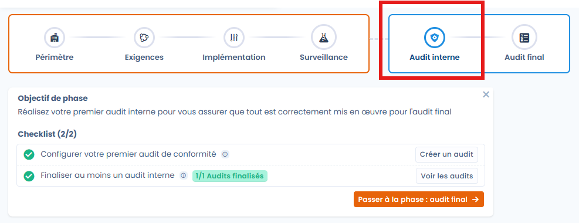
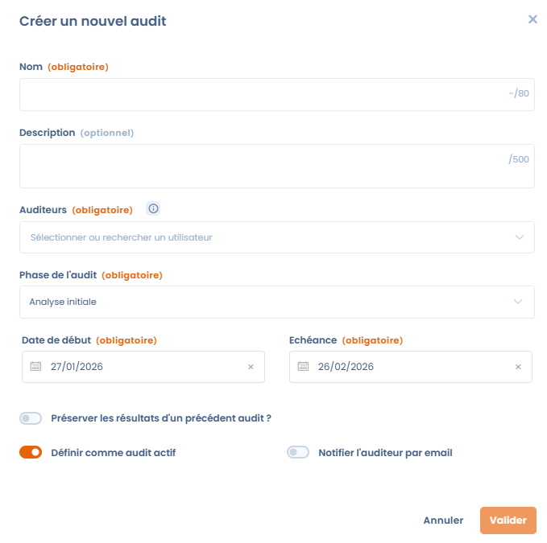
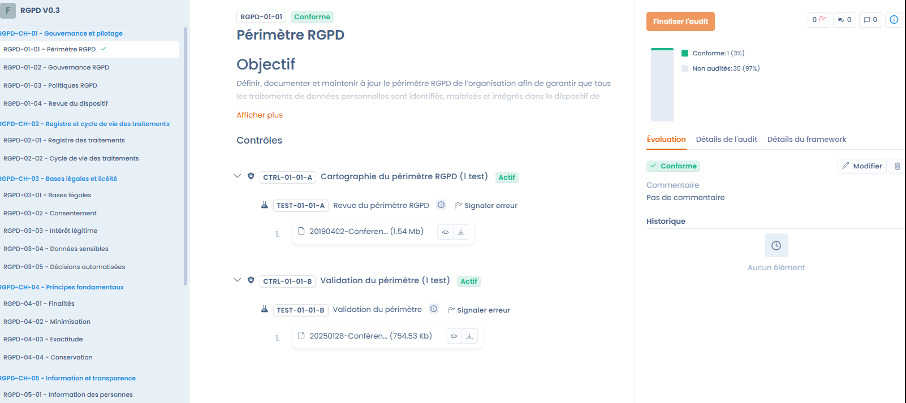

# Audits

The **Internal audit** and **Final audit** phases of a project officially validate the state of compliance at a given point in time. They build on the design and monitoring work done beforehand to provide a structured assessment, carried out internally or by external auditors.

An audit covers one framework of the project. Auditors assess each requirement using the controls, tests and evidence already in the project, then the audit is finalized with an overall assessment.

<figure><figcaption></figcaption></figure>

## What the module does

* **Run audits**, internal or external, with standard frameworks (GDPR, AI Act, etc.) or your own custom grids.
* **Collaborate**: auditors access the related requirements, controls, tests and evidence, and an auditor can be added during the audit.
* **Reuse the monitoring work**: the controls and evidence of the project can be viewed directly during the assessment.
* **Handle gaps**: report the issues found on tests and create corrective tasks.
* **Export** the results as XLSX, PDF, DOCX, JSON, HTML or Markdown.

<figure><figcaption></figcaption></figure>

## Create an audit

Create an audit from the compliance project, not from the Questionnaires module. There are two entry points:

* the **Audits** tab of the project, with the **Create a new audit** button. Then choose the framework in the **Please select the framework you would like to audit** list, which shows for each one whether an audit is already in progress;
* the **⋯** menu of a framework card on the project **Overview**, with **Create a new audit**. The framework is already selected.

If the project has no framework, Dastra shows **There is no framework to audit**: add a framework to the project first (see [Project design](design.md)).


Creating an audit outside an audit phase is not recommended: Dastra shows a warning but does not block you. Choosing the **Final audit** audit phase triggers the same warning while the project is not in the **Final audit** phase.


### General information

| Field | Description |
| --- | --- |
| **Name** | Title of the audit, for example "Annual compliance audit". Required, 80 characters at most. |
| **Summary** | Context or specific scope of the audit. Optional, 500 characters at most. |
| **Auditors** | Users allowed to perform the audit. Required. If you are not in this list, you cannot assess the requirements, even if you are the organization owner. |

<figure><figcaption></figcaption></figure>

### Audit phase and dates

The **Audit phase** segments the audit and lets you filter the governance dashboards. It is independent of the project phase.

| Phase | Use |
| --- | --- |
| **Initial analysis** | Scoping: definition of the scope, the framework and the regulatory stakes. Default value. |
| **Preparation** | Logistics: assigning controls to auditors and planning interviews. |
| **Pre-audit** | Mock audit: self-assessment to identify gaps before the official deadline. |
| **Final audit** | Closing: final scoring, conclusions and official report. |

Fill in the **Start date** and the **Deadline** to frame the audit in time. Both are required.

### Options

* **Preserve results from a previous audits ?**: starts from the assessments of an existing audit, useful for recurring audits or to redo an audit whose controls were not satisfactory. Then select the audit whose results you want to reuse.
* **Define as current audit**: the audit feeds the tracking indicators of the framework, including the compliance rate shown on the project overview. Enabled by default.
* **Notify auditor by email**: sends an invitation to the designated auditors. Enter a **Message content** if needed, then keep **Send email immediately** enabled, or disable it and choose a date and time within the next 3 days.

Click **Validate** to create the audit. The audit dashboard opens.

## Run the audit

The audit dashboard gathers progress and team.

On the left, three tabs:

* **Assessed requirements (x/y)**: the framework tree with the status of each requirement. Filter by status with **Filter by status**;
* **Test issues (n)**: the issues reported by auditors on tests (see [Report an issue on a test](#report-an-issue-on-a-test));
* **Graphs**: charts showing the distribution of requirements and controls.

On the right:

* the audited scope, the title, the description, the status and phase of the audit, the dates and the framework with its version. **Edit** opens the general information;
* the audit **Progression** as a percentage, with the distribution of requirements (not audited, compliant, partially compliant, not compliant, not applicable);
* the list of **Auditors**, with the number of assessments each one completed. **Add auditor** and **Remove auditor** let you adjust the team during the audit;
* the **Attachments**: gather external evidence documents here so that all auditors can access them.

The task and comment buttons of the dashboard let you follow the audit with other users, for example to create corrective tasks.

The **Fill in audit** button opens the assessment workspace. Its menu also offers:

* **Reopen the audit**: makes a finalized audit editable again;
* **Export**;
* **Copy link**;
* **Archive audit**, then **Restore** to bring it back. The audit defined as current cannot be archived.

If you are not designated as an auditor, the **Fill in audit** button is locked: ask to be added to the **Auditors** list.

## Assess the requirements

The assessment workspace lets you go through each requirement of the framework without leaving the audit page.

* **Navigation bar**: **Back** and **Next** move through the requirements, an arrow jumps to the next uncompleted requirement, and a counter shows the position (for example 1/31).
* **Left pane**: the framework tree, split into chapters and requirements. An indicator confirms the requirements already assessed.
* **Central area**: the objective of the requirement, then the associated controls with their tests. For each test you view the attached evidence (files, links, JSON data) directly in the interface.
* **Right pane**: the audit progress and three tabs: **Assessment**, **Audit details** and **Framework details**.

<figure><figcaption></figcaption></figure>

After analyzing the evidence, set a status on the requirement in the **Assessment** tab and enter a **Comment** to justify your opinion:

| Status | Meaning |
| --- | --- |
| **Compliant** | The evidence provided fully satisfies the requirement. |
| **Partially compliant** | Evidence exists but it is insufficient or incomplete. |
| **Not compliant** | No evidence, or the control is considered ineffective. |
| **Not applicable** | The requirement does not concern the scope of the audit. |

The **History** of the requirement keeps the successive assessments. Each entry updates the audit progress.

### Report an issue on a test

When the evidence of a test is not satisfactory, report it to the test owner without blocking the assessment.

1. In the central area, find the test and click **Report issue**.
2. Choose the **Severity**: **Low**, **Medium** (default) or **High**.
3. In **What is wrong with the evidences provided**, describe the problem. The comment is optional, but it helps the test owner improve the evidence.
4. Click **Create issue**.

The button is then replaced by a flag colored by severity. Hover over it to read the comment or delete the report. A test can carry only one report per audit.

<figure><figcaption></figcaption></figure>

Reports are gathered in the **Test issues** tab of the audit dashboard, with the reference, the test, its status and its severity. Filter by **Severity**, then tick tests to:

* **Invalidate tests**: the reported tests go back to the **To Do** status. Dastra then offers to **Re launch a test campaign** to notify their owners, so that they update their evidence before the next audit;
* **Test campaign launch**: directly creates a campaign with the ticked tests (see [Compliance monitoring](monitoring.md)).

<figure><figcaption></figcaption></figure>

## Finalize the audit

When all requirements are assessed, the **Complete audit** button becomes available. It opens a dialog where you enter the **Final Audit Assessment** (required, 1,000 characters at most). This summary gives an overall opinion on the maturity level of the audited scope, highlights points of attention or successes, and can include summary documents attached from the file manager.

Click **Validate** to close the audit.


Once the audit is finalized, individual assessments can no longer be edited, unless you reopen the audit with **Reopen the audit**.


## Use the results

The finalized audit feeds compliance tracking:

* the compliance percentage per framework appears on the project overview and in **Compliance** > **Statistics**;
* the **Final Audit Assessment** appears at the top of the audit dashboard;
* the audit export keeps a structured audit trail that you can reuse in the following years;
* non-compliant or partially compliant requirements can be followed with tasks, created from the audit task button, before the next monitoring cycle.

<figure><figcaption></figcaption></figure>
