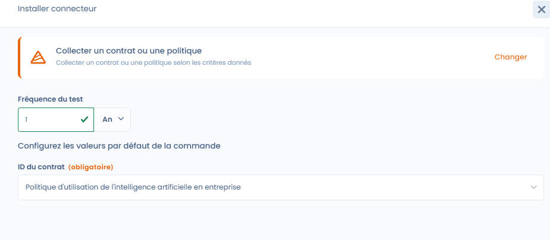
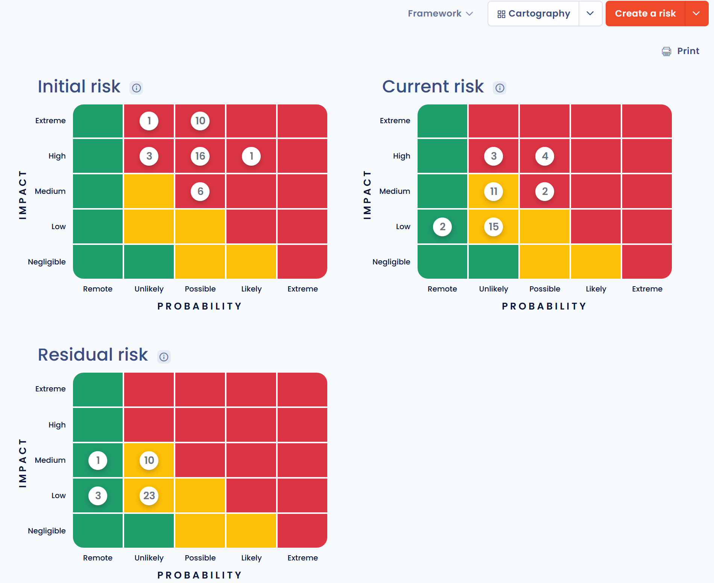

# Project implementation

The **Implementation** phase marks the transition from the theoretical framework to the operational execution of compliance. It consists of **configuring the controls concretely**, defining the verification methods and preparing the collection of evidence.

At this stage, the project already has:

* its frameworks,
* its controls,
* its tests and risks initialized during the design phase.

***

## Objective of the phase

The objective of the implementation phase is to:

* define **how the controls are verified**,
* configure the **tests (manual or automated)**,
* associate the **risks with the controls**,
* prepare the **collection of compliance evidence**.

***

## 1. Understanding the status of tests during the implementation phase

By default, all the project's tests are in the **"Missing evidence"** status.

This means that:

* the control exists,
* the test is defined,
* but **no evidence has yet been provided or collected**.

As long as the project is not in the **Monitoring** phase, modifying or validating the evidence is not recommended: Dastra shows a warning, without blocking you.

<figure><figcaption></figcaption></figure>

***

## 2. Configuring compliance tests

Each control can be verified using one or more **tests**.



A test allows you to define:

* a **verification procedure**,
* an **execution frequency** (e.g. monthly, quarterly, annually),
* a **test owner**.

Tests can be:

* **manual**, requiring a human action and evidence,
* or **automated**, via a Dastra or custom connector.



<figure><figcaption></figcaption></figure>



***

## Control status and exclusion

Each control of the project has a **Control status**, which you can change in the list of the **Controls** tab or in the control window:

| Status | Meaning |
| --- | --- |
| **Draft** | The control is identified but not implemented yet. It is counted among the not implemented controls. |
| **Implemented** | The control is in place. This is the status of controls imported with a framework. It is validated when all its tests pass. |
| **Excluded** | The control does not apply to the project. |

To exclude a control, choose **Excluded**: the **Justify control exclusion** dialog opens. Enter the reason in **Explain why this control should be excluded** (2,000 characters at most). The justification is optional in this dialog, but you should fill it in: it is shown on the control and during audits, and carried into the statement of applicability, where an excluded control is marked as not applicable (see [Compliance monitoring](monitoring.md)).

An excluded control is no longer assessed: during an audit, the justification is shown instead of its tests. Adding an excluded control to the project again, in bulk, reactivates it.

<figure><figcaption></figcaption></figure>

***

## Assign an owner to all the controls and tests of a requirement

In the **Requirements** tab of the project, the users button to the right of a requirement opens the **Assign owner to all controls and tests** dialog. It saves time at the start of implementation, before the **Assign owners to tests** checklist step.

1. Click the button of the requirement concerned. The action applies to the requirement and its sub-requirements.
2. In **Select a user to assign as owner**, choose the person.
3. Turn on **Overwrite existing owner assignments** if you want to replace the owners already defined. Otherwise, only items without an owner are filled in.
4. Click **Validate**.

Write access to operational compliance is required.

<figure><figcaption></figcaption></figure>

***

## 3. Associating and assessing risks

Controls can be linked to one or more **risks** in order to measure their impact on risk reduction.

For each risk, you can:

* define an **initial assessment** (probability × impact),
* define a **residual assessment**, after the controls are applied,
* choose the **risk treatment** (reduction, acceptance, etc.).

This approach makes it possible to concretely visualize the effect of the controls on the risk posture.

<figure><figcaption></figcaption></figure>

### Visualize risks on a map

In the **Risks** tab of the project, the selector above the list switches between the **Table** view, which lists each risk with its scores, and the **Cartography** view, which places the risks on a probability × impact matrix.

The **Cartography** view shows three matrices side by side:

* **Initial risk**: the level assessed when the risk was identified, before any remediation measure;
* **Current risk**: the level at a given point in time, based on the actual progress of remediation actions and controls;
* **Residual risk**: the level expected once all planned measures are implemented, that is, the risk accepted or tolerated by the organization.

Filter by **Framework** to see only the risks of one framework, click a risk to open it, or click **Print** to print the page. Reading risks as both a table and a map makes it easier to prioritize risks and to communicate them to stakeholders.

<figure><figcaption></figcaption></figure>

***

## 4. Linking threats, risks and controls

**Threats** represent the concrete scenarios that can trigger a risk\
(e.g. injection of malicious data, lack of supervision, information exfiltration).

A threat can be:

* linked to one or more **risks**,
* indirectly covered by the **controls** put in place.

This chaining allows complete traceability:\
**Threat** > **Risk** > **Control** > **Test** > **Evidence**

***

## 5. Installing a connector to automate evidence

For certain tests, it is possible to install a **Dastra connector** in order to automate the collection of evidence.

Connectors make it possible, for example, to:

* verify the presence of a policy or a contract,
* query a registry (AI systems, assets, incidents, processing activities, third parties) or the audits,
* automate recurring controls without manual action.

The list of connectors and their configuration are described in [Tests](../library/tests.md).

Each connector is configured with:

* an **execution frequency**,
* **collection parameters** adapted to the test.

<figure><figcaption></figcaption></figure>

***

## 6. Result of the implementation phase

At the end of the implementation phase:

* the **controls are configured**,
* the **tests are ready to be executed**,
* the **risks are assessed and linked**,
* any **connectors are installed**.

The project is then ready to enter the next phase: **Monitoring**, during which:

* the tests are executed periodically,
* the evidence is collected,
* and compliance is measured over time.
