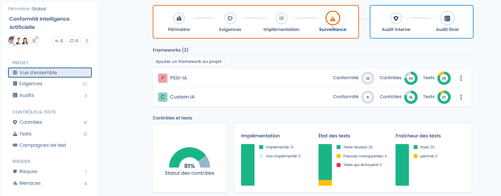
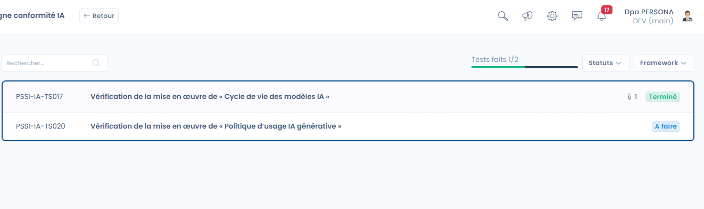

# Compliance monitoring

The **Monitoring** phase aims to **verify the actual effectiveness of the controls over time**, collect the associated evidence and track the evolution of compliance through recurring test campaigns.

Its objective: collect evidence across the entire project using test campaigns, make sure as many controls as possible pass and maintain a level of compliance that is measurable over time.

***

## Overview of the monitoring phase

In this phase, the project shifts from a preparation logic to a **continuous execution** logic:

* the controls are already implemented,
* the tests are executed regularly,
* the evidence is collected, updated and assessed,
* the compliance indicators become usable.

<figure><figcaption></figcaption></figure>

***

## Overall monitoring of controls and tests

In the **Controls & tests** area of the project **Overview**, four indicators give a synthetic view of the project status:

* **Controls status**: proportion of validated controls.
* **Controls implementation**: implemented or not implemented controls.
* **Tests status**:
  * passing tests,
  * missing evidence tests,
  * failing tests.
* **Tests freshness**:
  * up-to-date tests,
  * expired tests requiring new evidence.

These indicators make it possible to quickly identify points requiring attention and to prioritize corrective actions.

<figure><figcaption></figcaption></figure>

### Project history

Below these indicators, the **Project history** chart shows how the project evolves over time. Choose the period with the date picker (3 years at most), then set:

* **Time unit**: **Day**, **Week**, **Month** or **year**;
* **Metric**: **Tests**, **Controls**, **Requirements**, **Risks** or **Compliance**.

The chart lets you show the progress of compliance to management or auditors.

<figure><figcaption></figcaption></figure>

***

## Evidence management



Evidence is the core of the monitoring phase.\
It can be added directly from a test with **Add evidence** and be **reused across several tests of the project**.

The available collection methods notably include:

* adding evidence files,
* external links,
* selecting evidence already present in the project.

Each piece of evidence can be documented with an **Evidence description** in order to facilitate subsequent audits.



<figure><figcaption></figcaption></figure>



***

## Test campaigns

**Test campaigns** make it possible to orchestrate the execution of tests at scale. They are managed in the **Test campaigns** tab of the project.

A campaign allows you to:

* group together a set of tests to be executed,
* assign an owner to each test,
* define an overall deadline,
* track progress in a centralized manner.

To create a campaign, click **Create tests campaign** and enter the **Campaign label**. You can **pre-select all your project tests awaiting evidences** to make the launch easier. The campaign then opens in configuration: **Define the test campaign content**, check that each test has an owner, then launch the campaign.


If one or more tests of the campaign have no owner, Dastra shows a warning and asks you to review them before sending the invitations. Use **View tests without owners** to find them.


Launching a campaign outside the **Monitoring** phase is not recommended: Dastra shows a warning without blocking you.

<figure><figcaption></figcaption></figure>

***

## Launching and tracking campaigns



Once the campaign is configured:

* the users concerned receive an **invitation by email**, which you send with **Send invitations** after selecting the owners to notify,
* a personalized message can be added to contextualize the request,
* each test progresses individually (_to do_, _in review_, _completed_).

The overall progress of the campaign is visible in real time, allowing the project owner to quickly identify delays or blockers.



<figure><figcaption></figcaption></figure>



### Remind, close and track a campaign

In the list of campaigns, the **⋯** menu of each row offers:

* **Send reminder**: select the owners who still have tests to complete. A default reminder is sent, to which you can add a **Custom reminder message**;
* **Close test campaign**: ends the campaign; **Re open campaign** puts it back in progress;
* **Copy link**: copies the link to the campaign;
* **Move to recycle bin**: removes the campaign from the list. Use **Restore** to bring it back, or **Delete** to remove it permanently.

**Details** opens the campaign dashboard: number of tests, participants and frameworks, validated tests, **Completion rate by user** (completed tests, tests in review and tests to do) and **Test distribution by framework**.

***

## Validating tests

Each test has a clear lifecycle:

* consulting the **Test procedure**,
* adding or updating the evidence,
* validating the test with **Validate test**.

The result of a test is **Pass**, **Fail**, **Missing Evidence** or **Expired Evidence**. For a manual test, **Validate test** sets it to **Done**; **Invalidate test** cancels the validation. Once validated, the test automatically contributes to improving the status of the associated control and to the project's overall indicators.

The invitation sends the user to a personalized tracking dashboard in which they can fill in the evidence for the tests they own. This workspace is also available from **My tests** (see [Projects](README.md)). When a user has completed all their tests, Dastra shows a congratulation message with the **View My Tasks** button.

<figure><figcaption></figcaption></figure>

***

## Statement of applicability (SOA) export

The **Statement of Applicability** (SOA) is the reference document that gathers all the controls of a framework of the project. It is used for certification audits, for example ISO 27001, and to demonstrate the coverage of requirements to your management or auditors.

The export is done per framework, as an XLSX file:

1. Open the compliance project.
2. On the **Overview**, click the **⋯** menu of the framework card, or open the **Requirements** tab and use the **⋯** menu of the framework.
3. Click **Export statement of applicability**.

Export access to operational compliance is required.

<figure><figcaption></figcaption></figure>

The file contains one row per control, with the following columns:

| Column | Content |
| --- | --- |
| `ControlId` | Reference of the control. |
| `Label` | Name of the control. |
| `Description` | Description of the control, without formatting. |
| `Applicable` | Applicability: a control whose status is **Excluded** is not applicable. |
| `Justification` | Exclusion justification entered on the control (see [Control status and exclusion](implement.md)). |
| `ImplementationStatus` | Status of the control: **Draft**, **Implemented** or **Excluded**. |
| `Evidence` | References to the evidence collected on the tests of the control. |
| `Auditor` | Owner of the control. |
| `RequirementNodes` | Requirements covered by the control. |

***

## Expected result of the monitoring phase

At the end of this phase, the project has:

* **collected and traced evidence**,
* **regularly executed and updated tests**,
* a **reliable and measurable view of the actual compliance**,
* a solid base for preparing the **internal audit** and **certification** phases.
