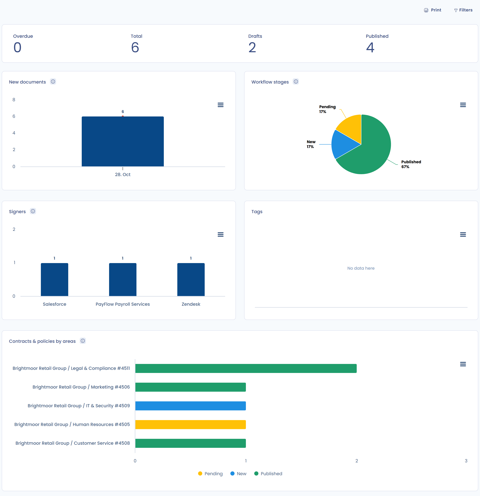

# Contracts and policies

The **Contracts & policies** module in Dastra lets you declare, edit, sign and version your legal and organizational documents: contracts, policies, notices and procedures. Each document is linked to the assets, stakeholders and users it concerns, so your commitments stay consistent with your record and your referentials.

## Access the module

Your subscription must include the contracts feature. If it is active in your plan, open **Operations** > **Contracts & policies** in the sidebar. The module has three entries:

* **Record of contracts & policies**: the list of your documents.
* **Reporting**: the indicators and charts of the module (see [Reporting](README.md#reporting)).
* **Templates of contracts & policies**: the templates used to generate documents (see [Contract templates](templates.md)). This entry is hidden from users whose role is `User`.

<figure><figcaption>
The Contracts and policies module in the sidebar
</figcaption></figure>

## Document types

Each document has a type: **Contract**, **Policy**, **Notice**, **Procedure** or **Other**. You choose the type when you create the document (see [Create a document](declare.md)). To change it later, click the type badge next to the document title.

In the record, the **Types** filter limits the list to one or several types.

## The record of documents

The record lists your documents in a table whose columns you choose, for example the version, the number of signatures, the number of attachments and the deadline. Filters let you find a document by organizational unit, step, signature status, type, status, tag or user.

The **Create a document** button opens the creation wizard (see [Create a document](declare.md)). The arrow on its right opens the other actions of the module:

* **Import**: import several documents from a file.
* **Export**: export the list.
* **Set up regular review**: define how often documents are reviewed (see [Regular review of documents](review.md)).
* **Email-to-Document Integration**: create documents from the emails received at a collection address.
* **Read the documentation**: open this documentation.

<figure><figcaption>
The record and the actions of the Create a document button
</figcaption></figure>

## Import and export

**Import** opens the import wizard for documents. It is available to users who have the import permission on contracts. The wizard is described in [Import your data (Excel, Csv)](../general/import.md).

**Export** opens a window where you choose the format: CSV, XLSX, JSON, PDF, HTML, DOCX or Markdown. From the record, the export covers the list. From a document, the menu of the **Save changes** button offers **Export** for that document only, with the **Include documents** option to add its attachments.

## Create documents from your emails

The **Email-to-Document Integration** entry leads to the integration of collection email addresses. Once the address is created for contracts, each email received creates a document: the subject becomes the name, the body becomes the description, and valid attachments are added to the document. Installing the address requires the permission to manage integrations; it is described in [Incoming mail data collection](../settings/mailboxes.md).

## Reporting

The **Reporting** entry gives an overview of your documents. The indicators at the top show the number of documents that are **Overdue**, the **Total**, the **Drafts** and the **Published** ones. Click an indicator to open the matching list.

The charts show:

* **New documents**: the change in the number of documents in the workspace and the number created on each date.
* **Signers**: the number of documents per signer.
* **Workflow stages**: the number of documents per workflow stage.
* **Tags**: the number of documents per tag.
* **Contracts & policies by areas**: the number of documents in each organizational unit, for each workflow stage.

The **Filters** button narrows the indicators and charts, and **Print** produces a printable version. The **Overdue** indicator relies on the deadline of your documents: fill it in on the **Details** tab (see [Details and attachments](documents.md)).

<figure><figcaption>
The Reporting page of the module
</figcaption></figure>
