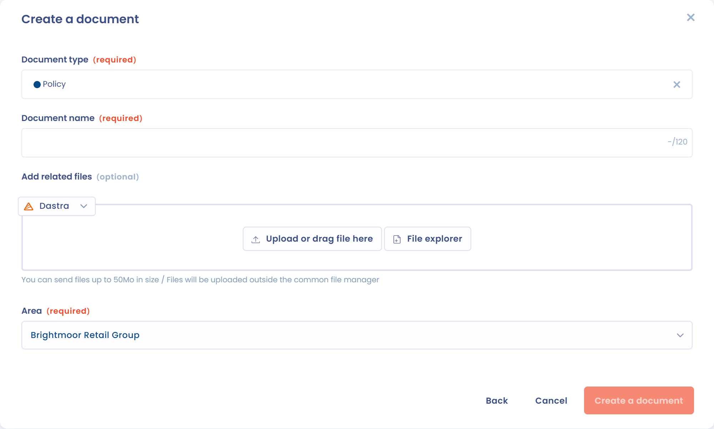

# Create a document

To declare a contract, a policy or any other document, click **Create a document** in the record of the **Contracts & policies** module. A wizard offers four ways to create the document.

<figure><figcaption>
The four options to create a document
</figcaption></figure>

| Option | What it does |
| --- | --- |
| **Create your document with AI** | Writes the document with AI from your instruction. |
| **Import your document** | Analyzes an existing file with AI and fills in the record for you. |
| **Personalized** | Creates an empty record that you fill in yourself. |
| **Generate document** | Generates the document from a [dynamic contract template](templates.md). |

The first two options require the matching AI features. If they are not included in your plan, they are greyed out.

## Start from scratch

1. Choose **Personalized**.
2. Select the **Document type**: contract, policy, notice, procedure or other.
3. Enter the **Document name**.
4. Optional: add files with **Add related files**. You can also add them later, once the document is created.
5. Choose the **Area**.
6. Click **Create a document**.

Dastra then opens the document record (see [Structure of a document](structure.md)).

<figure><figcaption>
The form to create a document
</figcaption></figure>

## Write a policy in Dastra

A document without an attachment shows a drop zone. You can drop the file there, or click **Write policy** to write the text in an editor. The text is saved as an attachment of the document, with the other files.

<figure><figcaption>
The drop zone and the Write policy button
</figcaption></figure>

## Generate a document with AI

1. Choose **Create your document with AI**.
2. Type a short description of the document you want to generate. You can add **Attachments** or a **Website url** as additional documentation.
3. Click **Generate**, then review the preview.
4. Check the **Document name** and the **Organizational unit**, then click **Validate**.

The document is created with the **Policy** type. You can change the type afterwards from the badge next to the title.

## Import an existing document

1. Choose **Import your document**.
2. Choose the **Organizational unit**.
3. Drop a file (PDF, DOCX, TXT, Markdown, JPG or PNG).

The analysis starts as soon as you drop the file. The Dastra AI assistant extracts the metadata from the file (name, description, tags, deadline, custom fields, etc.), infers the document type and creates the record with the file as an attachment. Review the record: the AI analysis can be wrong.

## Generate from a template

Choose **Generate document** to create the document from a template. The process is described in [Contract templates](templates.md).
