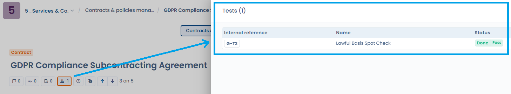

# Details and attachments

The **Details** tab of a document record gathers the document information and its attachments. The file preview stays on the left whichever tab is open.

## Attachments

Add to your document the files that make it up: the contract itself, amendments, appendices or any other related file. To get the preview, store PDF files or images.

Drop the files in the drop zone, or click **File explorer** to choose them. If you installed the [OneDrive & SharePoint / Google Drive integration](../settings/cloud-storage.md), a source selector lets you attach files from your own storage.

Attachment storage is linked to Dastra's [document management](../files/README.md) module. Users who manage attachments can move a file to the common file manager with **Move to common file manager**, then open it from the document with **View in file manager**.

<figure><figcaption>
Add attachments to a document
</figcaption></figure>

## Preview a document

The preview is on the left and the list of attachments on the right. To change file, click its name in the list, click the on-screen arrows or use the left and right arrow keys of your keyboard. The previewed file is highlighted in blue in the list. You can also rename the previewed file by clicking its name above the preview.

Because the preview stays visible on the **Signers - Signatories**, **Assets** and **Users** tabs, you can refer to the document while you fill in those tabs.

<figure><figcaption>
Previewing a document
</figcaption></figure>

## Document information

The **Details** tab contains the following fields:

* **Area**: the organizational unit the document is attached to.
* **Tags**.
* **Start date** and **Deadline**.
* **Description** and **Internal reference**.
* The custom fields defined for contracts in your workspace.

The deadline drives the follow-up of your due dates: a document past its deadline appears in the **Overdue** indicator of the **Reporting** page (see [Contracts and policies](README.md#reporting)), and a warning is displayed in the tab.

## Linked compliance tests

When a document is used as **evidence** for a test in the Compliance module, this link is visible directly from the document. An icon shows the **number of linked compliance tests**; clicking it opens the list of those tests. Clicking a test displays its details without leaving the document page.

<figure><figcaption>
The icon shows the number of linked compliance tests; a click opens the list and then the test details without leaving the contract
</figcaption></figure>
