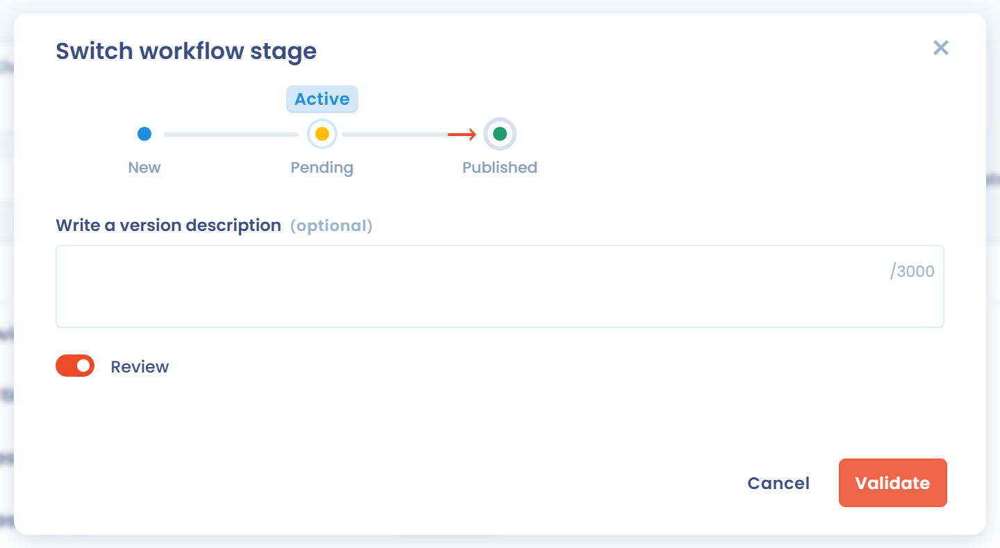

# Regular review of documents

Regular review sets a review date on your documents and lowers their freshness as that date approaches. It helps you reread your contracts and policies before they go out of date. The principle, the statuses and the display rules are described in [Regular review (freshness)](../regular-review.md). This page shows where to find it in the **Contracts & policies** module.

## Turn on regular review

In the record, click the arrow on the right of the **Create a document** button, then **Set up regular review**. The entry shows whether review is **Enabled** or **Disabled** for documents, and opens the regular review settings of the workspace. It is available to users with the advanced configuration permission.

The frequency you define there applies to all documents.

## Review a document

Once review is on, each document record shows the freshness indicator in the shortcuts menu (see [Structure of a document](structure.md)). It is active only for published documents. As long as the document is not published, the indicator stays greyed out.

Click the indicator to open the **Review** window. In the **New review** tab, choose the **Reviewer**, the **Review date** and, if needed, a description. Dastra calculates the **Date before next review** from the workspace frequency. You can replace it with a specific date using **Change the date of the next review**. The **Previous reviews** tab keeps the history.

When a document becomes outdated, its owner receives an email.

## Record a review when a document becomes active

When regular review is on, moving a document to a workflow stage whose internal status is **Active** opens the **Switch workflow stage** window with a **Review** switch, turned on by default. Keep it on and click **Validate**: Dastra changes the stage and records a review at the same time.

* The reviewer is you, and the **Review date** is today.
* The **Date before next review** is calculated from the workspace frequency.
* The text you write in the version description is kept as the description of the review.

<figure><figcaption>
The workflow stage window with the Review switch
</figcaption></figure>

The window appears when you change the stage from the document page and from the **Workflow** column of the list. The review updates the dates of the last and the next review of the document and appears in the **Previous reviews** tab. Turn the switch off if the stage change should not count as a review.

If the stage changes but the review cannot be saved, a message asks you to record it again from the **Review** window.
