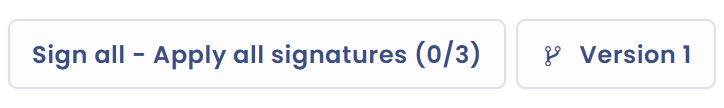

# Sign a document

Once you have added at least one signer to your document (see [Signers](signers.md)), you can manage its signature. Save the document first: as long as a change is not saved, the signature buttons are locked.

## Manual signature or Docusign

The **Add signature** window offers two modes:

* **Manual**: you declare that signers have signed. Select the signers whose signature you want to record, enter the **Signature date**, then click **Add signature**.
* **Sign with Docusign®**: Dastra sends the document for electronic signature and tracks its progress. This mode requires the [Docusign integration](docusign.md).

<figure><figcaption>
The two signature modes
</figcaption></figure>

When every signer has a signature, Dastra asks whether you want to publish the document. Confirm to set the document to the **Active** status.

## Open the signature window

There are three ways to open the signature window.

### Sign for one signer

In the **Signers - Signatories** tab, click **Add signature** on the row of the signer concerned.

### Sign for several signers

Click the arrow on the right of the **Add signer** button, then **Sign all - Apply all signatures**. You then select the signers for whom you record the signature.

<figure><figcaption>
Sign for several signers from the Signers tab
</figcaption></figure>

### Sign from the record

In the record, open the menu of the document row, then click **Add signature**. This action is disabled when all signers have already signed.

<figure><figcaption>
Sign from the record
</figcaption></figure>

## The signature button of the record

In the main actions menu of the record (see [Structure of a document](structure.md)), a button summarizes the state of the signatures. Its label changes with the number of signers and the number of signatures received.

### No signers

The button is disabled and shows **no signers**. Add signers to use it.

<figure><figcaption>
No signers
</figcaption></figure>

### Signatures are missing

The button shows **Sign all - Apply all signatures** followed by the number of signatures received out of the number of signers. Click it to declare the missing signatures.

<figure><figcaption>
Signatures are missing
</figcaption></figure>

### Document signed by all signers

The button shows **Signed**. On hover, it becomes **Delete signature**: after confirmation, a click deletes the signatures if you need to redo them.

<figure><figcaption>
Document signed by all signers
</figcaption></figure>
