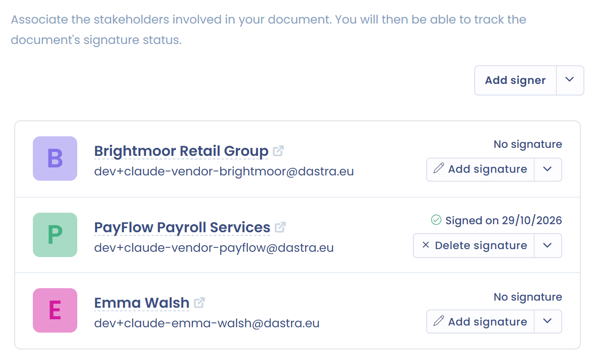

# Signers


The signer of a document is generally a natural or legal person **referenced as a stakeholder in Dastra**.


In the **Signers - Signatories** tab, specify the parties who must sign the document.

A signer is a stakeholder from your [repositories](../mapping/repositories/README.md). To add one, click **Add signer**, select the stakeholder, then click **Add**. If the stakeholder does not exist yet and you can write to the referentials, you can create it from the same window. The tab shows in brackets the number of signers.

<figure><figcaption>
The signers of a document
</figcaption></figure>

If the selected stakeholder is linked to assets, Dastra offers to link them to the document automatically: tick the assets to add.

Each signer shows their email address, or the **Stakeholder doesn't have an e-mail address** warning when it is missing, and the state of their signature: **No signature**, **Pending signature** or **Signed on** followed by the date. You can manage the signature of each signer independently (see [Sign a document](sign.md)).

As for assets, the record of each stakeholder lists the documents they are associated with.
