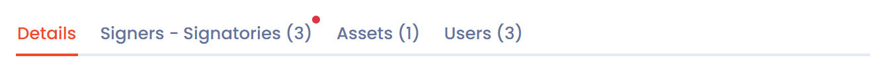

# Structure of a document

Once your document is created, Dastra opens its record (see [Create a document](declare.md)). The file preview takes the left of the screen and the input tabs take the right.

<figure><figcaption>
A newly created document record
</figcaption></figure>

## The title and the type

The editable title of the document is at the top left. The type badge (contract, policy, notice, procedure or other) appears above the title: click it to change the type.

<figure><figcaption>
The type, the title, the shortcuts and the main actions
</figcaption></figure>

## The shortcuts menu

Under the title, on the left, the shortcuts menu gives access to the elements associated with the document:

* internal discussions;
* associated tasks, if task management is active;
* the audit log, if audit is active, and the **Activity history** of the document;
* linked compliance tests, if the Compliance module is active (see [Details and attachments](documents.md));
* the regular review of the document (see [Regular review of documents](review.md)).

If you came from the record, arrows let you move from one document to another.

## The main actions

The main actions menu, at the top right, gathers:

* the **AI analysis (beta)** button: it opens the AI analysis of the document. This feature is in beta, it requires the AI analysis and AI agent features, and its results must be interpreted with caution;
* the signature button, whose label follows the state of the document (see [Sign a document](sign.md));
* the **Version** button followed by the version number, which opens the versions manager (see [Document versions](versions.md));
* the workflow stage selector;
* the **Save changes** button.

The arrow on the right of **Save changes** opens three actions:

* **Share**: create a sharing link for the document.
* **Export**: export the document (see [Contracts and policies](README.md#import-and-export)).
* **Move to recycle bin**: put the document in the recycle bin.

A document in the recycle bin carries the **Into recycle bin** badge. The same menu then offers **Restore** to put it back in the record, and **Delete** to delete it.

<figure><figcaption>
The actions of the Save changes button
</figcaption></figure>

## The input tabs

Four tabs are displayed on the right of the screen. Their content changes when you switch from one to another:

* **Details**: the general information, the attachments and the custom fields (see [Details and attachments](documents.md)).
* **Signers - Signatories**: the parties who sign the document (see [Signers](signers.md)).
* **Assets**: the assets the document concerns (see [Assets](assets.md)).
* **Users**: the workspace users who work on the document (see [Linked users](users.md)).

Except for **Details**, each tab shows in brackets the number of items it contains.

<figure><figcaption>
The tabs of a document record
</figcaption></figure>

## The attachments preview

The area on the left previews the files of the document: the contract or policy and any appendices. It stays displayed whichever tab is open. When the document has no file yet, it offers to drop a file or write a policy.
