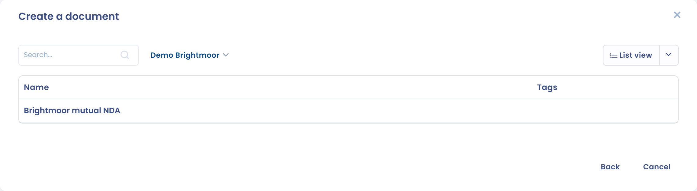
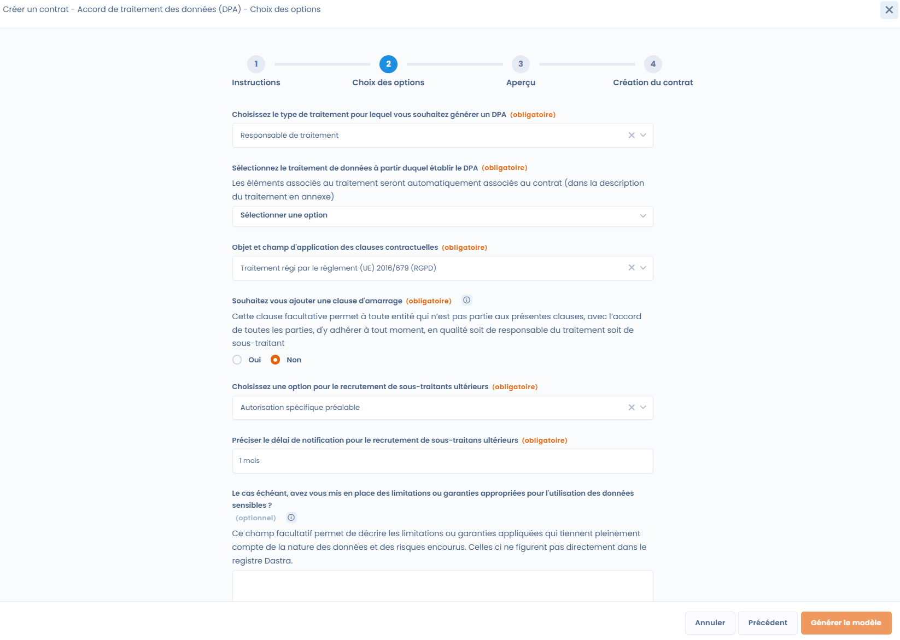

# Contract templates

## Use a template

When you [create a document in Dastra](declare.md), choose the **Generate document** option to use a dynamic template. You get the list of available templates, for example the template for the standard contractual clauses of your processor agreements (DPA).

With the standard clauses template, the document is filled in with the information from your record of processing activities and your referentials. The more complete they are, the more relevant the generated document is.

<figure><figcaption>
Select the template to use
</figcaption></figure>

Once you select the template, a panel guides you through several steps. The **Next** and **Back** buttons move forward or backward.

1. **Instructions**: the guidance of the template, when it has some.
2. **Options selection**: a form specific to each template, which depends on the fields to fill in. For the DPA, you choose the processing activity of the record concerned and the processor you are establishing the contract with, and you answer questions about optional clauses. Click **Fill in the template** to go to the next step.
3. **Preview**: the generated document. Click **Edit** to change its content or layout. Dastra warns you that editing may remove layout elements defined by the template.

<figure><figcaption>
Answer the questions of the template
</figcaption></figure>

At the **Preview** step, fill in the **Document name** and the **Organizational unit**. Select the storage location and the format of the generated file, **PDF file (.pdf)** or **Word (.docx)**, then click **Create a document**.

<figure><figcaption>
Review and edit the document before creating it
</figcaption></figure>

Dastra creates the document, adds it to the record and opens its record page.

## Generate a DPA from a processing activity

You can also start from the processing activity concerned, without going through the **Contracts & policies** module. Open the processing activity, then the **Recipients** step. On the row of the processor recipient you are establishing the DPA with, open the menu and click **Generate DPA**. This action requires the permission to write contracts.

<figure><figcaption>
Generate a DPA with a processor from a processing activity
</figcaption></figure>

Dastra opens the generation with the DPA template already selected and filled in with the processing activity and the processor you chose. The same action exists in a **Processor** processing activity, to establish a DPA with a customer from the customers tab.

## Create your own templates

The **Templates of contracts & policies** entry of the module lists the templates of your workspace. Each card shows the template name, its state (**Enabled** or **Disabled**) and its category. The card menu offers **Edit**, **Export** and **Delete permanently**.

To create a template:

1. Click **Add document template**.
2. Choose **From zero** and enter the **Template label**, or import a JSON file exported from another template with **Data importing**.
3. Dastra opens the template editor.

In the editor, you write the **Template body** in HTML. The [Liquid](https://shopify.github.io/liquid/) syntax lets you insert the answers collected by the form of the template. You define these fields with **Add field**, along with the instructions displayed at the top of the form, the language, the category and the description of the template. A preview and a test form let you check the result before you publish the template.

Turn on the **Enabled** switch, then click **Save changes** to make the template available in the **Generate document** option. A disabled template is not offered at creation.

<figure><figcaption>
The document template editor
</figcaption></figure>
