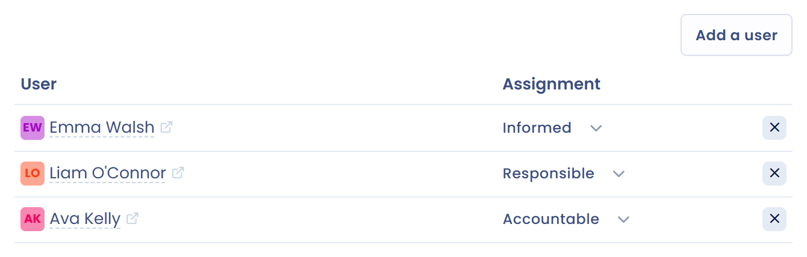

# Linked users

In the **Users** tab, associate users from your workspace with the document and give them a role: **Accountable**, **Responsible** or **Informed**. Click **Add a user**, then choose the user and their role.

Here is one way to split the roles for your documents:

* **Accountable**: the user in charge of validating that the document and the associated elements, as documented in Dastra, meet the organization's expectations. This role may differ from the signer of the document.
* **Responsible**: the user in charge of carrying out the actions needed to meet the requirements of the document. This could involve implementing data security measures, managing access or any other task required to comply with the terms of the contract.
* **Informed**: the users who need to be kept up to date on the progress and status of the document, without an active role in its validation or implementation. This can include management, project managers or other stakeholders.

<figure><figcaption>
Link users to a document
</figcaption></figure>
