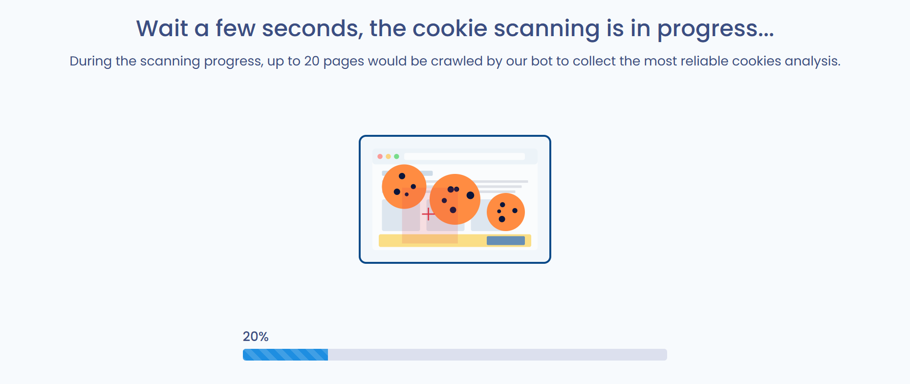
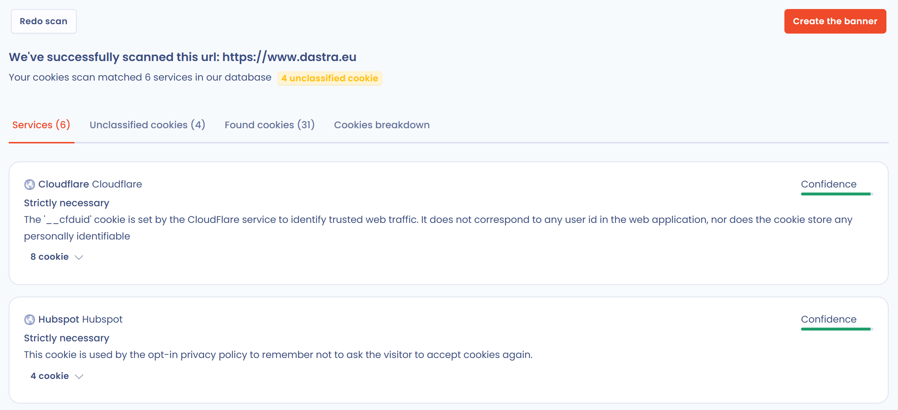

# Cookies scanning

Dastra scans the cookies placed on your website with the **cookie scanning** feature of the **Cookie consent** module. The scan is the starting point for creating your banner.

## Access the scan feature

Sign in to your Dastra workspace. To learn how to do this, go to the following page:


[README.md](../../../getting-started/tutorial/README.md)


1. In the menu, click **Cookie consent**. The list of banners appears.
2. Click **Create a banner**.

<figure><figcaption>
The "Cookie consent" module in the menu
</figcaption></figure>

<figure><figcaption>
The "Create a banner" button
</figcaption></figure>

Dastra asks **How would you like to create your banner?** Two choices are available:

* **Website scanning**: Dastra analyzes the cookies of your website and suggests a banner with the services it detected;
* **Manual configuration**: you create the banner from scratch and declare the URLs, services and cookies yourself.

<figure><figcaption>
The choice between "Website scanning" and "Manual configuration"
</figcaption></figure>

Choose **Website scanning** to continue on this page.

## Scan the cookies placed on your website

1. Enter the address of your website in the **Enter your domain name below** field, for example `https://www.example.com`. If you omit `https://`, Dastra adds it.
2. Click **Submit**.

<figure><figcaption>
Entering the address of the website to scan
</figcaption></figure>


The scan must be able to open your website. If an authentication or a firewall blocks access, Dastra tells you: use **Manual configuration** instead.


The scan crawls up to 20 pages of your website to collect the most reliable cookie analysis. A progress bar appears during the analysis.

<figure><figcaption>
Scanning is in progress
</figcaption></figure>

When the scan ends, the results appear: the services recognized in the Dastra cookie database, the cookies found and their breakdown by category. Click **Redo scan** to run the analysis again, or **Create the banner** to create the banner from these results.

<figure><figcaption>
The scan results
</figcaption></figure>

Once the cookies of your website are scanned, you can classify them.


[classify.md](classify.md)


***

## Handle unclassified cookies

The scan compares the detected cookies with the Dastra service library. A cookie that matches no service is an unclassified cookie: it is not linked to any service, it is never displayed in the public banner, and visitors therefore cannot consent to it.

In the scan results, a warning badge shows the number of unclassified cookies (for example "3 unclassified cookies") next to the scan summary. These cookies are grouped in the **Unclassified cookies** tab, next to the **Services**, **Found cookies** and **Cookies breakdown** tabs.

<figure><figcaption>
The "Unclassified cookies" tab of the scan results, with the badge showing their number
</figcaption></figure>

Select one or more cookies using the checkboxes (the header checkbox selects the whole list), then choose one of the available actions.

### Add cookies to an existing service

1. Select the cookies, then click **Add to an existing service**.
2. In the **Target service** field, choose the service to link the cookies to.
3. Confirm.

All selected cookies are added to the service at once. A cookie already present in the service (same name and same domain) is not added a second time.

### Create a service from a selection

1. Select the cookies, then click **Create a new service**.
2. The service form opens, pre-filled from the most frequent domain among the selected cookies (service name, domain and logo) and containing the selected cookies.
3. Review the suggested information, in particular the purpose of the service, then save.

Only the cookies kept in the service leave the list of unclassified cookies.

### Delete cookies

Select the cookies, click **Delete**, then confirm. The cookies are removed from the list of unclassified cookies.

### Remove a cookie from a service

In the **Services** tab of the scan results, expand the cookie list of a service, then click the trash icon next to the cookie (tooltip "Remove from this service"). The cookie is detached from the service and moves to the **Unclassified cookies** tab.

After each action, the tab counters, the badge and the breakdown chart are updated immediately.

### Handle unclassified cookies from the banner editor

You do not need to handle every cookie before creating the banner: unhandled cookies remain attached to the banner and can be handled later. In the banner editor, the title of the **Services** section shows the number of unclassified cookies, and the **Unclassified cookies** tab of this section offers the same actions: **Delete**, **Add to an existing service** and **Create a new service**.

When all cookies are linked to a service, the tab displays the message "All cookies are classified".

### Rescan an existing banner

In the **Services** tab of the banner editor, click **Website scanning** to scan the site again. In the results, a green check mark (tooltip "Already in your configuration") flags the services already declared in the banner. Detected cookies that match the cookies of a service already declared, including a custom service, are linked to that service and do not appear among the unclassified cookies.


Unclassified cookies are never displayed in the public banner. Link every cookie actually placed by your website to a service so that visitors can consent to it.


***

## Limitations and best practices

### Cookies set after consent (opt-in services)

By default, a cookie scanner browses your site without giving consent. Cookies that are only placed after opt-in (analytics, marketing, etc.) are never triggered and therefore cannot be detected.

**Exception: if the Dastra SDK is already integrated on your site**, the scanner is able to bypass the consent banner and collect all cookies actually placed: including those from opt-in services. In that case, the scan produces a complete result without any manual intervention.

If the Dastra SDK is not yet in place on the scanned site, opt-in services will need to be **added manually** via the service library.

### Manually added services: excess cookies

When you add a service from the Dastra library (e.g. Google Analytics, Meta Pixel), Dastra imports the full list of cookies that service *can* place across all its possible configurations. Your implementation likely only uses a subset of those.

It is recommended to **remove cookies that your specific implementation does not actually place**. Declaring cookies you do not use is misleading to visitors and may raise questions during a compliance audit.

To identify which cookies to keep, cross-reference the automated scan results (which detect what is actually placed) with the list imported from the library, and remove entries that do not appear in the scan.
