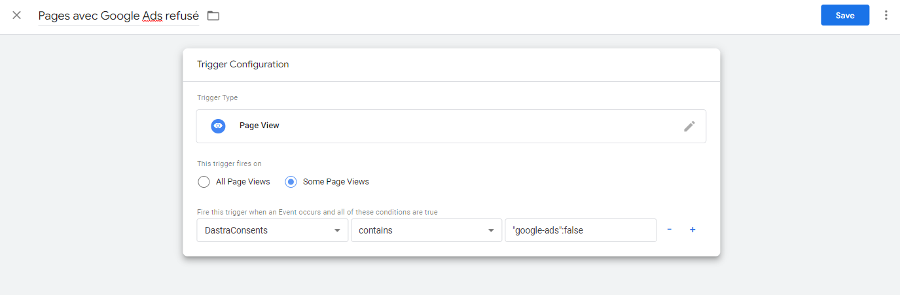
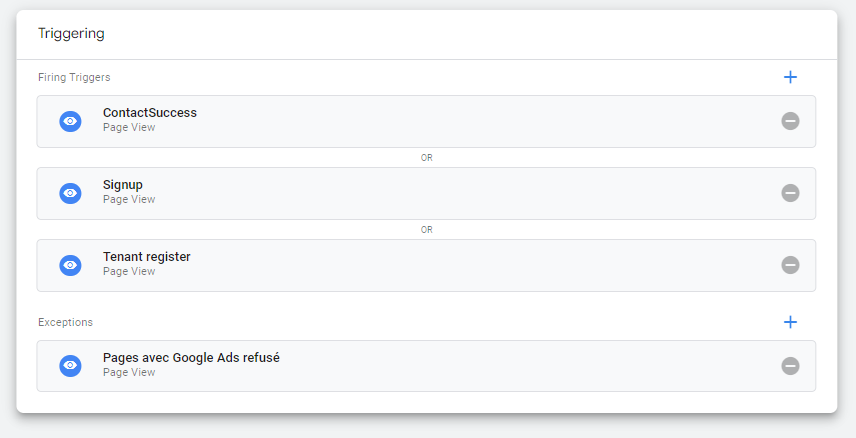

# Google Tag Manager

## Introduction

Google Tag Manager is a tagging tool that centralizes all the code snippets you want to integrate into your website (Dastra can be one of them).\
This tagging solution is very effective for implementing effective cookie consent because it does not require redeploying the entire website each time tags are modified.

## Google Consent Mode V2

Dastra natively supports **Google Consent Mode V2**. The prerequisites, how to enable it on a service, and the default consent snippet are described in a dedicated page:


[google-consent-mode-v2.md](google-consent-mode.md)


## Events sent to GTM in the DataLayer

The following events are automatically sent to Google's dataLayer:

| Name                              | Meaning                                                                                |
| --------------------------------- | -------------------------------------------------------------------------------------- |
| dastra:consent:{your-vendor-name} | This event is sent when the user has accepted cookies from this provider.              |
| dastra:refused:{your-vendor-name} | This event is triggered when the user has not consented to cookies from this provider. |

You can therefore trigger the tags corresponding to the different providers configured in the widget using these two events.

## Example

In this example, we trigger the Google Ads conversion tag when the visitor consents to the Google Ads service.

1. In your GTM container, create a trigger of type **Custom Event** whose event name is `dastra:consent:google-ads`.
2. Attach this trigger to your Google Ads conversion tag.

The tag then fires only on this event.

## Specific case of “blocking triggers”

In some cases, you need to disable certain tags if consent has not been given. Since the “dastra:consent:\<service name>” event only runs when a page is displayed, this may not be sufficient in some cases if you use different interaction triggers on the page, such as clicks on page elements, scroll heights, etc.

In this case, it is necessary to configure certain settings to directly **read the consent value stored in the consent cookie.**


This method works only with cookie storage: it does not suit the case where the **Enable localStorage store for consent cookies** option is enabled. If you set a custom cookie name in **Cookie consent name (Default to consent-eu)**, use it in the variable.


### 1. Create a variable called “DastraConsents”

#### Define the variable

**Log in** to your Google Tag Manager account and go to “Variables,” then create a new “User-defined variable.”

#### &#x20;Select “1st party cookies”

Name your tag “DastraConsents,” for example. In the cookie name field, enter the name of the consent cookie (default: **consent-eu**).\
Remember to **select the “URI-decode cookie” option**.

<figure><figcaption></figcaption></figure>

#### Then configure your trigger as follows:

In this case, our tag fires if the scroll depth on the page is > 20%. We want this tag to fire only if the Google Analytics service has been authorized by the user. Here's how to configure the tag trigger.

<figure><figcaption></figcaption></figure>

In the “Some Pages” section, if you want to activate the tag only when consent has been given to use a service, enter the formula **DastraConsents contains “{serviceName}”:true** (example “crisp”:true) without spaces

If you want to trigger the tag in the event of a refusal, enter the formula:

**DastraConsents contains “{serviceName}”:false** (example “google-analytics”:false)

### Case of multiple triggers of the same type with an exception

If you have many different triggers for the same tag, it is also possible to create an exception in this way.\
Example of a tag with multiple triggers:

<figure><figcaption></figcaption></figure>

In this case, we want to add an exception: if the Google Ads tag (google-ads) is not accepted, we do not want the tag to trigger.

Click on “**Add Exception**”


Please note that exceptions only work properly when they are of the same type. If your triggers are of the “Page view” type, the exception must also be of the page view type.


Create a trigger of the same type with a name such as “Pages viewed with Google Ads service explicitly refused.”


If you also want to disable the default tag even if the user has not clicked on the consent modal (and therefore does not have cookies storing preferences), you can use a trigger with a negation such as:

**DastraConsents Does not contain “google-ads”:true**


<figure><figcaption></figcaption></figure>

Click “Save.” You should have this:

<figure><figcaption></figcaption></figure>

Save your changes and you should see that your tags are disabled on the relevant pages if consent is not given.

### Specific case: refreshing the page if the consent configuration changes


The `dastra:consents:*` and `dastra:consent:<slug>` events also fire on every page load, when the widget applies the choices already saved. A `location.reload()` attached directly to these events reloads the page in a loop. Always register the listener inside `dastra:consents:ready`, as in the examples below: only the choices made by the visitor then trigger the reload.


#### Rejection of cookies after acceptance:

In some cases, certain tags are not properly cleaned up after cookies are rejected. This occurs in particular when a user decides to accept cookies, then clicks on the widget again and decides to withdraw their consent. In most cases, this does not pose a problem because the markers are not executed multiple times on the page anyway, so it is no longer necessary to delete the script tags inserted into the page.

In some situations, it is possible that the tags are still active.

To prevent this type of problem, it is possible to force the page to refresh, which completely resets all markers or JavaScript SDKs loaded by the services.

Insert the following code (below the Dastra widget initialization tag if possible)

```markup
<script>
// If any service is refused explicitely in the modal
// Consent events also fire on every page load: listen only once the widget is ready
window.addEventListener('dastra:consents:ready', function(){
    window.addEventListener('dastra:consents:any_refused', function(){
        // Refresh the current page
        location.reload();
    })
})
</script>
```

#### Consent update:

To reload the page when any consent changes in any way, use the updated function with the following code:

```markup
<script>
// Consent events also fire on every page load: listen only once the widget is ready
window.addEventListener('dastra:consents:ready', function(){
    window.addEventListener('dastra:consents:updated', function(){
        // Refresh the current page
        location.reload();
    })
})
</script>
```

#### Full acceptance of trackers:

To reload the page when all trackers are accepted (“accept all” button):

```markup
<script>
// Consent events also fire on every page load: listen only once the widget is ready
window.addEventListener('dastra:consents:ready', function(){
    window.addEventListener('dastra:consents:all_accepted', function(){
        // Refresh the current page
        location.reload();
    })
})
</script>
```

#### Acceptance of a specific service:

To reload the page when accepting a specific service:

```markup
<script>
// Consent events also fire on every page load: listen only once the widget is ready
window.addEventListener('dastra:consents:ready', function(){
    window.addEventListener('dastra:consent:<service-slug>', function(){
        // Refresh the current page
        location.reload();
    })
})
</script>
```
