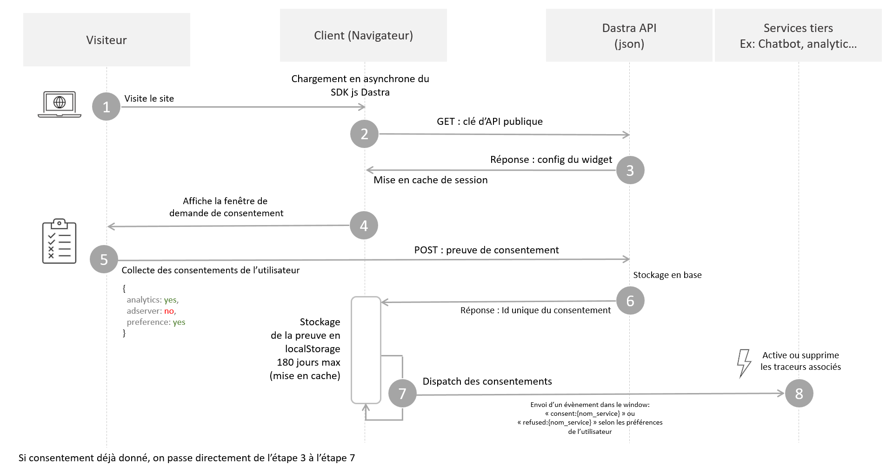

# How the banner works

## How the license works

Unlike other solutions that sell consent banners per domain, the Dastra license is based on two criteria:

* **Maximum monthly traffic**: the total number of user sessions (or visits) on your websites over one month.
* **The number of banners**: you configure a banner with a set of cookies and services, which you can reuse across several websites or subdomains. The consent cookie can work across several subdomains (for example `*.example.com`).

The number of **domains and subdomains is therefore unlimited** per banner.

<figure><figcaption><p>One banner can serve several sites and subdomains</p></figcaption></figure>

## Overall operation

The consent banner works in three main steps:

1. The **proposal** of the consent window.
2. The **collection** of consent (storage of proof).
3. The actual **execution** of the user's consent.


The Dastra banner covers the first two steps largely automatically. For the third step, which applies the user's cookie preferences, you must technically integrate the consent system with the third-party services that may set cookies. See the [cookie blocking guide](blocking/README.md).


The banner's JavaScript SDK must be called on all pages of the site that use cookies.



### 1. Visit to the client's website

The visitor opens the website where the JavaScript code snippet is installed. To avoid affecting the performance and SEO of your pages, the SDK is loaded asynchronously and cached for one day.

### 2. and 3. Collect and cache the banner configuration

To work, the banner needs an up-to-date configuration retrieved from the Dastra servers. To get the latest version, it makes a GET request with the public API key, which checks that the banner belongs to the customer.


If the domain of the site is not set in the banner, the request is refused and the banner does not appear. To fix this, open the banner in **Cookie consent** > **Banners**, then add the address of the site in **Urls authorized (Allowed origins)**, in the **Settings** section.


### 4. Requesting consent from the user

If the `consent-eu` cookie (you can change the cookie name) is missing, the consent window appears. To test that the banner displays correctly, delete this cookie from your browser.

### 5. Collecting consent

Consents are collected automatically by the Dastra API with a POST request in JSON.

In the banner interface, consent is expressed by purpose, but it is stored by service.

Here is what a proof of consent looks like as stored in our databases. Internal technical fields are not shown.

```json
{
    "id": "6185fe65-0924-410d-9132-3cde838c4627",
    "sessionId": "0b93b823-ff36-4d61-8959-e9e8deee5ef8",
    "date": "2026-10-12T16:54:03.272Z",
    "dateExpiration": "2027-04-10T16:54:03.272Z",
    "type": 2,
    "widgetId": 43,
    "typeDevice": 2,
    "workSpaceId": 19,
    "consentId": "8a5e89c4-2243-4598-97c5-ba3cfb35a138",
    "countryCode": "FR",
    "referrer": "https://www.example.com/pricing",
    "consents": {
        "lang": "fr-FR",
        "versionKey": "6f65cb1d-85eb-4a64-976d-519679189f8d",
        "cookieConsents": [
            {
                "id": "584ffef3-251c-4e9a-efb8-08d7fbfbee92",
                "tenantId": 0,
                "name": "Drift",
                "slug": "drift",
                "consent": true,
                "version": "6f65cb1d-85eb-4a64-976d-519679189f8d",
                "date": "2026-10-12T16:53:59.511Z",
                "purpose": 3
            }, {
                "id": "1c3baa61-0d05-44e4-da3d-08d7eeadee05",
                "tenantId": 0,
                "name": "Google Analytics",
                "slug": "google-analytics",
                "consent": true,
                "version": "6f65cb1d-85eb-4a64-976d-519679189f8d",
                "date": "2026-10-12T16:54:00.568Z",
                "purpose": 2
            }
        ]
    }
}
```

In return, the API returns a `consentId`, which is saved with the visitor's choices in the consent storage: the `consent-eu` cookie by default, or `localStorage` if you chose that mode. Its lifetime is the one set by the **Consent expiry time (Default to 180 days)** setting (180 days by default, from 1 to 365 days). This identifier is the unique identifier of the proof of consent. In the case of a dispute, it is the one to look for in the customer's browser.

### 6. Execution of consent

Once consent is collected, you need to apply the user's choice by passing the consent information to all the services on the site.

For this phase, see the guide on blocking cookies:


[README.md](blocking/README.md)



With the exception of strictly necessary cookies, all third-party tracking services must be blocked by default.


You can now start the technical integration of the banner:


[README.md](quickstart/README.md)

