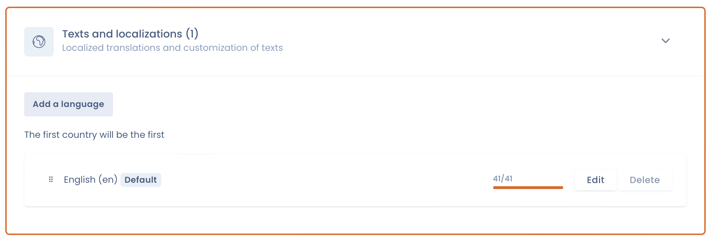

# Language management

## How to manage multiple languages for the widget?

Go to the settings page of the desired widget, then to the "Texts and translations" tab. You can add one or more languages.

<figure><figcaption></figcaption></figure>

## How is the widget language detected?

By default, the widget uses the language set by the `lang` attribute of the page's `<html>` tag. If this attribute is missing, it uses the browser language.

## How to force the language of the widget?

To force the language of the widget, add the `data-lang` attribute to the widget's div:

```html
<div id="dastra-cookie-consent" data-widgetid="{your_widget_id}" data-lang="fr"></div>
```

If you load the widget with the `loadCookieConsent` method, pass the `lang` option instead:

```javascript
dastra.push(['loadCookieConsent', {
    widgetId: {your_widget_id},
    selector: '#cookie-consent',
    lang: 'fr'
}]);
```
