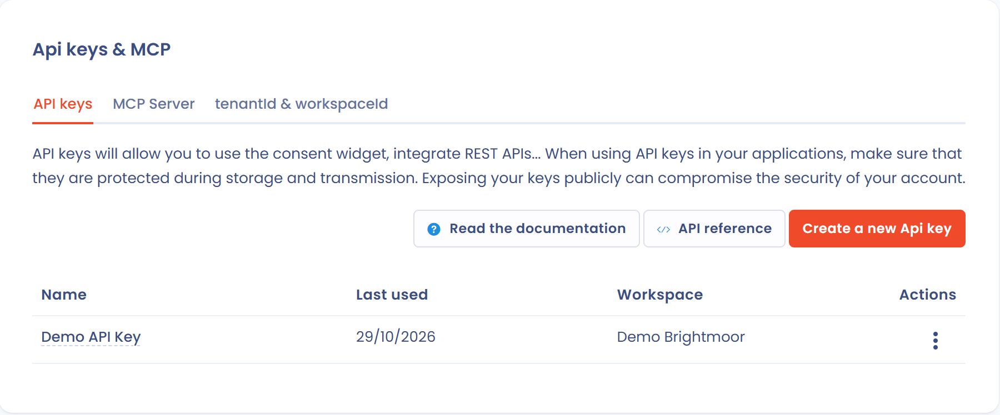

# Troubleshooting

If the cookie banner does not appear, check the following points in order.

1. Check the allowed URLs. In the menu, click **Cookie consent** > **Banners**, open the banner, then the **Settings** section. The address of your website must be listed in **Urls authorized (Allowed origins)**, in the format `https://myurl.com`, without a path. This is the most frequent cause: an origin missing from the list is refused.

   <figure><figcaption>
The "Urls authorized (Allowed origins)" field
</figcaption></figure>
2. Check the status of the banner. In the editor, the **Status** switch must be **Enabled**.
3. Check the validity of your public API key (do not use the private key). Click the gear icon in the top bar (**Organization settings**), then **Api keys & MCP**. Check that the key exists and has not expired. See [API key management](../settings/api-keys.md).

   <figure><figcaption>
The "Api keys & MCP" page
</figcaption></figure>
4. Check that you did not set a display trigger by mistake. In the **Triggers** section, a **Scroll before trigger in %** value that is too high prevents the banner from appearing when the visitor arrives on the page.
5. Check the options that hide the banner. The **Disable the banner display (all cookies with default consent will be triggered)** option hides the banner, and so does **Enable Global Privacy Control (GPC)** for visitors whose browser sends this signal. A visitor who already made a choice no longer sees the banner: delete the `consent-eu` cookie from your browser to test.
6. Check your subscription. To use the cookie consent banner, your subscription must include the feature. If the **Cookie consent** menu does not appear in the navigation, the feature is probably not included: contact your organization owner. If the subscription has expired, the API refuses the banner configuration. For more information, you can contact the [support](mailto:support@dastra.eu).
7. For any other problem, [contact the support](../../getting-started/support/request.md).
