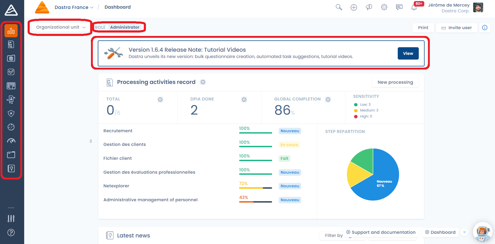
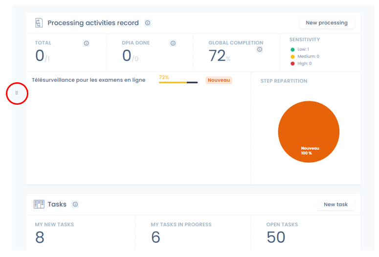
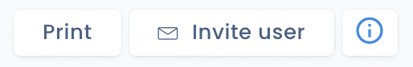

# Dashboard

## Introduction&#x20;

The Dastra dashboard is the first page you see when you enter your workspace, and is a summary of your RGPD compliance.&#x20;

It's composed of 3 main sections:&#x20;

* The feature bar on the left of the screen,&#x20;
* The selector of organizational unit
* Your role in this workspace
* The last release note (for a review of the new features)
* The section in the center containing the tiles summarizing the news and the watch of your space, and the different features.

<figure><figcaption></figcaption></figure>

## The tiles of the dashboard

In the section containing the tiles, you can change the order of appearance of these tiles by clicking on the drag and drop button to move the order of appearance of the tile.

<figure><figcaption>
An example of tile
</figcaption></figure>

There are several **categories of tiles** available in the dashboard:&#x20;

* **News**&#x20;
* **Data processing (ROPA)**
* **Risk analysis**&#x20;
* **Assessments**
* **Deadline tasks**&#x20;
* **Data subjects rights**
* **Cookie consent widget**&#x20;
* **Latest data breaches** &#x20;
* **Asset management**

## How to share the dashboard?&#x20;

You can also print the dashboard or invite a user directly by clicking on one of the buttons at the top right of the tiles section.

<figure><figcaption>
The print and invite a user buttons
</figcaption></figure>

## For more information

Explore the features now:


[editer-le-registre](ropa/README.md)



[data-visualization](ropa/visualization/README.md)



[risk-management](risks/README.md)



[planifier](tasks/README.md)



[gerer-les-exercices-des-droits](requests/README.md)



[notifier-les-violations-de-donnees](incidents/README.md)



[gerer-le-consentement-aux-cookies](cookies/README.md)



[audit](questionnaires/README.md)



[settings](settings/README.md)

