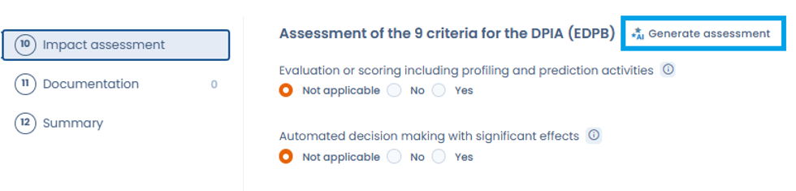

# Impact analysis

This step will allow you to evaluate in a simple way if your processing must be subject to a data protection impact analysis (DPI or PIA) provided for by [Article 35 of the GDPR](https://eur-lex.europa.eu/eli/reg/2016/679/oj#d1e3546-1-1).&#x20;

What is a DIA? A process to assess the necessity and proportionality and to manage the risks.&#x20;

Under what conditions should I conduct a PIA? If the risks to the rights and freedoms of data subjects are high. The EDPS has clarified the scope of this requirement. Specifically, if the processing meets at least two of the following criteria, an AIP will be required:

* Evaluation/scoring&#x20;
* Automatic decision with legal effect&#x20;
* Systematic monitoring&#x20;
* Sensitive data&#x20;
* Large scale&#x20;
* Cross-referencing of data&#x20;
* Vulnerable persons&#x20;
* Innovative use&#x20;
* Blocking a right/contract

Sometimes, in case of a processing operation that is particularly sensitive for the data subjects, only one criterion may be retained.&#x20;

## Generate the assessment with the AI assistant

The AI assistant can suggest an answer for each of the 9 criteria based on the information already entered in the processing activity record: name, description, purposes, data subject categories, personal data categories, assets and recipients.

<figure><figcaption>
The Generate assessment button starts the analysis of the 9 criteria by the AI assistant
</figcaption></figure>

1. In the **Impact assessment** step of the processing activity, click **Generate assessment**, next to the **Assessment of the 9 criteria for the DPIA (EDPB)** title.
2. Check the **Data shared with the AI model** section: it lists the information from the processing activity that is sent to the assistant.
3. Click **Generate**.
4. Review the proposal: for each criterion, the assistant gives an answer (Yes, No or Not applicable) with a justification, along with a confidence score for the analysis. Where relevant, the **Missing information that could change the assessment** section lists the items to complete in the record to make the result more reliable.
5. Click **Apply to the form** to copy the answers into the step, or **Back** to return to the previous screen.

You stay in control of every answer: once applied, each criterion can still be edited individually. The assistant's proposal supports your analysis and does not replace your own assessment.

In addition, supervisory authorities publish a list of types of processing for which an AIP is mandatory and may publish a list of types of processing for which an AIP is not mandatory.&#x20;

The French CNIL has published these two lists (in French)which can be accessed here:&#x20;

[List of types of processing with non-mandatory PIA ](https://www.cnil.fr/sites/default/files/atoms/files/liste-traitements-aipd-non-requise.pdf)

[List of types of processing with mandatory PIA ](https://www.cnil.fr/sites/default/files/atoms/files/liste-traitements-aipd-requise.pdf)

Note that [Article 30 of the GDPR](https://eur-lex.europa.eu/eli/reg/2016/679/oj#d1e3265-1-1) doesn't require to specify whether an AIP has been performed on the processing.
