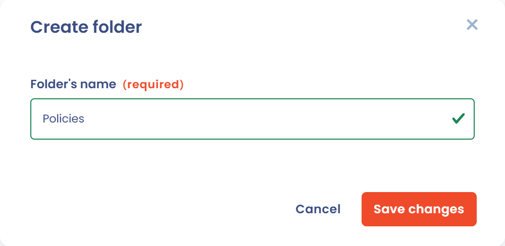
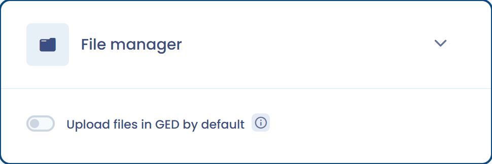

# File manager

Dastra natively integrates a file manager, also called GED (electronic document management) in French. It centralizes and shares access to all the documents associated with your work in Dastra. You find the module under **Resources** > **File Manager** in the left menu.

This is where you can store all the documentation that helps prove your GDPR compliance.


**Focus on GDPR documentation**

The documentation requirement stems from the **accountability principle** set out in Article 24 of the GDPR.

In practice, this goes beyond the record of processing activities and includes (non-exhaustive list):

* Internal procedures for creating new personal data processing activities
* DPIA methodology and completed assessments
* Written data protection policies
* Data mapping and inventory procedures
* Training records for staff involved in data processing
* Data subject rights management procedures
* Internal complaint handling mechanisms
* Data breach management and notification procedures
* Internal or external audit reports and findings
* Contract documentation for processors and joint controllers


## Accepted file formats

Many formats are supported:

* PDF
* Word (.docx)
* Excel (.xlsx)
* Images (JPG, PNG, etc.)
* Archives (.zip)
* And more

If a format is not accepted, put the file in a `.zip` archive and upload that instead.

## Create a document

You can write a document directly in Dastra, for example to take notes. In the file manager, click **Write a document**.

<figure><figcaption>
The Write a document button
</figcaption></figure>

Enter the label of the document, then its content in the Markdown editor. The document is saved in Markdown format (.md).

<figure><figcaption>
The document editor
</figcaption></figure>

### Generate a document with AI

The AI assistant can **generate a document** from a description and, if needed, files or a website address provided as context.

To use it, click **Write a document**, then **Generate with AI** in the editor. Briefly describe the document you need (type, purpose, expected content) and optionally add files to enrich the context. The generated text appears in the editor: review it, edit it and save it. The button is only active if the AI assistant is available in your subscription.


This feature is useful to draft a first version of a data protection policy, an internal procedure or any other compliance document.


## Create a folder

Organize your documents in folders so you can find them. Click **Create folder**, name it and choose its location: sub-folders are supported.

<figure><figcaption>
The folder creation window
</figcaption></figure>

## Manage access rights

You can restrict access to folders and files. Rights apply to folders as well as files. They are configured by the workspace administrator or by a user allowed to manage files.


By default, no restrictions are applied to the folder tree. The permissions linked to the user's roles still apply.


On the row of a folder or a file, click the **File access** button, then add the teams and users with the permission level you want.

<figure><figcaption>
The access rights window
</figcaption></figure>

These permissions apply to all child elements, that is, everything the folder contains, sub-folders included.


A folder with no defined permissions is accessible to all users.

If permissions are defined or inherited on an element, it is hidden from users who do not have the required authorizations.


## Files from other modules

The files attached to processing activities, assets, stakeholders and contracts can be stored in the file manager, in a dedicated folder. They are then visible to all the users allowed to view files: you need to manage access to the folders.

To choose this default behavior, click **Workspace settings** > **General**, then, in the **File manager** card, turn on **Upload files in GED by default**. If you turn the option off, files stay attached to their item and do not appear in the file manager, which can make access management simpler.

<figure><figcaption>
The option to upload files by default
</figcaption></figure>

Users who can manage files have three additional commands:

* **View files not in file manager**, in the **Filters** menu of the file manager, lists the files that are not stored there.
* **Move to common file manager** moves a file into the file manager, in the folder of your choice.
* **Remove from common file manager** takes the file out of the file manager: the file is kept, but other users can no longer discover it.

## Cloud storage

By default, Dastra stores files on Azure Blob Storage: they are encrypted, scanned for viruses and redundant. You can also connect your own storage, Microsoft OneDrive & SharePoint or Google Drive, to avoid duplicating files between systems.


[cloud-storage.md](../settings/cloud-storage.md)


## Document templates

Dastra provides ready-to-use document templates to help you build your compliance documentation.


[templates.md](templates.md)

