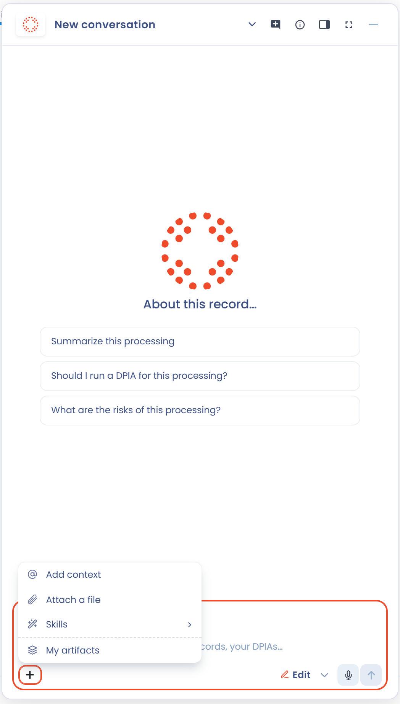

# AI Assistant

Dastra's AI Assistant lets you generate and enrich workspace elements from simple text descriptions. It relies on generative AI models hosted on Azure, in France and the European Economic Area, without any data from your organization being used to train those models.

Dastra AI brings together all of Dastra's AI features, in two families:

* The **AI assistants** are tightly scoped generation features. A button in a module covers one precise use case: generating a processing activity, an information notice or a risk analysis.
* The **conversational mode** covers the Dastra AI chat, [agents](agents/README.md) and the [MCP server](mcp.md). It is more open: you ask questions and hand over tasks in natural language.

This page covers both.

The availability of the AI Assistant depends on your organization's plan, module by module. In a module that your plan does not include, the AI buttons are greyed out, or do not appear for a few features. To change the scope of your plan, contact our team.

## AI as a starting point, not a final answer

The AI Assistant is designed to **accelerate your compliance work**, not to replace human expertise. All content generated by the assistant, whether a processing description, a privacy notice or a compliance analysis, is **a proposal that requires review and validation** by a qualified person before use.

In particular:


**AI-generated content does not constitute legal advice.** It cannot substitute for the judgment of a data protection professional or legal counsel.

**Compliance assessments are analytical aids.** Scores and recommendations produced by the AI are based solely on information recorded in your workspace. They reflect the quality of that documentation, not an independent legal opinion.

**You remain in control.** No AI-generated result is applied or communicated automatically. Every result requires a deliberate human action to be used. The one exception is an [autonomous agent](agents/autonomous.md) that you configure: it runs without anyone watching and applies the changes its editing tools allow, which is why you choose those tools yourself.


## Data protection and confidentiality

Your organization's data is never used to train AI models. The models used by Dastra are hosted on Microsoft Azure infrastructure in France, under contractual guarantees that exclude your data from any training or sharing with third parties. For full details, see [How it works](how-it-works.md).

## What the AI Assistant can help you with

The assistant is available across several modules of the platform:

* **Processing activities**: generate descriptions, datasets, security measures, privacy notices, the DPIA criteria assessment, and compliance analyses
* **AI systems**: generate descriptions, notices, the role justification, risk analyses, and the business value assessment
* **Questionnaires**: generate a template, translate it, and generate AI-assisted responses to DPIAs and risk analyses
* **Data subject requests**: draft responses in multiple languages and registers, and redact documents automatically
* **Data breaches**: generate a post-mortem
* **Assets and stakeholders**: generate structured entries from a URL or free description
* **Contracts**: extract metadata from an imported document
* **Compliance**: suggest controls, tests and requirement references, and analyze test evidence
* **Workflow rules and integrations**: generate an HTTP action or suggest a field mapping
* **Custom documents and reports**: generate content from your own instructions

For a step-by-step guide to each feature, see [Use cases](use-cases.md).

## Dastra AI, agents and the MCP server

Beyond content generation, Dastra AI offers a conversational mode that you query from the dashboard, from the **Open Dastra AI** button at the bottom right of the screen or from the **Dastra AI** entry of the **Automation** menu. You can also create your own [agents](agents/README.md), conversational or autonomous, keep the files the assistant produces as [artifacts](artifacts.md), and connect your AI tools to Dastra with the [MCP server](mcp.md). These features depend on your organization's plan and on each user's permissions.

The **Dastra AI** entry of the **Automation** menu groups the full-size chat (**Conversations**, with the **Artifacts** list), **Agents**, **Inbox** and **Skills**. The last three appear when your plan includes custom agents and your role allows them.

All AI features share the monthly AI credit quota described in [How it works](how-it-works.md#ai-credits-and-quotas).

## Chat with Dastra AI

**Dastra AI** answers questions about your workspace in a conversation. It looks up your records with read-only tools, so you can ask for a summary, a list of overdue requests or the processing activities that have no DPIA.

To answer, Dastra AI can also rely on the regulatory base indexed by Dastra, on the Dastra documentation and on a web search. In Edit mode, it can create records, update fields, create an action plan, a questionnaire, a comment or a tag, and run record actions such as changing the workflow step. It can build [artifacts](artifacts.md), ask you clarifying questions before acting and direct you to the relevant record.

1. Click **Open Dastra AI**, at the bottom right of the screen, or press **Ctrl+J** (**Cmd+J** on Mac). On the dashboard, you can also type your question in the message box under **How can I help you today?**: the panel opens and answers.
2. Type your question, or pick one of the **Suggested prompts**. They change with the page you are on: the record you are viewing, the register, requests, AI systems.
3. Read the answer. When the assistant relies on your records, it shows its steps and cites them. Use the **Suggested follow-up questions** to continue.

<figure><figcaption>
The Dastra AI panel, with the + menu open
</figcaption></figure>

The record or the register you are viewing is passed to the assistant as context, so you can ask "summarize this processing" without naming it. A guided tour of the panel is available: click **Display the guide**, the information icon of the panel header.

The panel offers several tools:

* **Open in full view** opens the conversation on the Dastra AI page, in the **Automation** menu, where your conversations are listed on the left. Older links to the AI agent page of a workspace lead to the same page.
* **Dock to the right** keeps the panel in a column beside the page, **Undock** puts it back over the page, and **Minimize** closes it. Docking is offered on screens at least 1,480 pixels wide. Dastra remembers your choice.
* **New conversation** starts a fresh conversation. The list of conversations keeps the previous ones, grouped by date, with a search box: rename or delete them from there. Deleting a conversation deletes all of its messages.
* **Choose an agent** switches between the **Standard chat** and the [agents](agents/README.md) your workspace has enabled.
* **Add context** gives the assistant a record or a user to work on. Type `@` in the message to mention a record or a user.
* **Attach a file**, or drop a file in the message box. Dastra AI reads PDF, PNG and JPEG files itself. CSV, XLSX, DOCX, JSON, TXT and Markdown files are accepted too, but only code execution can open them, where it is available. A file is limited to 10 MB.
* **My artifacts**, in the **+** menu, opens the list of [artifacts](artifacts.md) of the workspace.
* Type `/` or click **Skills** to run a [skill](agents/skills.md), a reusable prompt. A message applies at most five skills.
* **Dictate a message** records your voice and transcribes it into the message box. Your browser asks for microphone access the first time.
* **Copy** puts an answer in your clipboard.
* Rate an answer with **Good response** or **Bad response**. A **Bad response** opens a window where you can add a comment. Dastra stores the rating and the comment with the message.

Dastra restores what you were doing after a page reload: the text you were typing and, if your last exchange is less than six hours old, the conversation.

When a conversation gets long, a **Context** indicator appears next to the message box from 50% of the room available. From 80%, the indicator turns orange and suggests a new conversation. Sending stays possible, but the assistant may lose the beginning of the conversation once the room is used up.

### Ask and Edit modes

In **Ask** mode, the assistant only reads: nothing in your workspace changes. In **Edit** mode, it can also create and update records. The mode selector appears for users who have the write permission of the assistant. The **Edit** mode requires the matching option in your organization's plan. Without it, the option is locked.

**Tools available in Ask mode.** Searching the workspace, the documentation, the regulations and the web. Browsing and reading records, comments, files, organizational units, questionnaires and the workspace profile. Inspecting the structure of a record type, its editable fields and its available actions. Listing users, tags, workflow steps and regulation categories. Exporting records, building [artifacts](artifacts.md), running code (where it is available) and delegating a sub-task. The assistant can also ask you questions and take you to a page of Dastra.

**Tools added by Edit mode.** Creating a record, updating one or several records, running a record action (archive, restore, clone, change the workflow step, etc.), adding a comment, creating an action plan or a tag, planning and filling in a questionnaire, writing a document, linking or saving a file, drafting a record from a description, analyzing a record and creating or updating an agent. Deletion and anonymization are not offered.

Before it runs one of these tools, Dastra AI shows an **Authorization required** card that names the tool. Click **Show arguments** to see what it is about to send, then choose:

* **Approve** to run the tool this time;
* **Always approve for this session** to stop being asked for the tools of this conversation;
* **Decline** to refuse.

If you send another message while a card is waiting, the card no longer applies.


Dastra AI is available when your plan includes it and when your role has the AI assistant permission. The messages count towards the monthly AI credit quota, and a banner warns you when the quota is almost used up.


## Beta features

Some AI features are released in beta: they are operational but continue to be refined based on user feedback. Beta features are clearly identified in the interface.

When using a beta feature:

* Results may be less consistent than in stable features and should be treated with extra care.
* The underlying prompts and criteria are actively being improved, so results may evolve between versions.
* Feedback is welcome and helps Dastra improve the feature. Use the feedback option available in the interface.


Beta features should never be the sole basis for a compliance decision. They are designed to support thorough human review, not replace it.


**Currently in beta**: the AI compliance analysis, available on processing activities, AI systems, contracts, assets, stakeholders and audit response summaries. Open it with the **AI analysis (beta)** button of the record, or ask Dastra AI to analyze a record in Edit mode. The result gives a score from A to F, the assessed criteria and suggested tasks, and can be printed, relaunched or continued in the chat.

***


[ai-assistant-how-it-works.md](how-it-works.md)



[ai-assistant-use-cases.md](use-cases.md)



[ai-assistant-faq.md](faq.md)



[README.md](agents/README.md)



[serveur-mcp.md](mcp.md)



[artifacts.md](artifacts.md)

