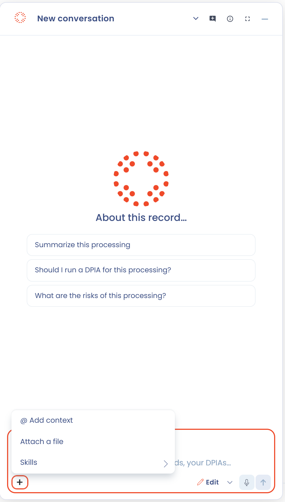

# AI Assistant

Dastra's AI Assistant lets you generate and enrich workspace elements from simple text descriptions. It relies on generative AI models hosted on Azure, in France and the European Economic Area, without any data from your organization being used to train those models.

The availability of the AI Assistant depends on your organization's plan, module by module. In a module that your plan does not include, the AI buttons are greyed out. To change the scope of your plan, contact our team.

## AI as a starting point, not a final answer

The AI Assistant is designed to **accelerate your compliance work**, not to replace human expertise. All content generated by the assistant, whether a processing description, a privacy notice or a compliance analysis, is **a proposal that requires review and validation** by a qualified person before use.

In particular:


**AI-generated content does not constitute legal advice.** It cannot substitute for the judgment of a data protection professional or legal counsel.

**Compliance assessments are analytical aids.** Scores and recommendations produced by the AI are based solely on information recorded in your workspace. They reflect the quality of that documentation, not an independent legal opinion.

**You remain in control.** No AI-generated result is applied or communicated automatically. Every result requires a deliberate human action to be used.


## Data protection and confidentiality

Your organization's data is never used to train AI models. The models used by Dastra are hosted on Microsoft Azure infrastructure in France, under contractual guarantees that exclude your data from any training or sharing with third parties. For full details, see [How it works](how-it-works.md).

## What the AI Assistant can help you with

The assistant is available across several modules of the platform:

* **Processing activities**: generate descriptions, datasets, security measures, privacy notices, and compliance analyses
* **AI systems**: generate descriptions, notices, and risk analyses
* **Questionnaires**: generate AI-assisted responses to DPIAs and risk analyses
* **Data subject requests**: draft responses in multiple languages and registers
* **Assets and stakeholders**: generate structured entries from a URL or free description
* **Contracts**: extract metadata from an imported document
* **Custom documents and reports**: generate content from your own instructions

For a step-by-step guide to each feature, see [Use cases](use-cases.md).

## Dastra AI, agents and the MCP server

Beyond content generation, Dastra offers a conversational assistant, **Dastra AI**, that you query from the dashboard or from the **Open Dastra AI** button at the bottom right of the screen. You can also create your own [agents](agents/README.md), conversational or autonomous, and connect your AI tools to Dastra with the [MCP server](mcp.md). These features depend on your organization's plan and on each user's permissions.

All AI features share the monthly AI credit quota described in [How it works](how-it-works.md#ai-credits-and-quotas).

## Chat with Dastra AI

**Dastra AI** answers questions about your workspace in a conversation. It looks up your records with read-only tools, so you can ask for a summary, a list of overdue requests or the processing activities that have no DPIA.

1. Click **Open Dastra AI**, at the bottom right of the screen, or press **Ctrl+J** (**Cmd+J** on Mac).
2. Type your question, or pick one of the **Suggested prompts**. They change with the page you are on: the record you are viewing, the register, requests, AI systems.
3. Read the answer. When the assistant relies on your records, it shows its steps and cites them. Use the **Suggested follow-up questions** to continue.

<figure><figcaption>
The Dastra AI panel, with the + menu open
</figcaption></figure>

The panel offers several tools:

* **Toggle fullscreen** expands the panel to the full screen. A link to the AI agent page of a workspace opens the assistant full screen, then goes back to the dashboard of that workspace.
* **New conversation** starts a fresh conversation. The conversation list keeps your previous conversations: rename or delete them from there. Deleting a conversation deletes all of its messages.
* **Choose an agent** switches between the standard assistant and the [agents](agents/README.md) your workspace has enabled.
* **Add context** and **Attach a file** give the assistant a record or a document to work on. Type `@` to mention a record or a user.
* Type `/` or click **Skills** to run a [skill](agents/skills.md), a reusable prompt.
* **Dictate a message** records your voice and transcribes it into the message box. Your browser asks for microphone access the first time.
* Rate an answer with **Good response** or **Bad response**, and add a comment, to send feedback to Dastra.

### Ask and Edit modes

In **Ask** mode, the assistant only reads: nothing in your workspace changes. In **Edit** mode, it can also create and update records, and asks for your confirmation before it applies a change. The mode selector appears for users who have the write permission of the assistant. The **Edit** mode requires the matching option in your organization's plan. Without it, the option is locked.


Dastra AI is available when your plan includes it and when your role has the AI assistant permission. The messages count towards the monthly AI credit quota, and a banner warns you when the quota is almost used up.


## Beta features

Some AI features are released in beta: they are operational but continue to be refined based on user feedback. Beta features are clearly identified in the interface.

When using a beta feature:

* Results may be less consistent than in stable features and should be treated with extra care.
* The underlying prompts and criteria are actively being improved, so results may evolve between versions.
* Feedback is welcome and helps Dastra improve the feature. Use the feedback option available in the interface.


Beta features should never be the sole basis for a compliance decision. They are designed to support thorough human review, not replace it.


**Currently in beta**: the AI compliance analysis, available on processing activities, AI systems, contracts, stakeholders, assets and questionnaire responses. Open it with the **AI analysis (beta)** button of the record, or ask Dastra AI to analyze a record. The result gives a score from A to F, the assessed criteria and suggested tasks, and can be printed, relaunched or continued in the chat.

***


[ai-assistant-how-it-works.md](how-it-works.md)



[ai-assistant-use-cases.md](use-cases.md)



[ai-assistant-faq.md](faq.md)



[README.md](agents/README.md)



[serveur-mcp.md](mcp.md)

