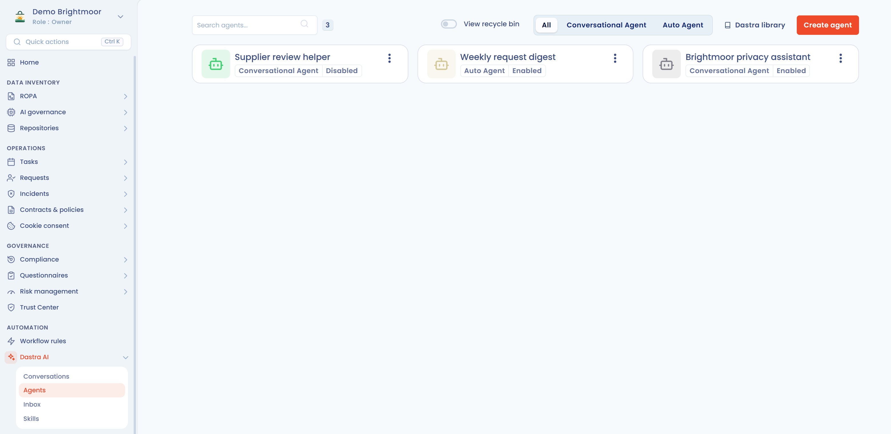
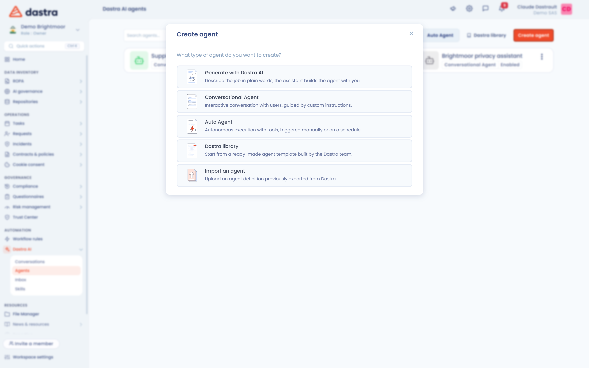

# Dastra AI agents

A **Dastra AI agent** is an assistant you configure yourself: you give it a role, a set of instructions, and the list of tools it is allowed to use in your workspace. Where the standard [AI assistant](../README.md) answers anything, an agent is specialised on one mission and always behaves the same way.

Agents are configured from **Automation** > **Dastra AI** > **Agents**. The **Agents**, **Inbox** and **Skills** entries appear when your plan includes custom agents and your role has the **Custom AI agents** permission.

<figure><figcaption>
Automation &#x3E; Dastra AI &#x3E; Agents: the list of configured agents
</figcaption></figure>


**Do not confuse this with the AI systems register.** The [AI systems](../../../ai-systems/README.md) section is where you document **your own** AI systems for the AI Act. The agents described here are a Dastra feature you use to work on your data.


***

### Two types of agents

| | Conversational Agent | Auto Agent |
| --- | --- | --- |
| **What it is for** | A specialised chat assistant with its own personality and rules | A repetitive task that runs with nobody watching |
| **What triggers it** | A user, by opening a conversation | A manual run, a schedule, or a workflow rule |
| **Interaction** | The agent can ask questions and request confirmation | The agent can neither ask a question nor request confirmation: it goes all the way and returns its result |
| **Where you find it** | In the Dastra AI panel, through the **Choose an agent** selector | In **Agents**, with its runs in the **Inbox** |
| **What you configure** | Welcome message, assistant instruction, conversation starters | System instruction, input fields, scheduling |

***

### Creating an agent

Click **Create agent**. Five starting points are offered:

<figure><figcaption>
The five ways to create an agent
</figcaption></figure>

* **Generate with Dastra AI**: describe the mission in a few words and click **Generate the agent**. The assistant asks a few questions, then creates the agent for you to review and adjust. This is the built-in `/design_agent` skill.
* **Conversational Agent**: start from a blank page for a chat assistant. See [Creating a conversational agent](conversational.md).
* **Auto Agent**: start from a blank page for a tool-driven run. See [Creating an autonomous agent](autonomous.md), and [Build an autonomous agent](../../../../examples/autonomous-agent.md) for a worked example.
* **Dastra library**: start from a ready-made template. The library offers the templates built by the Dastra team, those of your partner library when you have one, and the agents of another workspace you can access. Click **Install**: the template is imported **as a draft**, deactivated and without notified users. Review its instructions and its tools before you activate it. The **Dastra library** button of the agent list opens the same gallery.
* **Import an agent**: drop in a definition file previously exported from Dastra.

In every case creation happens in two steps: you pick the type, you enter a **name** (120 characters maximum) and an optional **description**, then the full editor opens. The editor accepts descriptions of up to 3000 characters, with basic Markdown formatting.

The editor **saves automatically**: the last save time is shown in the top-right corner. There is no Save button.

***

### Activating, deactivating, trashing, deleting

* **Deactivate** and **Activate**, in the editor or in the menu of the row, switch an agent between **Disabled** and **Enabled**. A deactivated agent no longer appears in the agent selector, and a schedule or a workflow rule cannot start it. You can still run it manually with **Run now**, which is how you test it. Use this state while you are still tuning its instructions.
* **Move to trash**: the agent goes to the recycle bin and never runs, even if a workflow rule still names it. Switch on **View recycle bin** in the list to find it and click **Restore**. Its past runs are kept.
* **Delete**: available for an agent in the recycle bin. Deletion is permanent and **also erases every session and every message** belonging to the agent. Use it when you need to purge that data.

### Exporting and importing an agent

The **Export** button, in the editor or in the menu of the row, produces a JSON file containing the agent definition (instructions, tools, input fields, scheduling). You can import it into another workspace through **Create agent** > **Import an agent**.

On import, Dastra resets a few things: the agent is created deactivated, without a logo and without notified users. Review it, then click **Activate**.

***

### Who can do what

Access to agents depends both on your **plan** and on your **permissions**. Two permissions of the role editor are involved, each with a read level and a write level:

| Permission | Level | What it allows |
| --- | --- | --- |
| **AI Assistant** | Read | Use the conversational assistant in Ask mode and the skills |
| **AI Assistant** | Write | Use Edit mode, where the assistant creates and updates records (the plan must include it too) |
| **Custom AI agents** | Read | See the agents of the workspace, chat with them and run them |
| **Custom AI agents** | Write | Create, update, export, import, move to the trash and delete agents; create and edit [skills](skills.md) |

Permissions are set in the role editor, see [Roles](../../../settings/roles.md). The [MCP server](../mcp.md) is covered by a separate plan.


**A conversational agent never has more rights than the person who talks to it.** Its tools run with your own permissions: if you cannot access a record, neither can the agent. Deletion and anonymization are not offered to agents.

**An autonomous agent is not tied to a user's permissions.** A run started by a schedule, by a workflow rule or by **Run now** works with the rights of the workspace, whoever launched it. Give it only the tools its mission requires.


***

### Credits and consumption

Messages sent to an agent and runs of an autonomous agent are counted in the monthly AI credit quota of your organization, like the messages sent to Dastra AI. See [AI credits and quotas](../how-it-works.md#ai-credits-and-quotas).

Your organization's monthly quota and its consumption are tracked in **Organization settings > Dastra AI**. Once the quota is reached, conversations and runs are refused, and the **Run now** button of an autonomous agent is disabled.

Model families, hosting and the data sent to the models are documented in [How it works](../how-it-works.md).

***

<table data-view="cards"><thead><tr><th></th><th></th><th data-hidden data-card-target data-type="content-ref"></th></tr></thead><tbody><tr><td><strong>Creating a conversational agent</strong></td><td>Build a specialised chat assistant with its own personality, rules and tools</td><td><a href="conversational.md">conversational.md</a></td></tr><tr><td><strong>Creating an autonomous agent</strong></td><td>Configure an agent that runs on its own: manually, on a schedule, or from a workflow rule</td><td><a href="autonomous.md">autonomous.md</a></td></tr><tr><td><strong>Skills</strong></td><td>Save your recurring instructions as reusable commands in the Dastra AI chat</td><td><a href="skills.md">skills.md</a></td></tr><tr><td><strong>Tracking runs</strong></td><td>Find the history of your agent runs, their status and the detail of what they did</td><td><a href="inbox.md">inbox.md</a></td></tr></tbody></table>
