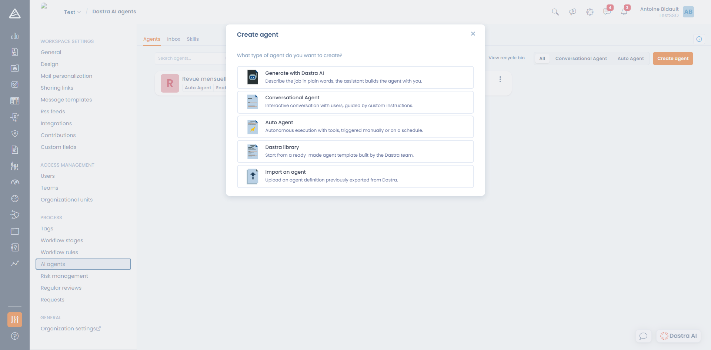

# Dastra AI agents

A **Dastra AI agent** is an assistant you configure yourself: you give it a role, a set of instructions, and the list of tools it is allowed to use in your workspace. Where the standard [AI assistant](../README.md) answers anything, an agent is specialised on one mission and always behaves the same way.

Agents are configured from **Workspace settings > AI agents** ([direct access](https://app.dastra.eu/workspace/0/settings/ai-agents)).

<figure><figcaption>
Workspace settings &#x3E; AI agents — the list of configured agents
</figcaption></figure>


**Do not confuse this with the AI systems register.** The [AI systems](../../../ai-systems/README.md) section is where you document **your own** AI systems for the AI Act. The agents described here are a Dastra feature you use to work on your data.


***

### Two types of agents

| | Conversational Agent | Auto Agent |
| --- | --- | --- |
| **What it is for** | A specialised chat assistant with its own personality and rules | A repetitive task that runs with nobody watching |
| **What triggers it** | A user, by opening a conversation | A manual run, a schedule, or a workflow rule |
| **Interaction** | The agent can ask questions and request confirmation | The agent can neither ask a question nor request confirmation: it goes all the way and returns its result |
| **Where you find it** | In the Dastra AI panel, through the **Choose an agent** selector | In **AI agents**, with its runs in the **Inbox** |
| **What you configure** | Welcome message, assistant instruction, conversation starters | System instruction, input fields, scheduling |

***

### Creating an agent

Click **Create agent**. Five starting points are offered:

<figure><figcaption>
The five ways to create an agent
</figcaption></figure>

* **Generate with Dastra AI** — describe the mission in a few words and the assistant builds the agent with you, saving it once you approve. This is the built-in `/scaffold_agent` skill.
* **Conversational Agent** — start from a blank page for a chat assistant. See [Creating a conversational agent](conversational.md).
* **Auto Agent** — start from a blank page for a tool-driven run. See [Creating an autonomous agent](autonomous.md).
* **Dastra library** — start from a ready-made template built by the Dastra team. The template is imported **as a draft**: review its instructions and its tools before publishing it.
* **Import an agent** — drop in a definition file previously exported from Dastra.

In every case creation happens in two steps: you pick the type, you enter a **name** (120 characters maximum) and an optional **description** (1000 characters), then the full editor opens.


The editor **saves automatically**: the last save time is shown in the top-right corner. There is no Save button.


***

### Publishing, deactivating, archiving, deleting

* **Enabled / Deactivated** — a deactivated agent no longer appears to users and its schedules stop firing. This is the state to use while you are still tuning its instructions.
* **Archive** — the agent goes to the recycle bin. Tick **View recycle bin** in the list to find it and restore it. Its past runs are kept.
* **Delete** — deletion is permanent and **also erases every session and every message** belonging to the agent. Use it when you need to purge that data.

### Exporting and importing an agent

The **Export** button produces a JSON file containing the agent definition (instructions, tools, input fields, scheduling). You can import it into another workspace through **Create agent > Import an agent**.

On import, Dastra resets a few things: the agent is created **deactivated**, without a logo and without notified users. Review it, then enable it.

***

### Who can do what

Access to agents depends both on your **plan** and on your **permissions**.

| Permission | What it allows |
| --- | --- |
| **AI Assistant usage** | Use the conversational assistant: ask questions, let the agent use its read-only tools |
| **AI Assistant edit mode** | Let the assistant create and update records from the conversation |
| **Custom AI agents execution** | See the agents of the workspace and run them |
| **Custom AI agents management** | Create, update and delete the agents of the workspace |

Permissions are set in **Organization settings > Roles and permissions**. The [MCP server](../mcp.md) is covered by a separate plan.


**An agent never has more rights than the person who triggers it.** Its tools run with your own permissions: if it cannot access a record, neither can the agent.


***

### Credits and consumption

Each **message you send** to an agent costs **1 Dastra AI credit**, whatever the number of tools the agent then uses to answer you. Resuming a conversation after a confirmation request costs nothing extra.

Your organization's monthly quota and its consumption are tracked in **Organization settings > Dastra AI**. Once the quota is reached, conversations and runs are refused, and the **Run** button of an autonomous agent is disabled.

Model families, hosting and the data sent to the models are documented in [How it works](../how-it-works.md).

***


[agent-conversationnel.md](conversational.md)



[agent-autonome.md](autonomous.md)



[competences.md](skills.md)



[boite-de-reception.md](inbox.md)

