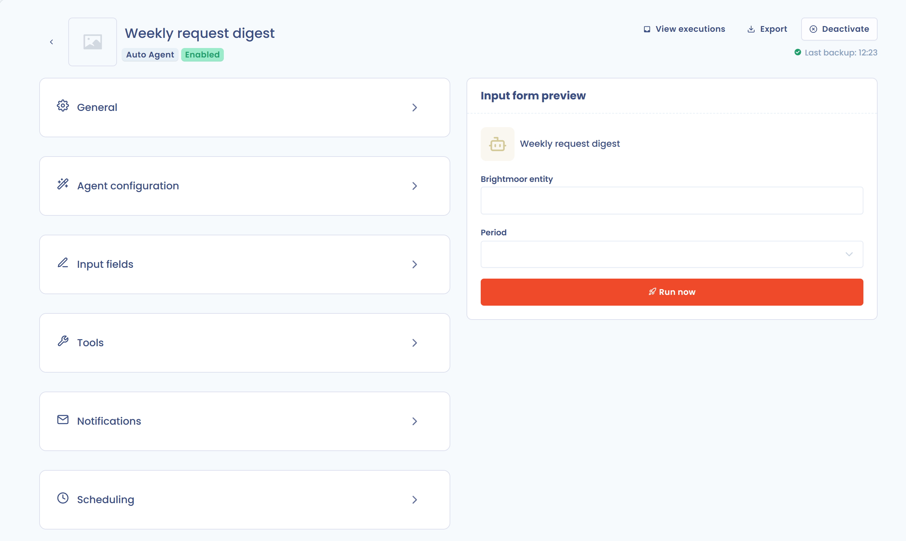
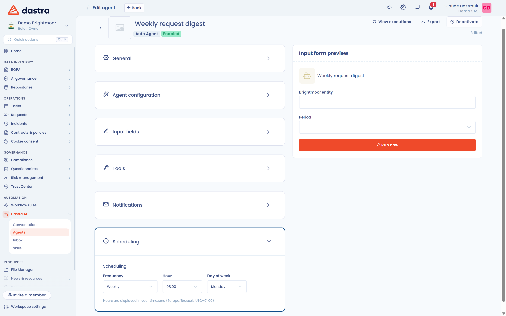

# Creating an autonomous agent

An autonomous agent carries out a task from end to end, with nobody watching: reviewing a slice of the record of processing activities, preparing an action plan, producing a monthly summary.

Go to **Automation** > **Dastra AI** > **Agents**, click **Create agent**, then **Auto Agent**. For a complete case, from the instruction to the first run, see [Build an autonomous agent](../../../../examples/autonomous-agent.md).


**An autonomous agent cannot ask you anything.** The tools that require interaction (asking a question, navigating the interface) are removed from it, and its editing tools run without a confirmation request. Its instruction must therefore cover every case, including what to do when information is missing.


***

### Agent configuration

The **system instruction** (10,000 characters maximum) describes the whole mission. Unlike a conversational agent, where you mostly define a personality, this is a procedure.

An effective system instruction is numbered, explicit about its limits, and precise about the expected output:

```
You carry out the monthly review of the record of processing activities.

Steps to follow:
1. List the processing activities of the organizational unit given in the
   input field.
2. For each record, check that the purpose, the legal basis, the retention
   period and the security measures are filled in.
3. Group the gaps you find by record.
4. Create an action plan with one task per incomplete record, stating which
   fields must be completed.

Do not modify any processing activity: restrict yourself to creating the
action plan tasks.

Finish with a summary stating the number of records reviewed, the number of
incomplete records and the tasks created.
```

***

### Input fields

Input fields make up the short form filled in before a run. Each value reaches the agent **under its technical name**: use those names in the system instruction to tell the agent what to do with them.

<figure><figcaption><p>The input fields and their preview, on the right</p></figcaption></figure>

Each field is defined by:

| Setting | Purpose |
| --- | --- |
| **Label** | What the person launching the run sees |
| **Name** | The technical name under which the value reaches the agent |
| **Type** | Text, Number, Boolean or Select |
| **Required** | Prevents the run from starting while the field is empty |
| **Default** | Pre-filled value |
| **Description** | Help text shown under the field |

An agent with no input field at all runs without asking anything.


The **Name** is generated automatically from the label. If you change it, check the final value: that is what you must quote in the system instruction.


The **form preview**, on the right of the editor, shows exactly what your users will see. It is also how you launch a test run.

***

### Tools

This works like a [conversational agent](conversational.md#tools): all tools are available by default, and you can restrict each group with **All**, **None** or **Custom**.

The stakes are higher here, though, since nobody reviews the agent while it works. Give it the read-only tools it needs, and **only the editing tools its mission requires**.

### Notifications

Choose the **Notified users** of the agent. They receive a Dastra notification when a run completes, and another one when a run does not complete. A run that ends with **Human review required** counts as completed. A run that ends with any other status, such as **Failed** or **Missing information**, counts as not completed.

***

### Scheduling

<figure><figcaption><p>Scheduling an autonomous agent</p></figcaption></figure>

Pick a **Frequency** (**No schedule**, **Daily**, **Weekly** or **Monthly**) then the **Hour**, and depending on the case the **Day of week** or the **Day of month**.


**Hours are shown in your own time zone**, as stated under the form. Dastra stores them in UTC, which is why the agent card in the list may display a different hour from the one you entered.

The trigger runs **once an hour, on the hour**. A schedule therefore cannot target a specific minute.


Only **enabled**, non-archived, autonomous agents are picked up by the scheduler.

***

### The three ways to trigger a run

#### 1. Manually

Fill in the form in the preview, then click **Run now**. The run is queued: you are redirected to the inbox, where you watch it move from **Running** to its final status. A deactivated agent can be run this way, which lets you test it before you activate it.

#### 2. On the schedule

The agent starts on its own at the configured frequency. A scheduled run receives no value for its input fields: the **Default** value only pre-fills the form of a manual run. Write the system instruction so that the agent does not depend on an input field when it runs on a schedule.

#### 3. From a workflow rule

In **Automation** > **Workflow rules**, the **Execute an AI agent** action triggers an agent from an event on a record (a stage change, a creation, a deadline). See [Workflow rules](../../../settings/workflow-rules.md).

There you pick the **AI agent to execute**, an optional **Instruction message** (2000 characters maximum) and the values of the **Agent input fields**. The message and the values accept **custom variables** resolved from the record that triggered the rule, so the agent receives a different context on every run. A deactivated agent, or one in the recycle bin, is not started.

***

### Run limits

| Limit | Behaviour |
| --- | --- |
| **30 tool iterations** per turn | Beyond that the agent must conclude: the run ends as *Incomplete execution* |
| **Context size** | The oldest tool exchanges are summarised; on overflow the run ends as *Context limit reached* |
| **10,000 characters** of input | A longer message is refused |
| **Credit quota** | A run is refused when the monthly quota is reached |

These statuses, and the others, are detailed in [Tracking runs](inbox.md).

***


[boite-de-reception.md](inbox.md)

