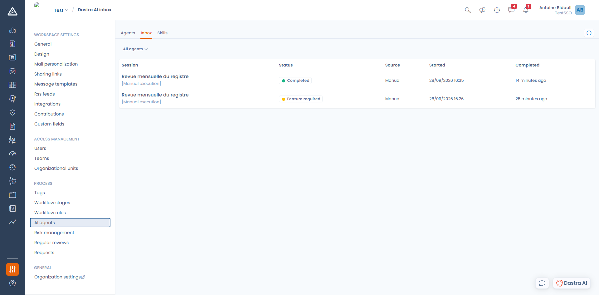

# Tracking runs

The **Inbox** gathers the run history of your agents: what was started, by what, when, and with what outcome.

You will find it in **Workspace settings > AI agents > Inbox**.

<figure><figcaption>
The Inbox, with the status and the source of every run
</figcaption></figure>

Each row shows the **session**, its **status**, its **source** (Manual, Schedule or Workflow), the **start** time and the **completion** time. The selector at the top of the list narrows the view to a single agent.

Runs in progress update live: there is no need to refresh the page.

***

### The detail of a run

Click a row to open the detail. It has two tabs:

* **Conversation** — the full trace: the agent's reasoning, the tools it called, and its final answer.
* **Inputs** — the values of the input fields the run was launched with.

<figure><figcaption>
The detail of a run
</figcaption></figure>

The **Continue in chat** button carries the result of the run into a new conversation. It is the simplest way to dig into a result, ask for a rewrite, or have something corrected.

***

### Statuses

Some statuses are technical; others are **declared by the agent itself** at the end of its work — they are conclusions, not failures.

| Status | Meaning |
| --- | --- |
| **Running** | The run is in progress |
| **Completed** | The agent went all the way through its mission |
| **Failed** | A technical error interrupted the run; the error message is shown in the detail |
| **Human review required** | The agent did its job but considers that a validation is needed before going further |
| **Insufficient permission** | The agent lacked the rights to reach some data or perform an action |
| **Feature required** | A feature it needed is not included in the organization's plan |
| **Missing information** | The available data did not allow the mission to be completed |
| **Incomplete execution** | The agent hit the tool iteration limit before concluding |
| **Context limit reached** | The conversation became too long for the model |


A **Missing information** or **Human review required** status usually points back to the agent's instruction or its list of tools: it did what it could with what it was given. The run detail generally explains what it was missing.


***

### Notifications

If you are one of an agent's **notified users**, you receive a Dastra notification at the end of every run, successful or failed. This is the recommended way to keep an eye on a scheduled agent without opening the Inbox.

### Technical log

For organization-level monitoring — model used, duration, user behind the call — see the **AI assistant invocation logs** in **Organization settings > Dastra AI**. They are kept for 90 days.
