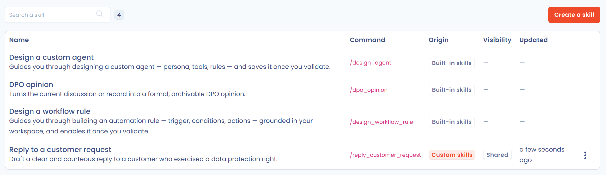

# Skills

A **skill** is an instruction you save once and then recall with a command, by typing `/` in the conversation. Think of it as a prompt template shared across the organization.

Skills are managed in **Automation** > **Dastra AI** > **Skills**.

<figure><figcaption>
The Skills tab, with Dastra's built-in skills
</figcaption></figure>

***

### Built-in skills

Dastra ships three skills, available in every workspace and not editable:

| Command | What it does |
| --- | --- |
| `/design_agent` | Guides you through designing a custom agent (persona, tools, rules) and saves it once you validate. This is what the **Generate with Dastra AI** option of the agent creation screen triggers. |
| `/dpo_opinion` | Turns the current discussion, or the record you are looking at, into a formal, archivable DPO opinion. |
| `/design_workflow_rule` | Guides you through building a workflow rule (trigger, conditions, actions) based on your workspace, and enables it once you validate. |

### Creating your own skill

Click **Create a skill**, then fill in:

* **Name**: the label shown in the command list (120 characters maximum).
* **Command**: the text typed after the `/`. Lowercase letters, digits and underscores, starting with a letter, and **unique within the organization**: for example `steering_committee_summary`.
* **Description**: one sentence explaining when to use it, shown next to the command in the chat (1000 characters maximum).
* **Prompt**: the instruction sent to the assistant, up to 10,000 characters.
* **Share with the organization**: when it is on, every member of your organization sees the skill, in all the workspaces. Otherwise only you can use it. The list shows each skill as **Shared** or **Private**.

### Using a skill

In a Dastra AI conversation, type `/` or click **Skills**: the list of available skills appears, with the **Built-in skills** and your **Custom skills**. Pick one, complete your message if needed, then send. A message applies at most five skills.


A skill applies to the current conversation, with the agent and the mode (Ask or Edit) currently selected. A skill that needs to modify records therefore requires Edit mode.


Creating, updating or deleting a skill requires the write level of the **Custom AI agents** permission, but not the custom agents plan option. Using a skill only requires access to the assistant. The **Skills** list of the menu appears with the other custom agent entries. From the **Skills** submenu of the message box, you can also add a skill (**Add a skill**), or edit and delete your own, without leaving the chat.

***

### Skill or agent?

Both let you capitalise on an instruction, but not at the same moment:

* A **skill** is a one-off. You trigger it in the middle of a conversation, on whatever context is at hand.
* An **agent** is permanent. It has its own identity, its own tools, and where relevant its own schedule.

If you keep retyping the same request, create a skill. If you want a specialised counterpart or an automated task, create an [agent](README.md).
