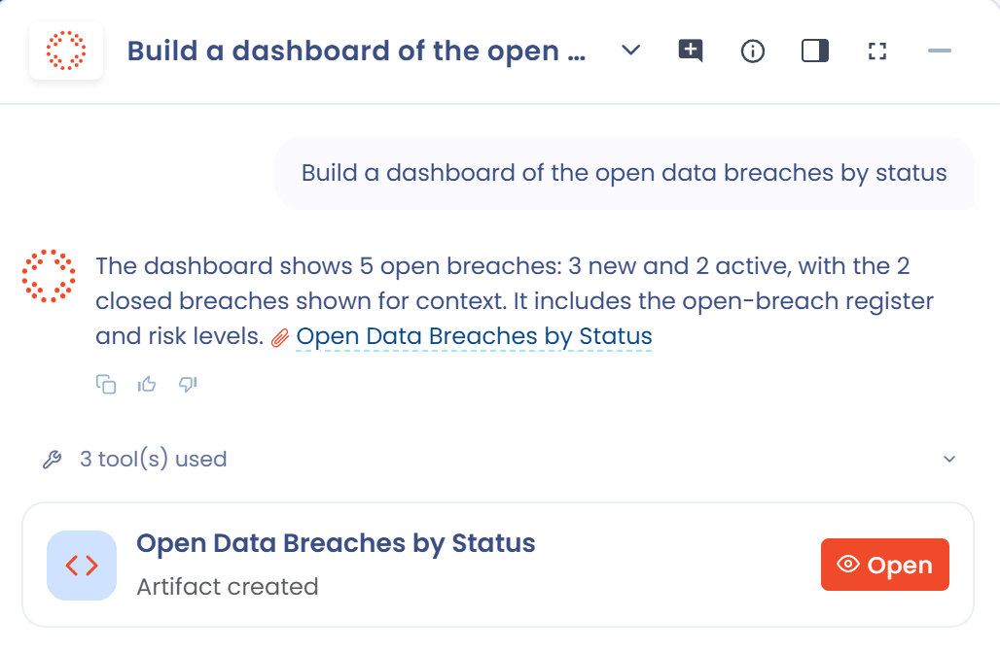
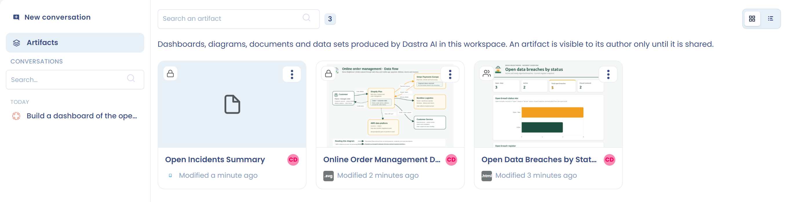
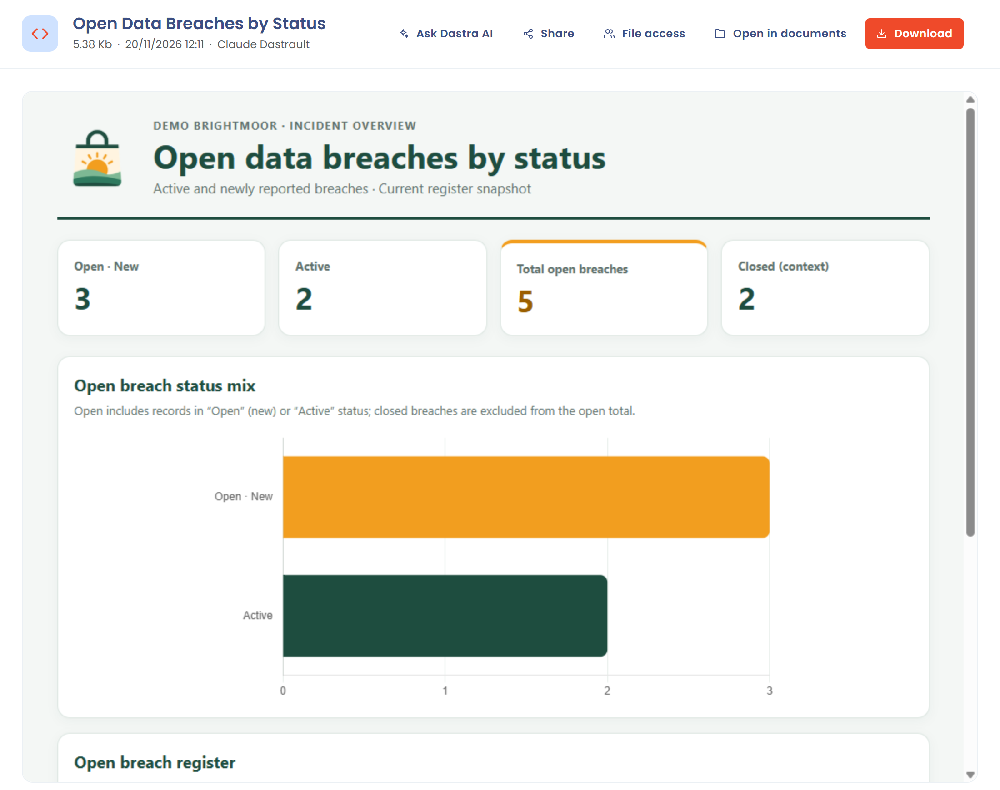

# Artifacts

An artifact is a file that Dastra AI writes as the result of a conversation: a dashboard, a diagram, a document or a data export. Artifacts are for anyone who uses [Dastra AI](README.md) to prepare a report or a working document from the data of a workspace.

## What an artifact can be

Dastra AI creates an artifact in one of these formats:

| Format | Typical use |
| --- | --- |
| HTML page | A dashboard, a chart or an interactive page |
| SVG | A diagram |
| Markdown or text | A document, a note, a summary |
| JSON or CSV | A data set |

When the assistant builds a file with code execution, or exports records, the result is stored as an artifact too, in a spreadsheet, Word, PowerPoint, PDF or image format. Code execution is not available on every instance.

## Create an artifact

1. Open Dastra AI and describe what you want: "Build a dashboard of the open data breaches by status" or "Draw the data flow of this processing activity as a diagram".
2. The assistant gathers the data it needs with your permissions, then shows a card with the title of the artifact and the **Open** button. The card reads **Artifact created**.

<figure><figcaption>
The card of an artifact, with the Open button
</figcaption></figure>

3. Click **Open** to see the result on its own page.
4. Ask for changes in the same conversation. The assistant updates the same artifact instead of creating a second one, and the card reads **Artifact updated**.

An artifact is the answer of the assistant, not a change to your records. It needs neither the Edit mode nor an authorization. A dashboard carries the name, logo and colors of your workspace.


An HTML artifact shows the data as it was when the assistant built it. To refresh it, ask the assistant to update the artifact.


## Find your artifacts

Artifacts are listed in the **Dastra AI** section of the **Automation** menu:

1. Open **Automation** > **Dastra AI** > **Conversations**.
2. Click **Artifacts**, below **New conversation**, in the list on the left.

From the panel, the **My artifacts** entry of the **+** menu opens the same list.

The list shows each artifact as a card or as a row of a table: choose **Detailed view** or **Condensed view**. Use **Search an artifact** to filter by name. The table shows the creator, the date of the last update, the size and the visibility.

<figure><figcaption>
The artifacts of the workspace, with their visibility
</figcaption></figure>

The list follows the permissions of the Documents module: you only see the artifacts you can open. When it is empty, the **Ask Dastra AI** button starts a conversation.

## Visibility and sharing

An artifact is visible to its author only, and to the workspace owners, until it is shared. The visibility icon of the list tells where it stands:

* **Only its creator (and the workspace owners)**;
* **Shared with specific users or teams**;
* **Visible to the whole workspace**.

To open an artifact to others, use the actions of its page or the menu of its row:

* **Share** opens the sharing window of the Documents module. It requires the advanced write permission.
* **File access** sets who can open the file, by user or team. It requires the permission to manage attachments.


An artifact can contain data that the assistant read in your workspace, including personal data. Check the content before you share it.


## Work with an artifact

<figure><figcaption>
An artifact page: preview and actions
</figcaption></figure>

On the page of an artifact, you can:

* **Ask Dastra AI**: starts a new conversation with the artifact as context, to ask for a rewrite or a new version.
* **Open in documents**: shows the file in the Documents module.
* **Download**: saves the file on your computer.

An HTML artifact runs in an isolated frame. A link to a record opens it in a new tab.

## Where artifacts are stored

Artifacts are files of the Documents module of the workspace, in the **AI Artifacts** folder. They follow the rules of any file:

* **Move to trash**, in the menu of the row, sends the artifact to the recycle bin of the Documents module.
* Deleting a conversation deletes its messages and the files attached to it, but never the artifacts it produced: the same artifact can be updated from several conversations. Move an artifact to the trash from its page or from the **AI Artifacts** folder of the Documents module.
* Dastra AI can find them again: ask it to list the artifacts of the workspace.

***


[ai-assistant.md](README.md)



[serveur-mcp.md](mcp.md)

