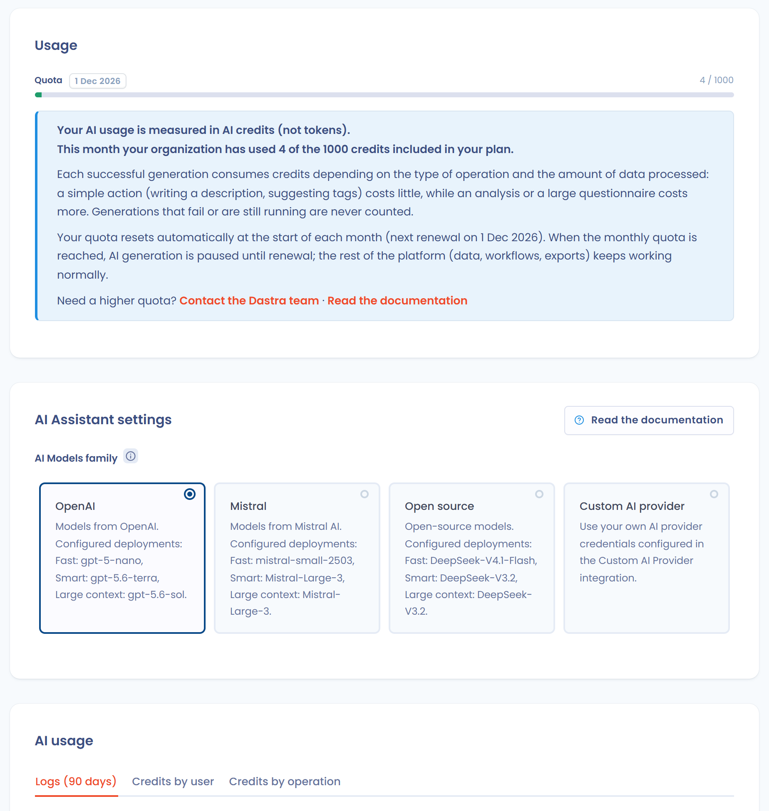
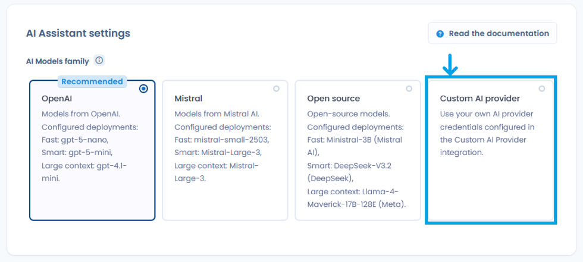
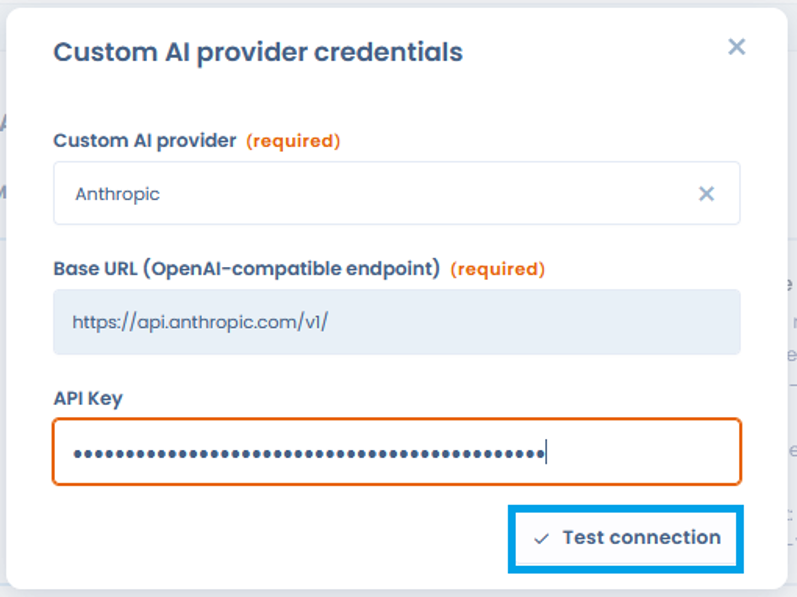
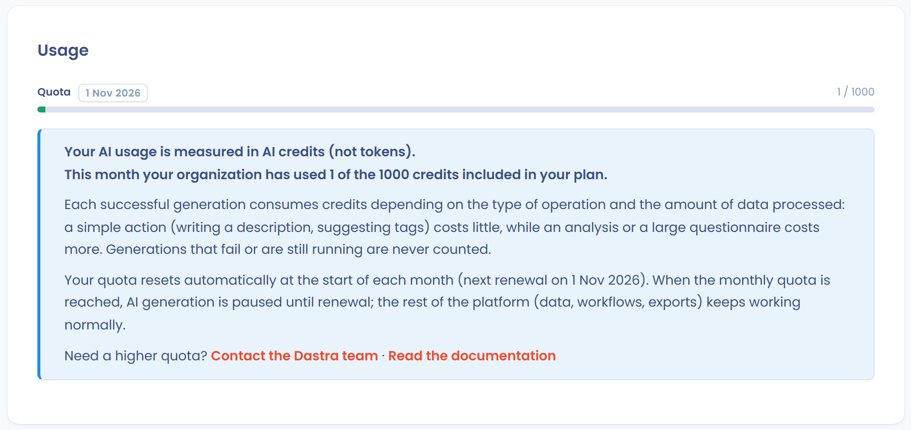

# How it works

## Models and hosting

<figure><figcaption>
Organization settings > Dastra AI: choose the model family and track credits
</figcaption></figure>

Dastra uses pre-trained generative AI models, available in four families to choose from:

| Family | Configured models | Hosting |
| --- | --- | --- |
| **OpenAI** _(recommended default)_ | Fast: gpt-5-nano · Smart: gpt-5.6-terra · Large context: gpt-5.6-sol | Azure, France / EEA |
| **Mistral** | Fast: mistral-small-2503 · Smart: Mistral-Large-3 · Large context: Mistral-Large-3 | Azure, France / EEA |
| **Open source** | Fast: DeepSeek-V4.1-Flash · Smart: DeepSeek-V3.2 · Large context: DeepSeek-V3.2 | Azure, France / EEA |
| **Custom AI provider** | Your own provider via API key _(see below)_ | Depends on your setup |

For the first three families, models are hosted on Microsoft Azure infrastructure in France. They are not operated directly by OpenAI or Mistral: Dastra uses Azure managed services, meaning **your data does not transit through OpenAI's or Mistral's own infrastructure**.


**Bleu offer.** On [Bleu](../../../security/bleu.md), the AI features do not go through Azure: they are run by Mistral AI, a French company outside the Bleu perimeter. The table above does not apply. Only the Mistral family is used, and any OpenAI or Open source preference is replaced by Mistral: Mistral Small for the Fast tier, Mistral Large for the Smart and Large context tiers. Dastra AI and agents use Mistral Medium, and voice dictation uses Mistral Voxtral.


For each family, three model tiers are used depending on task complexity:

* **Fast** (simple actions): generating descriptions, suggesting tags
* **Smart** (actions requiring more reasoning): generating structured objects in Dastra
* **Large context** (actions processing large volumes of data): answering a questionnaire, compliance analysis

The organization owner chooses the model family in **Organization settings** > **Dastra AI**, in the **AI Assistant settings** card, **AI Models family** field. The change is saved as soon as you select a family.

***

## Custom AI provider

<figure><figcaption>
The Custom AI provider among the model families
</figcaption></figure>

Dastra lets you connect your own AI provider with an API key, provided it is compatible with the OpenAI API standard. The providers offered are OpenAI, Google, Anthropic, Mistral and Azure AI Foundry. The **Other** option accepts any other compatible endpoint, including a self-hosted LLM. The custom provider applies to the generation features of the AI assistant (the buttons in each module). Dastra AI (chat), agents and the MCP server keep using Dastra's models.

To configure a custom provider, select the **Custom AI provider** family in **Organization settings** > **Dastra AI**. In the **Custom AI provider credentials** block, click **Add credential**, enter the provider and its API key, then assign a model to each of the three tiers (Fast, Smart, Large context).

For recognized providers, the **Base URL** is pre-filled: for Anthropic, it is `https://api.anthropic.com/v1/`. For Azure AI Foundry and for **Other**, you enter it yourself.

* The **Test connection** button verifies the validity of the credentials before saving.
* You choose the model to use for each tier, with a recommended model proposed by default.
* The API key is never displayed again in clear text, and credential management is reserved for organization owners.

<figure><figcaption>
Anthropic configuration: pre-filled Base URL, API key and "Test connection" button
</figcaption></figure>


When using a Custom AI provider, data sent to the model is subject to **your provider's** privacy policy, not the Azure guarantees described on this page. Review your provider's terms before enabling this option, especially if your prompts may contain personal data.


***

## What Dastra sends to the model

Dastra only transmits the information necessary for the requested generation: the text entered by the user, and where applicable the structured fields of the relevant object (processing activity, AI system, rights request, etc.).

The exact data transmitted per feature is detailed in the [What data is transmitted to the model](how-it-works.md#what-data-is-transmitted-to-the-model) section.

For some generation features, Dastra applies a filter before sending that masks the email addresses, phone numbers, postal addresses and postcodes it recognises in the text, as well as names preceded by a title (Mr, Mrs, Dr...). The filter follows European formats. It leaves dates, identifiers and standard numbers such as ISO 27001 untouched, so that the model keeps the business data it needs. This filter is not applied to every feature: in particular, it is not applied to Dastra AI, agents, AI Analysis or redaction. It does not guarantee that a text is anonymised: avoid entering unnecessary personal data.

**Voice dictation** in the Dastra AI message box sends your recording to a speech-to-text service, which returns the transcribed text. Dastra does not keep the recording. Dastra uses Azure Speech on the standard platform and Mistral Voxtral on [Bleu](../../../security/bleu.md).

***

## What Dastra does not do

The following points are contractually guaranteed by Microsoft Azure for all models in the OpenAI, Mistral, and Open source families:

* Your prompts and results are **not available** to other Azure customers
* Your data is **not transmitted** to OpenAI, Mistral, or any other third party
* Your data is **not used** to train or improve base models
* Models are **stateless**: no prompt is stored in the model between requests

***

## Abuse monitoring and human review

Microsoft Azure maintains an automated mechanism for detecting potentially abusive content. In exceptional cases where content is flagged, a sample of prompts may be temporarily retained in a customer-isolated storage environment for review purposes. For resources deployed in the EEA (which is the case for Dastra), any human reviewers involved are also located in the EEA.

This retention remains exceptional and does not apply to normal platform usage. For more details, see the [Microsoft documentation on Azure Direct Models data privacy](https://learn.microsoft.com/en-us/azure/ai-services/openai/concepts/data-privacy).


**Bleu offer.** This section describes Azure and does not apply to Bleu: requests are processed by Mistral AI, under its own terms. For the commitments that apply, refer to your Dastra contract or contact our team.


***

## AI usage logs

Dastra keeps a history of AI assistant calls. The **AI usage** card of **Organization settings** > **Dastra AI** shows the **last 90 days** in the **Logs (90 days)** tab, reserved for organization owners. For each call, the following information is recorded:

| Field | Description |
| --- | --- |
| **Date** | Timestamp of the call |
| **Status** | Success or failure of the generation |
| **Operation** | Type of prompt used |
| **Model name** | Name of the model used |
| **Credits** | Credits consumed. Only successful generations consume any |
| **Duration** | Processing time for the request |
| **User** | Workspace member who triggered the generation |

The **Credits by user** and **Credits by operation** tabs total the consumption of the current month.

## AI credits and quotas

Dastra measures AI assistant consumption in **AI credits** (not tokens). The quota is monthly and shared by all the workspaces of the organization: it depends on the plan and subscription, and renews automatically on the first day of each month. Conversations with Dastra AI and agent runs use the same quota.

A successful generation consumes credits according to the type of operation. A failed or running generation is never counted.

| Operation | Credits |
| --- | --- |
| Generating a processing activity, asset, stakeholder, dataset, security measure, AI system or AI model; privacy notice; tag suggestion; response to a rights request; contract metadata extraction; control and test suggestions; questionnaire template generation; AI system role justification; mapping or HTTP action suggestion | 1 |
| Risk analysis, business value analysis, DPIA criteria assessment, test evidence verification, data breach post-mortem, custom report | 2 |
| Answering a questionnaire and translating a questionnaire | 1 per 25 questions |
| Automatic document redaction | 1 per document segment sent |
| Message sent to Dastra AI or to an agent | 1 per message, whatever the number of tools used |

The **Usage** card of **Organization settings** > **Dastra AI** shows the consumption of the current month, the quota of the plan and the renewal date. The **progress bar** changes color according to the share of the quota consumed:

* **Green**: less than 80% of the quota
* **Orange**: from 80% to 99%
* **Red**: the quota is reached

When the monthly quota is reached, a message informs you and offers to contact the Dastra team.

In the Dastra AI panel, all users see the quota status: a discreet counter from 50%, an orange banner from 80%, then a red banner at 100%, which blocks sending new messages (the history stays available).

<figure><figcaption>
Tracking of current-month AI credit consumption
</figcaption></figure>


When the quota is reached, AI features are disabled until the next renewal. The rest of the platform (data, workflows, exports) continues to work normally.



**Custom AI provider: no credit counting for the AI assistant.** When your organization uses a Custom AI provider, the Dastra credit system does not apply to the generation features of the AI assistant. Consumption is managed directly by your own provider according to its own billing terms. Dastra AI and agents use Dastra's models: their messages still consume the credit quota and are blocked once it is reached.


***

## What data is transmitted to the model?


Dastra transmits **no data from your workspace** to the AI model unless you initiate it. Only the information listed below, depending on the feature used, is included in the request sent to the model.


| Feature                                           | Data transmitted to the model                                                                                                                                    | Potential personal data                                      |
| ------------------------------------------------- | ---------------------------------------------------------------------------------------------------------------------------------------------------------------- | ------------------------------------------------------------ |
| **Generate a processing activity**                | Free text entered by the user                                                                                                                                    | No, unless the user mentions individuals in the description |
| **Generate a processing activity with the Use existing elements option** | Free text entered by the user + labels of the existing security measures, assets and data fields in the workspace | No, unless existing labels contain named references |
| **Generate an asset**                             | Free text + the privacy policy URL provided                                                                                                                      | No                                                           |
| **Generate a stakeholder**                             | Free text + URL or attachment provided                                                                                                                           | No                                                           |
| **Generate a dataset**                            | Free text entered by the user                                                                                                                                    | No                                                           |
| **Generate a security measure**                   | Free text entered by the user                                                                                                                                    | No                                                           |
| **Generate a privacy notice**                     | Structured fields of the processing activity (purposes, legal basis, retention periods, recipients, rights)                                                      | Potentially, if the fields contain named references         |
| **Generate the DPIA criteria assessment** | Name, description, purposes, data subject categories (with vulnerability indication and maximum volume), datasets and their fields (including sensitive fields), assets and recipients of the processing activity | Potentially, depending on the processing activity content |
| **Generate a description**                        | Free text entered by the user                                                                                                                                    | No                                                           |
| **Suggest tags**                                  | Text content of the object (name, description)                                                                                                                   | No                                                           |
| **Generate a questionnaire template**             | Free text entered by the user                                                                                                                                    | No                                                           |
| **Answer a questionnaire (DPIA, risk analysis…)** | Structured fields of the linked processing activity + any custom instructions                                                                                    | Potentially, depending on the processing activity content   |
| **Generate a response to a rights request**       | First and last name of the requester, request message, language, workspace name, purposes, operator name, request date and days remaining, request status and ID | **Yes**: first name, last name and request content          |
| **Generate a data breach post-mortem**            | Structured fields of the breach (description, affected data, measures taken)                                                                                     | Potentially, depending on the breach record content         |
| **Extract contract metadata**                     | Text content of the transmitted document (attachment or URL)                                                                                                     | Potentially, depending on the contract content              |
| **Generate a custom report**                      | Instructions entered by the user                                                                                                                                 | No, unless the user includes data in the instructions       |
| **Risk analysis (AI system)**                     | Structured fields of the AI system (description, purposes, data processed, stakeholders)                                                                         | Potentially, depending on the AI system content             |
| **Generate an AI system description**             | Free text + URL or attachment provided                                                                                                                           | No                                                           |
| **Generate an AI system notice**                  | Structured fields of the relevant AI system                                                                                                                      | Potentially                                                  |
| **Suggest controls / requirements / tests**       | Context of the relevant object (name, description, framework)                                                                                                    | No                                                           |
| **AI analysis of test evidence (Compliance)**     | Test procedure description + evidence content (extracted text, image, or fetched URL)                                                                            | Potentially, depending on the evidence content              |
| **Generate the role justification (AI system)** | Name and description of the AI system, labels of the linked AI models, type of responsibility (provider, deployer…) | No, unless the name or description contains named references |
| **Generate the business value assessment (AI system)** | Name, description and AI models of the system, the organization's AI Act roles, labels of the linked processing activities, assets, categories of data subjects and datasets (with the labels of their fields) | Unlikely, unless a label contains a name |
| **Generate an AI model** | Free text entered by the user, text extracted from the attached files or from the URL provided | Potentially, depending on the content of the files or the page |
| **AI analysis of a record (processing activity, AI system, contract, asset, stakeholder, audit response summary)** | Content of the record and its comments, plus the linked records that the analysis reads with your permissions. The content of attachments is not transmitted | **Yes**: a record may contain names of owners or contacts |
| **Translate a questionnaire template** | All the texts of the template: titles, descriptions, sections, questions, answer options, suggested tasks and analysis blocks. Answers entered by users are not transmitted | No, unless the template mentions names or contact details |
| **Automatically redact a document (data subject request)** | Full text of the document, extracted by optical character recognition (OCR) and sent in blocks, with the free instruction if any. If you exclude the data subject, their name, email, phone number and address are also transmitted. Page images are not sent to the model. The masking filter is not applied, otherwise the data to redact could not be detected. Dastra does not log the text or the detected values | **Yes**: the text of the document contains personal data by nature, including that of third parties |
| **Generate a document from the file manager** | Instruction entered by the user | No, unless the instruction mentions people |
| **Workflow rule description** | Object type, trigger, action and conditions of the rule, and the text already entered | No, unless a condition contains a named value |
| **HTTP action of a workflow rule** | Object type, instruction, pasted API documentation excerpt, columns of the object (name, label, type, possible values) and the current configuration (URL with parameter values masked, method, header names without their values, request body). Never record data or credentials | Unlikely, unless the pasted documentation or the request body contains some |
| **Integration field mapping** | Connector, source fields and Dastra target columns (key, label, type, possible values), existing mapping rules. Metadata only, without sample data | No |
| **Chat with Dastra AI or an agent** | Your message and the conversation history, the agent's instructions, the values of its input fields, the result of the tools (content of the records you can access) and attachments. Images and PDFs are sent to the model; other formats are not read. The masking filter is not applied. Conversations are saved in Dastra, and you can delete them; attachments are kept for 180 days | **Yes**, depending on the records consulted and the attachments |

With the [MCP server](mcp.md), the data read is sent to the AI tool you connected, subject to its own terms, and not to a Dastra model.


**Bleu offer.** The data in the table is sent to Mistral AI, not to Azure. For Dastra AI and agents, attached images are sent to the model and other files are sent as extracted text. Automatic redaction uses Mistral's optical character recognition (OCR). Code execution in Dastra AI is not available.



**Best practice**: avoid including personal data directly in free text fields (descriptions, custom instructions). Use identifiers or generic terms where possible.


### Data that is never transmitted

The following are **never** part of the requests sent to the AI model:

* Dastra user credentials and passwords
* Data from other records in your workspace (only the object you are working on is in scope, except for Dastra AI, agents and AI analysis, which read the records they need with your permissions), except the labels of existing security measures, assets and data fields when you enable the **Use existing elements** option while generating a processing activity
* Session metadata (logged-in user name, IP address, etc.)
* Attachments not explicitly provided in the relevant feature

### Prompt retention

The Azure models used by Dastra are **stateless**: prompts and results are not stored in the model and are not used to retrain or improve base models.


**Exception: abuse detection**: Microsoft Azure maintains an automated mechanism for monitoring potentially abusive content. If a prompt is flagged, a sample may be temporarily retained in a customer-isolated storage environment for review purposes. For resources deployed in the EEA (which is the case for Dastra), any human reviewers involved are also located in the EEA. This retention remains exceptional and does not apply to normal platform usage.


For more information, see the [Microsoft documentation on Azure Direct Models data privacy](https://learn.microsoft.com/en-us/azure/ai-services/openai/concepts/data-privacy).
