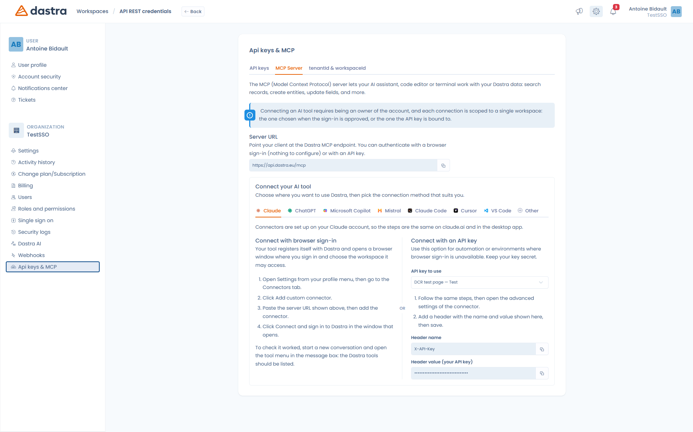

# The MCP server

The MCP (**Model Context Protocol**) server lets your AI assistant, code editor or terminal work with your Dastra data: search records, create entities, update fields, and more.

In other words, instead of coming into Dastra, you ask the tool you already use — Claude, ChatGPT, Microsoft Copilot, Le Chat, Cursor… — to do it for you.

Everything is configured in **Organization settings > Api keys & MCP > MCP Server** ([direct access](https://app.dastra.eu/general-settings/api)).

<figure><figcaption><p>Organization settings &#x3E; Api keys &#x26; MCP &#x3E; MCP Server</p></figcaption></figure>

***

### Before you start


**Three conditions must be met:**

* The MCP server is part of the **Dastra AI Pro** plan. If it is not included in your subscription, the tab stays visible but the connection is refused.
* Only an **account owner** can connect an AI tool.
* **Each connection is scoped to a single workspace**: the one chosen when the sign-in is approved, or the one the API key is bound to. To work on two workspaces, create two connections.


### Server URL

Point your client at the URL shown in the panel:

```
https://api.dastra.eu/mcp
```

The transport is **HTTP** (streamable). There is nothing to install locally: this is not a `stdio` server.


If your organization is hosted on the sovereign infrastructure, the URL is `https://api-bleu.dastra.eu/mcp`. Always use the URL shown in your own panel rather than copying it from this page.


***

## Choosing a connection method

Two methods work, and the panel presents both side by side for every tool.

### Browser sign-in (recommended)

Your tool registers itself with Dastra and opens a browser window where you sign in and **choose the workspace** it may access.

This is the method to prefer: there is no key to create, copy or store, and you can revoke access at any time.

### API key

Reserved for automation and environments without a browser. You add an HTTP header to the connector configuration:

| Header name | Value |
| --- | --- |
| `X-API-Key` | The private key of your API key |


**The API key must be bound to a workspace**, otherwise the MCP connection is refused. When creating the key in the **API keys** tab, fill in the **Select a specific workspace** field. Eligible keys carry an `MCP` badge in the list.


<figure><figcaption><p>The “Select a specific workspace” field is what makes a key usable for MCP</p></figcaption></figure>

The general procedure for creating a key is described in [API key management](../../settings/api-keys.md).

***

## Connecting your tool

The **Connect your AI tool** panel has one tab per tool, with the exact steps and the values to copy. Here is the essence.



Connectors are set up on your Claude account, so the steps are the same on claude.ai and in the desktop app.

1. Open **Settings** from your profile menu, then go to the **Connectors** tab.
2. Click **Add custom connector**.
3. Paste the server URL, then add the connector.
4. Click **Connect** and sign in to Dastra in the window that opens.

To check it worked, start a new conversation and open the tool menu in the message box: the Dastra tools should be listed.

For an API key connection, follow the same steps then open the connector's **advanced settings** and add the `X-API-Key` header.



Register the server with the command below, then start Claude Code and type `/mcp` to finish the connection:

```bash
claude mcp add --transport http dastra https://api.dastra.eu/mcp
```

With an API key, no interactive sign-in is needed:

```bash
claude mcp add --transport http dastra https://api.dastra.eu/mcp \
  --header "X-API-Key: YOUR_API_KEY"
```



Add the server to `~/.cursor/mcp.json`:

```json
{
  "mcpServers": {
    "dastra": {
      "url": "https://api.dastra.eu/mcp"
    }
  }
}
```



Add the server to `.vscode/mcp.json`:

```json
{
  "servers": {
    "dastra": {
      "type": "http",
      "url": "https://api.dastra.eu/mcp"
    }
  }
}
```



**ChatGPT** and **Microsoft Copilot** each have their own setup wizard: follow the steps of the matching tab in the Dastra panel. Copilot Studio uses the OAuth 2.0 **"Dynamic discovery"** option, which corresponds exactly to Dastra's browser sign-in mode.

**Mistral (Le Chat)** only supports **browser sign-in**: that tool does not send an `X-API-Key` header, so the API key method does not work.

For any other MCP-compatible client, use the **Other** tab: it gives you the server URL and the header to set.



***

## What your tool will be able to do

Once connected, your tool has around thirty Dastra tools at its disposal.

### Read-only tools

| Tool | What it does |
| --- | --- |
| Searching the workspace | Broad search across every record type — the usual starting point |
| Browsing records | Lists and filters the records of a given type |
| Reading a record | Fetches one record by type and identifier |
| Inspecting record structure | Describes the fields and columns of a record type |
| Checking editable fields | Says which fields can be updated, and in what format |
| Reading comments | Lists the comments of a record |
| Reading files | Lists the files of the workspace or of a record |
| Reading a file | Extracts the text of a PDF, DOCX, XLSX, HTML, TXT, CSV, JSON or Markdown file |
| Reading questionnaire | Fetches an audit template or a planned questionnaire with its questions |
| Reading organizational units | Returns the hierarchy of entities and departments |
| Listing users | Lists the members of the workspace |
| Listing tags | Lists tags, optionally filtered by type |
| Listing workflow steps | Lists the steps configured for a record type |
| Checking regulations | Queries the regulation corpus indexed by Dastra (GDPR, NIS2, DORA, ISO 27001…) with cited sources |
| Listing regulation categories | Gives the categories usable for regulation search |
| Searching documentation | Searches the Dastra documentation |
| Searching the web | Public web search, as a last resort |
| Analyzing the record | Produces a compliance analysis graded A to F, with improvement suggestions |
| Record links | Builds clickable Dastra web app URLs for records |

### Editing tools

| Tool | What it does |
| --- | --- |
| Creating a record | Creates an empty record |
| Drafting a record | Generates a complete record from a description and imports it |
| Updating record(s) | Updates up to 50 records at once |
| Changing workflow state | Moves a record to another stage |
| Adding a comment | Comments a record, mentions included |
| Creating an action plan | Creates up to 10 tasks linked to a record |
| Creating a tag | Creates a tag for a record type |
| Writing a document | Creates or updates a Markdown document in the file manager |
| Linking a file | Attaches an existing file to a record |
| Planning questionnaire | Instantiates a questionnaire from a template and assigns it |
| Updating questionnaire | Fills in the answers of a planned questionnaire |


The MCP server exposes **tools only**. It publishes neither *resources* nor *prompts* in the sense of the protocol: a client querying `resources/list` or `prompts/list` will get an empty list.


***

## Security

**Your tool never has more rights than you do.** The MCP server has no service account: it forwards your own key or your own token to the Dastra API. Every read and every write is therefore subject to the usual permissions of the user or of the API key.

A few points worth knowing:

* **Scope** — a connection only sees one workspace, in one organization.
* **Traceability** — writes performed through MCP are identified as coming from an AI agent. The last-used date of each key is visible in the API key list.
* **Revocation** — a connection approved from the browser becomes an ordinary API key, visible and revocable in the **API keys** tab. Deleting the key cuts access immediately.
* **Rate limits** — calls are limited to 60 requests per minute on the MCP server, and 120 requests per minute across all uses. Beyond that, the server answers a `429` error stating how long to wait.


An API key used for MCP grants read **and write** access to an entire workspace. Treat it like a password: never publish it, and revoke it at the slightest doubt.


***

## Troubleshooting

| Symptom | Likely cause |
| --- | --- |
| The connection is refused with a subscription message | The MCP server is not included in your plan — it requires Dastra AI Pro |
| "API key must be bound to a specific workspace" | The key was created without a workspace: create a new one and fill in that field |
| No Dastra tool appears in your client | The connection was not completed. In Claude, open the connector and click **Connect**; in Claude Code, type `/mcp` |
| Le Chat refuses the API key | Expected: Le Chat only supports browser sign-in |
| You have to sign in again constantly | Long-lived access was not granted: remove the connector and connect again |
| `429` error | You exceeded the rate limit; retry after the stated delay |

***


[README.md](agents/README.md)

