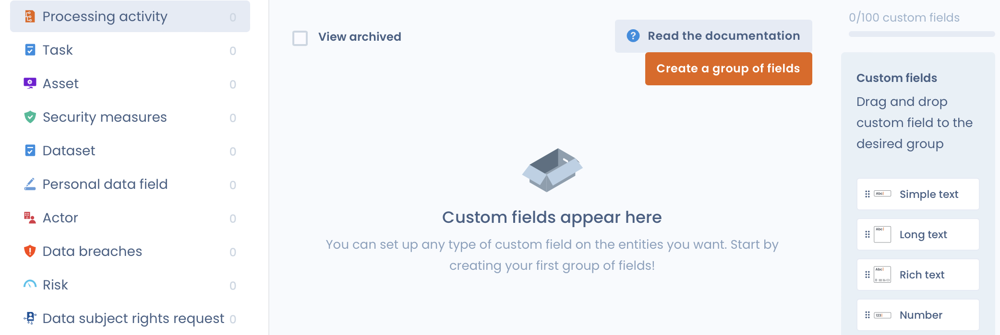
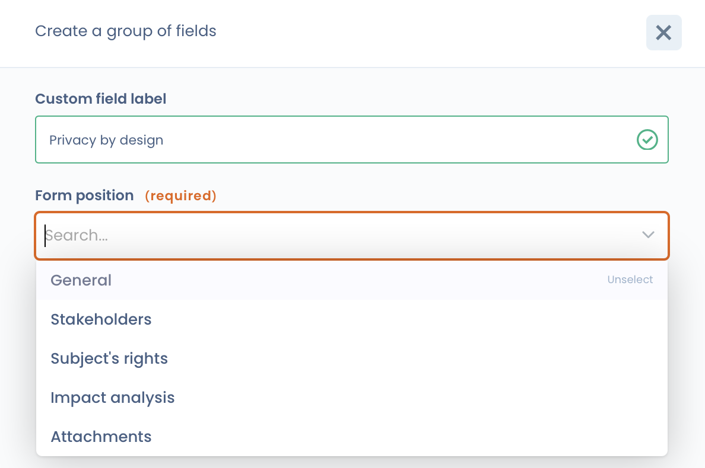
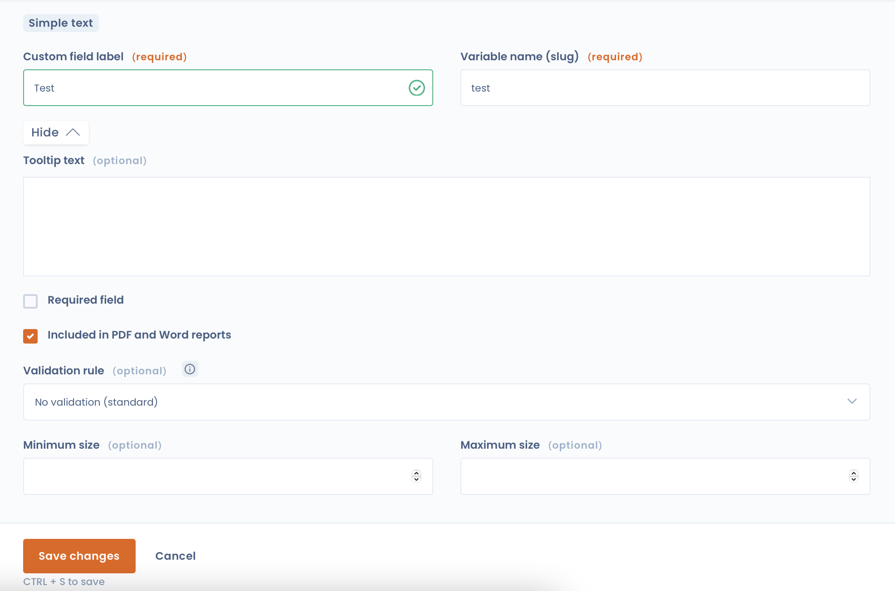

# Custom fields


This feature is still in beta. It may still have some instabilities.


## When to use custom fields?

Some specific industry information may not be included in the default fields of the ROPA, like DSR and tasks.

With Dastra, you can create custom form fields to easily enhance the inputted data.

## Functionalities concerned


Please note! Not all features are concerned by custom fields


You can customize the following forms:&#x20;

* [Processing activities ](../ropa/README.md)
* [Data subject right request](../requests/README.md)
* [Tasks](../tasks/README.md)&#x20;
* [Assets](../ropa/activity/assets.md)&#x20;
* Actors&#x20;
* Measures&#x20;
* Data sets&#x20;
* Data fields&#x20;
* [Incidents](../incidents/README.md)
* [Risk assessments](../risks/attach-to-processing.md)
* [AI Systems](../ai-systems/README.md)
* [Contrats and policies](../contracts/README.md)
* [Controls points](../risks/process/monitor.md)


**Limitations on the number of custom fields**

The number of custom fields is limited depending on your chosen plan. Please visit the application's pricing page for more information.


## Available field types

Dastra offers several types of custom fields:&#x20;

* Simple text&#x20;
* Long text&#x20;
* Rich text&#x20;
* Whole number&#x20;
* Decimal number&#x20;
* Date&#x20;
* Date and time&#x20;
* Check box (multiple response) (**unfilterable**)&#x20;
* Check box (single response)&#x20;
* Single selector&#x20;
* Multiple selector (**unfilterable**)&#x20;
* Check box (Yes/No)

## Using custom fields

You can:&#x20;

* View and edit custom field data in the forms of each module&#x20;
* Custom fields can be displayed in all the application's visualization tables. To display them, click on the table column settings button
* Custom fields are **present in all Excel data exports**. For more information on exports, see [the page on exports](../ropa/export-import.md)&#x20;
* Custom fields can be present in HTML, Word and PDF exports as an option (by checking the "Exportable in reports" box on the field in question)&#x20;
* **With the exception of multiple response fields**, custom fields are all filterable via the [advanced filter system](filters.md)
* Custom fields can be updated en masse in data tables&#x20;
* Custom fields can be imported via flat files using [the import system](import.md)&#x20;
* Custom fields **are accessible and modifiable via all APIs**. To do this, you will need to use the variable name assigned to each column. See the section on [API modifications of custom fields](custom-fields.md#handling-custom-fields-in-apis)

## Setting up custom fields

* Go to your **Workspace**
* Click on the **Workspace Settings** menu on the left
* Click on the **Custom fields** menu
* Choose the module in which you want to add a custom field
* Fields must be created in groups. These groups can be positioned in a certain way in the form Click on "**Create a group of fields**"

<figure><figcaption></figcaption></figure>

**Fill in the name and location** in the form that you want

<figure><figcaption></figcaption></figure>

For some elements, it is possible to define the location you want in the form!&#x20;

* Once the group is created, you can now **drag and drop the field types** you want to set up!

<figure><figcaption></figcaption></figure>

Fill in all the information! Click on save and that's it!&#x20;

* Your first personal data field is in place!&#x20;
* You can drag and drop to reorder the fields as you see fit.

## Handling custom fields in APIs

### Dastra API Guide

Dastra allows you to retrieve, modify, and create entity values, including custom fields, via the REST API. A "customFields" property is available in all entities you retrieve using the GET method in Dastra.

```json
 {
   "id": 1234,
   "label": "Test asset",
   etc...
   "customFields": {
     "dpo_name":"jean-marc le dpo",
     "dpo_email":"dpo@github.com",
     "dpo_habilitations": ["Expert","Consulting","Data Mapping"],
     "has_large_dataset":false,
     etc...
   }
 }s
```

To modify this property, you need to post (POST) or update (PUT) the element by modifying the elements of the collection. To gather the names of the custom variables, go to the custom fields configuration page.


**Attention:** All custom fields will be validated by the server. If a colonen is not present in the configuration, it will be automatically deleted. If a field is not valid (for example, if it's not filled in even though it's marked as mandatory), an exception with the code 400 will be raised.


## Limitations

You cannot **filter custom fields of the multiple types (checkbox (Multiple) and selector (Multiple))**. This is a known limitation that we are working on.
