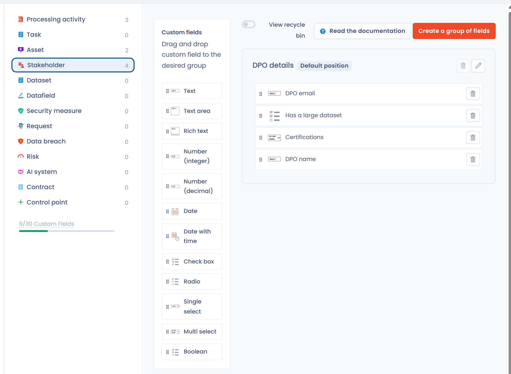

# Custom fields

## When to use custom fields

Some information specific to your industry is not included in the default fields of the ROPA, data subject requests, tasks, etc. Custom fields let you create your own form fields to enrich the data you enter.

Here is an example of a field configuration for a stakeholder:

<figure><figcaption><p>Field configuration of a stakeholder</p></figcaption></figure>

And here is the result in the form:

<figure><figcaption><p>The custom fields in the stakeholder form</p></figcaption></figure>

## Functionalities concerned

Custom fields are not available in every module. You can customize the following forms:

* [Processing activities](../ropa/README.md)
* [Data subject requests](../requests/README.md)
* [Tasks](../tasks/README.md)
* [Assets](../ropa/activity/assets.md)
* [Stakeholders](../ropa/activity/stakeholders.md)
* [Security measures](../ropa/activity/security.md)
* [Datasets](../ropa/activity/datasets.md)
* Data fields
* [Data breaches](../incidents/README.md)
* [Risk assessments](../risks/attach-to-processing.md)
* [AI systems](../ai-systems/README.md)
* [Contracts and policies](../contracts/README.md)
* [Control points](../risks/process/monitor.md)


**Limit on the number of fields.** The number of custom fields depends on the plan and subscription of your organization. A quota indicator is shown on the configuration page. For more information, see the [pricing page](https://www.dastra.eu/en/pricing).


## Available field types

Dastra offers the following field types:

| Type | Use |
| --- | --- |
| Text | One line of text |
| Text area | Text on several lines |
| Rich text | Text with formatting |
| Number (integer) | A number without decimals |
| Number (decimal) | A number with decimals |
| Date | A date |
| Date with time | A date and a time |
| Check box | Several answers possible from a list of choices |
| Radio | A single answer from a list of choices |
| Single select | One value chosen in a drop-down list |
| Multi select | Several values chosen in a drop-down list |
| Boolean | A Yes or No answer |

## Using custom fields

Once created, custom fields work like the native fields:

* They are displayed and edited in the forms of each module.
* They can be displayed in all the tables of the application: click the **Customize columns** button of the table. They are hidden by default.
* They are **present in all Excel data exports**. For more information on exports, see [the page on exports](../ropa/export-import.md).
* They are present in PDF and Word reports when the field has **Included in PDF and Word reports** ticked (ticked by default).
* They can be filtered with the [advanced filters](filters.md). **Check box** and **Multi select** fields cannot be used to sort a list, however.
* They can be updated in bulk in data tables.
* They can be imported from flat files with the [import system](import.md).
* They are **accessible and editable through all APIs**, using the variable name assigned to the field. See [Handling custom fields in APIs](custom-fields.md#handling-custom-fields-in-apis).

## Setting up custom fields

1. In the sidebar, click **Workspace settings**, then **Custom fields**.
2. In the list on the left, choose the module in which to add a custom field.
3. Fields are created in groups. Click **Create a group of fields**.
4. Fill in the **Custom field label** of the group and its **Form position**. For some modules, such as the processing activity, you can choose the step of the form where the group is displayed.

<figure><figcaption><p>Creating a field group</p></figcaption></figure>

5. Once the group is created, drag a field type from the **Custom fields** list into the group. The field window opens.
6. Fill in the options of the field (see below), then save.

<figure><figcaption><p>The options of a custom field</p></figcaption></figure>

You can reorder fields, or move them from one group to another, by drag and drop. A group can only be deleted once it no longer contains any field. A deleted field goes to the recycle bin: turn on **View recycle bin** to restore it.

### Field options

| Option | Description |
| --- | --- |
| **Custom field label** | The name of the field shown in forms. Required. |
| **Variable name (slug)** | The identifier of the field for APIs and imports. It is suggested from the label and cannot be changed once the field is created. |
| **Tooltip text** | A help text shown next to the field. |
| **Required field** | Makes the input mandatory. |
| **Included in PDF and Word reports** | Adds the field to the generated reports. Ticked by default. |
| **Validation rule** | For Text fields: checks that the input follows a syntax (email, URL) or a **Custom regex** (JavaScript format). |
| **Minimum size** and **Maximum size** | Length of the input for text fields. |
| **Minimum value** and **Maximum value** | Bounds for numeric fields. |
| **Possible answers** | For types with a list of choices: one row per choice, with a color. **Add answer** adds a row; pasting text that contains one option per line creates one answer per line. |

The label and the variable name of a field must be unique within a module.

## Handling custom fields in APIs

Dastra lets you retrieve, modify and create, through the [REST API](../../api/configuration.md), all the values of entities that include custom fields.

A `customFields` property is present in every entity you retrieve with a `GET`:

```json
 {
   "id": 1234,
   "label": "Test asset",
   etc...
   "customFields": {
     "dpo_name":"jean-marc le dpo",
     "dpo_email":"dpo@github.com",
     "dpo_habilitations": ["Expert","Consulting","Data Mapping"],
     "has_large_dataset":false,
     etc...
   }
 }
```

To modify this property, send the element with `POST` or `PUT`, updating the elements of the collection. The variable names to use are listed on the custom fields configuration page.


All **custom fields are validated by the server**. If a column is not present in the configuration, it is automatically removed.

If a field is not valid (for example, if it is empty although it is marked as required), the API returns an error with the code 400.

