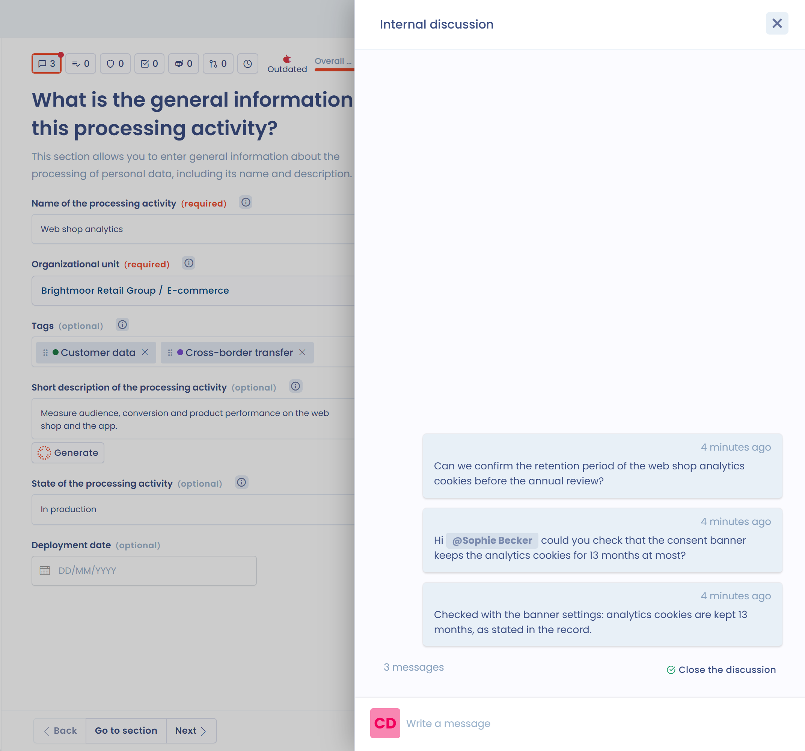
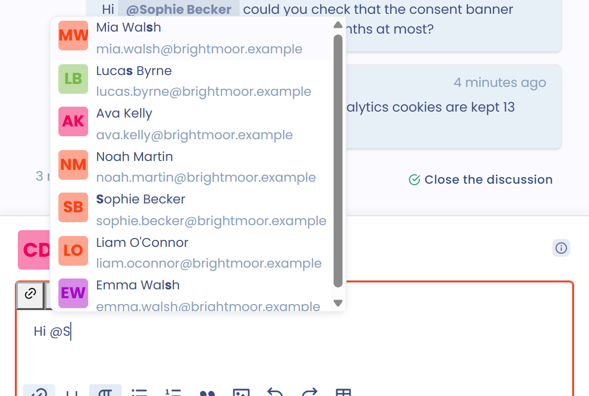
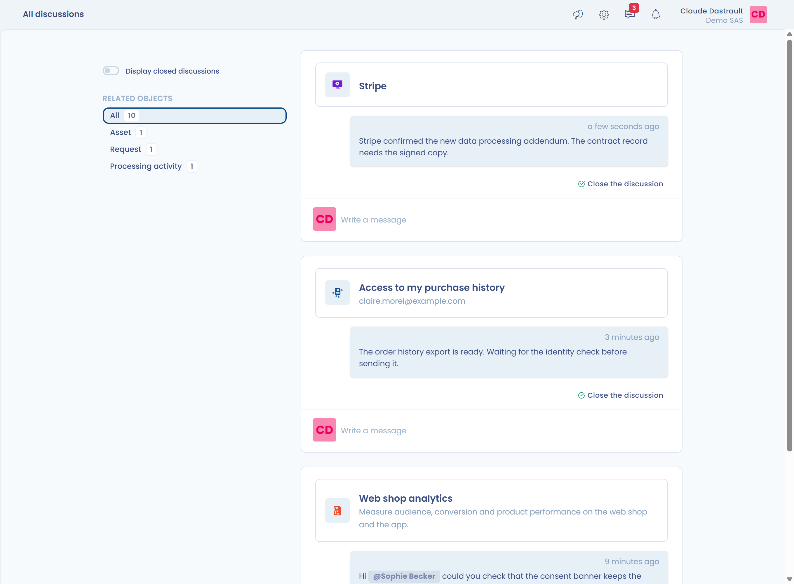

# Internal discussions

Internal discussions work like a chat attached to an element of Dastra: processing activity, data subject request, task, data breach, stakeholder, asset, dataset, data field, control point, risk assessment, contract, AI system, compliance project or audit, questionnaire response. Each element has a single conversation.

## How it works

1. Open the record of the element concerned.
2. Click the **Internal discussion** button, a speech bubble with the number of messages. The thread opens in a panel on the right.

<figure><figcaption>
The Internal discussion button and the discussion thread of a record
</figcaption></figure>

3. Click the **Write a message** area and type your message. The **Add an attachment** button attaches a file, by click or by drag and drop.
4. Click **Send**, or press **CTRL+Enter**.

An unsent draft is kept in your browser and restored when you reopen the panel. You can edit or delete your own messages from their menu. An edited message shows **Last edit** followed by the date.

## Mentions

Mention the users concerned with the **@** character. A list of the users of your workspace appears and narrows as you type.

<figure><figcaption>
The list of users suggested after @
</figcaption></figure>

A mention triggers an immediate notification to the user concerned.

## Quotes

You can reply directly to a specific message, to keep the context readable in a long thread.

1. Hover over the message you want to reply to and click **Reply**. This button is available on other users' messages.
2. A **Replying to** banner with the author's name appears above the text area, with a preview of the quoted message. Its author is mentioned automatically in your reply, which triggers their notification.
3. Type your message, add any attachments, then click **Send**.

To remove the quote while keeping your message in progress, click the trash icon of the banner. You can also remove the mention if you do not want to notify the author.


A message can only quote one message at a time. The quote is kept if you edit your message afterwards.


Once published, the quoted message appears in a banner above your reply. If the quoted message is deleted later, the banner shows **This message has been deleted**: your reply stays visible.

## Notifications

For each new message, Dastra notifies:

* the users mentioned in the message, immediately;
* the people responsible for the element (for example its owner, its operator or the person it is assigned to, depending on the element type), except the author of the message.

The **Notified users** line under the input area shows how many people will receive your message and lists them. How each user receives notifications depends on their preferences: see the [Notifications](../settings/notifications.md) page.


If you use Slack, mentioned users can also be notified by the Dastra bot in Slack, provided their Dastra email address is the same as in Slack. See [Integrations](../integrations/README.md).


## Opening and closing the conversation

As soon as a message is sent on an element with no ongoing conversation, or after a closure, the conversation is open. The **Internal discussion** button then shows a small red dot.

<figure><figcaption>
The red dot flags an open conversation, the green dot a closed one
</figcaption></figure>

When the exchange is over, click **Close the discussion** at the bottom of the thread. This button is reserved for users who have the **Discussions** permission in their role. The dot turns green, and the thread shows **Discussion has been closed by** followed by the person's name. A user with the same permission can click **Cancel** to reopen the conversation.

## Conversation hub

The hub gathers all the conversations of your workspace. You can answer your users' questions there while accessing the records concerned.

To open it, click the speech bubble icon (**All discussions**) in the top bar. A red badge shows the number of open conversations.

<figure><figcaption>
The All discussions icon and the conversation hub
</figcaption></figure>

On the hub page:

* the left column lists the object types that have conversations; select one to filter;
* turn on **Display closed discussions** to include closed conversations;
* each conversation is shown as a card with the name of the element, a link to its record, its latest messages and a reply area.
