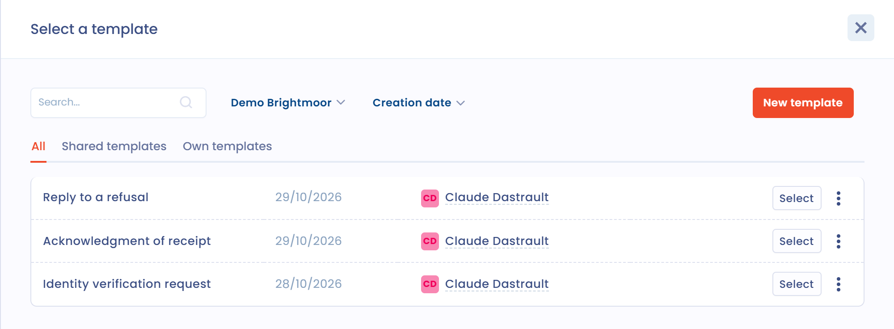
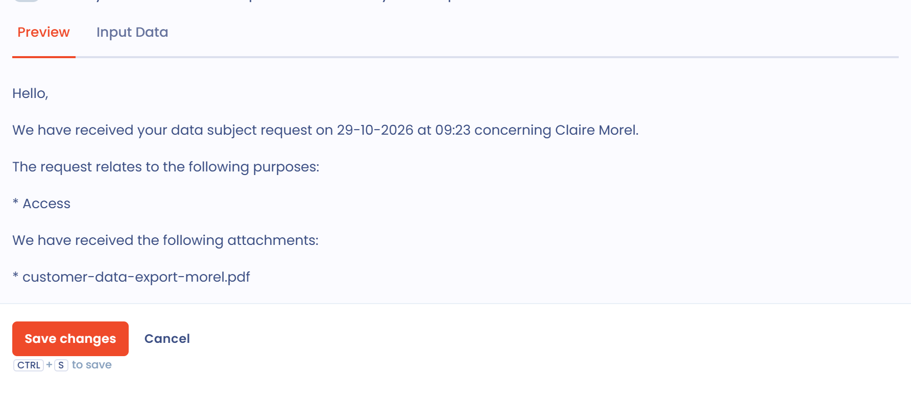

# Email templates

## General

Message templates are available in data subject requests, tasks, questionnaire invitations, invitations to complete a processing activity or a data breach, and workflow rules that send a message. Once saved, they are a quick way to communicate with stakeholders. The data of the object concerned can be inserted in the text, with conditions and loops to retrieve more information.

This page explains how to write a template. For template types, sharing, import and export, see the [Message templates](../settings/message-templates.md) page.

## How to use

To use a template, click **Select a template** next to the message writing area.

<figure><figcaption><p>The Select a template button in a data subject request</p></figcaption></figure>

The **Select a template** panel opens. Search the list for a template, open the **Shared templates** or **Own templates** of each type, or choose another workspace that you have access to. Click **Select** next to the template you want.

<figure><figcaption><p>The panel to select a template</p></figcaption></figure>

If no template fits, click **New template**. The creation window includes:

* the **Name** of the template, so that you can find it later;
* the **Template body**, the input area;
* the option to share the template with all the users of the workspace;
* the **Preview** tab, which displays the rendering of the message in real time;
* the **Input Data** tab, which displays the data of the object concerned by the template.

The **Preview** and **Input Data** tabs only appear if you create the template from the place where you write the message, not from the settings.

<figure><figcaption><p>The template creation window</p></figcaption></figure>

## Customize the template

In the template body, you can apply styles and insert images or tables. The result appears in the **Preview** tab.

To insert a piece of data from the object, click the braces icon of the toolbar (**Insert dynamic fields**) and choose a field in the list. The value of the field is inserted at the cursor.

<figure><figcaption><p>Inserting a dynamic field</p></figcaption></figure>

## Dynamic fields

Fields surrounded by double braces are variables: they are replaced by the values of the corresponding object (here a data subject request).

### Use a field from the Input Data

The **Input Data** tab lists the properties of the linked object. To display the message of the request, for example:

1. Find the field in the **Input Data** tab.
2. Enter its name in the template body with the syntax `{{message}}`.
3. Check the result in the **Preview** tab.

You can go further with loops, conditions and date formats.

### Conditions

A conditional block is only displayed under certain conditions. It starts with an `if` tag and ends with an `endif` tag. For example:

```liquid

  You have an attachment

```

The block is only displayed if the request contains an attachment.

### Loops

Loops work in the same way, with a variable internal to the loop:

```liquid

  {{ purpose }}

```

In this example, the loop goes through the `purposes` list and displays each item in the `purpose` variable.

### Date format

The dates of the Input Data are not presentable as they are. Apply a format to them:

```liquid
{{ dateCreation | date: "%d-%m-%Y at %H:%M" }}
```

This template gives, for example, 15-03-2023 at 15:40.

### A more complete example

The body text below uses all the elements above:

```liquid
Hello,

We have received your data subject request on {{ dateCreation | date: "%d-%m-%Y at %H:%M" }} concerning {{ givenName }} {{ familyName }}.

The request relates to the following purposes:

* {{ purpose }}



We have received the following attachments:

* {{ attachment.fileName }}



We will keep you informed of the progress of your request.

Kind regards,
{{ operator.displayName }}
```

For the request currently being processed, the message is transformed as follows:

<figure><figcaption><p>The rendering of a complete template</p></figcaption></figure>

## Going further

Templates use the Liquid syntax. See the [Liquid documentation](https://shopify.github.io/liquid/) for the list of tags and filters.
