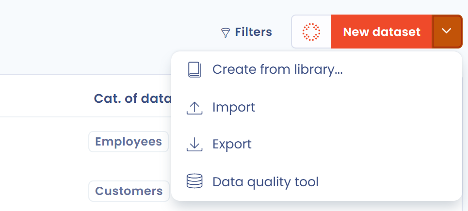

# FAQ

## How do I import datasets?

1. Open **Data inventory** > **Repositories** > **Datasets**.
2. Click the arrow of the **New dataset** button, then **Import**.

<figure><figcaption>
The Import entry of the create button menu
</figcaption></figure>

3. Click **Download the file template**, then **View columns format** to see the expected values.
4. Fill in the template, then drop the file in the upload zone.

For conflict handling, column mapping and the import of associated data fields, see the [Import your data](import.md) page.
