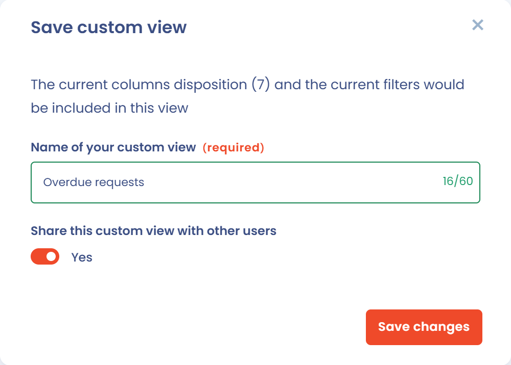

# Advanced filters



## Use

Advanced filters let you filter your data on almost any field of your entities.

1. Go to a Dastra module, for example the data subject requests module.
2. Click the **Filters** button at the top right of the data table.
3. In the window that opens, apply one of the most commonly used standard filters: the table updates automatically.

<figure><figcaption><p>The standard filters of a data subject requests list</p></figcaption></figure>


Filters add up.

_For example: if you filter on the tags "complex" and "pending" and on the organizational unit "Contoso", the table shows the rows that have both tags **and** that are in the organizational unit "Contoso"._


4. If no standard filter fits, click **Add filter** to build the combination of conditions that suits your need.

Every change applies immediately. The **Reset filters** button puts the table back in its initial state.

Dastra keeps the filters you select: if you change pages or refresh your browser, they are retained. They are specific to your browser, to the list and to your workspace, and are stored in your browser's **LocalStorage**.

## Customize columns

The **Customize columns** button, in the last cell of each list header, lets you choose which columns are displayed (**Visible columns** and **Hidden columns**), including custom fields, and set their order. Click **Apply** to confirm, or **Reset** to go back to the original selection.

You can also reorder columns directly from the list header: when you hover over a column header, a drag handle appears to the left of the column name. Drag the column to the desired position: the new order applies immediately. Some fixed columns cannot be moved.

Hovering over a column header shows the additional explanation of the column, when one exists. Your column selection is saved on your account.

## Custom views

A **custom view** saves the current state of your filters and your column selection under a name. The view selector is at the top left of each list: it shows **Default view**, or the name of the active view followed by an asterisk when you changed it without saving.

To create a view:

1. Apply the desired filters and column selection.
2. Open the view selector and click **Save custom view**.
3. Enter the **Name of your custom view** and confirm.

<figure><figcaption><p>The custom view selector</p></figcaption></figure>

The selector lists **Default view**, which resets filters and columns, your own views under **My views** and your colleagues' views under **Shared views**. Hover over a view to edit it (pencil) or delete it (trash). When the active view has been modified, the **Update** entry replaces it with the current filters and columns.

To **share a view** with the other users of your workspace, turn on **Share this custom view with other users** when you save it. The option is only offered to users with advanced access, who are also the only ones who can edit or delete a shared view.

<figure><figcaption><p>Saving a custom view, with the sharing option</p></figcaption></figure>

Custom views are available in most lists: data subject requests, record of processing activities, assets, contracts, AI systems, data breaches, etc.

## Condition groups

Advanced filters let you combine conditions with the **And** and **Or** operators within a single filter.

### Principle

By default, all the conditions of a filter are linked by **And**: a row must satisfy _all_ the conditions. As soon as a group contains at least two items (conditions or groups), an **And** button appears on its border: click it to change it to **Or**, and back. Each group has its own operator, and so does the filter as a whole.

Example:

```
Group 1: status = "In progress" AND priority = "High"
OR
Group 2: status = "Overdue"
```

This filter shows all in-progress, high-priority requests, and also all overdue ones, whatever their priority.

### Create a group of conditions

1. Open the filters window and click **Add filter**.
2. Click **Add a condition**, then choose the field, the comparison operator and the value.
3. Click **Add a group of conditions** to create an independent block, then add its conditions.
4. Click the **And** or **Or** button to choose how the conditions of a group, or the groups among themselves, are combined.
5. Delete a condition or a group with the trash icon.

<figure><figcaption><p>Two condition groups connected by Or, with the Add a condition and Add a group of conditions buttons</p></figcaption></figure>


A group cannot contain another group, and a filter holds at most 10 conditions. Filters and custom views created before groups remain usable.


## Known problems

### My data is no longer displayed

If a filter makes you lose the display of your data, clear your browser data (cookies, LocalStorage, etc.). This resets the filters and the active view of your workspace. You can also click **Reset filters**, then choose **Default view**.

### Some columns are missing from the advanced filters

For technical reasons, some columns cannot be filtered. In that case, export the raw data and build your report in a tool such as Excel.

If a filter is essential to your business, submit a feature request [via the Dastra community or the request system](../../getting-started/support/request.md).
