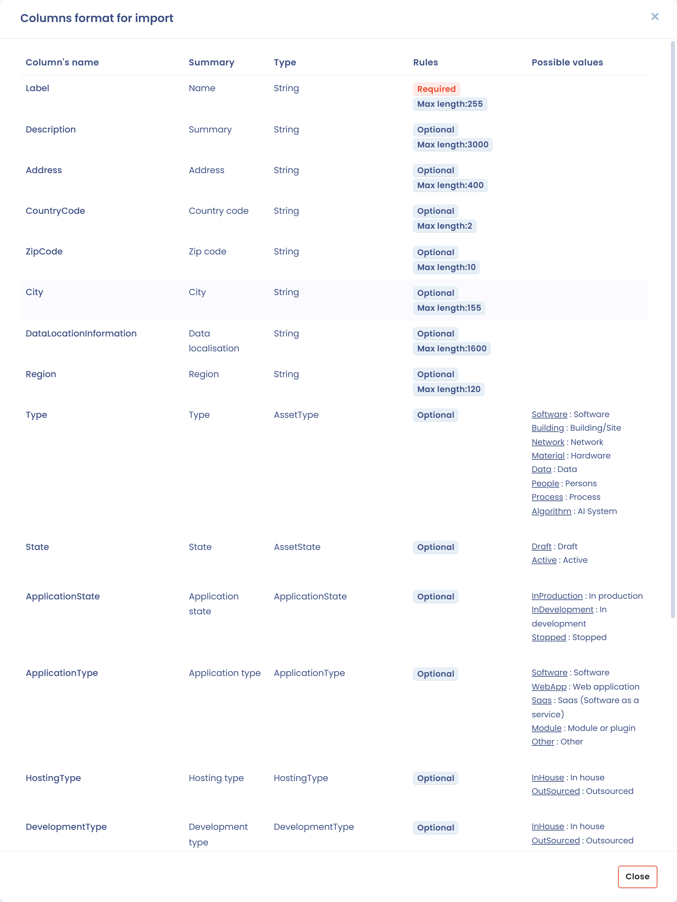
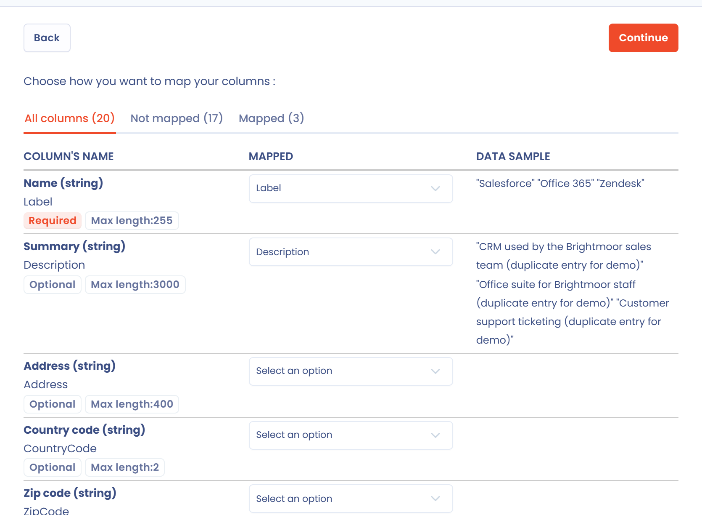
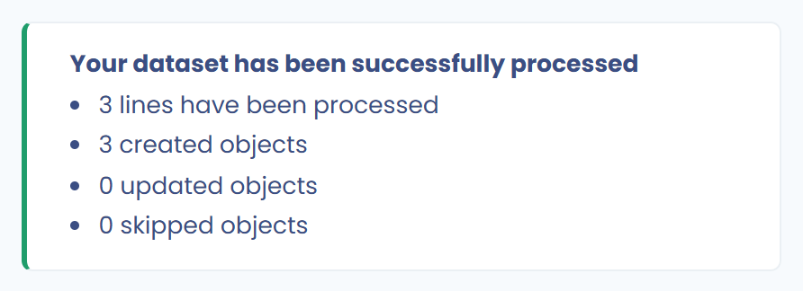

# Import your data (Excel, Csv)



## Importing data into Dastra

Dastra imports your own data from a spreadsheet file. In each list that supports it, start the import from the arrow of the create button, then **Import**.

<figure><figcaption>
The Import entry of the create button menu
</figcaption></figure>

The following objects can be imported:

| Object | Where to import | Note |
| --- | --- | --- |
| Processing activities | Data inventory > ROPA > Record of processing activities | Flat file (CSV), complex Excel workbook (beta) or JSON |
| Assets | Data inventory > Repositories > Assets | Excel or CSV, or JSON |
| Stakeholders | Data inventory > Repositories > Stakeholders | |
| Datasets | Data inventory > Repositories > Datasets | |
| Data fields | Data inventory > Repositories > Data glossary | |
| Security measures | Data inventory > Repositories > Measures | |
| Categories of data subject | Data inventory > Repositories > Cat. of data subject | |
| AI systems and AI models | Data inventory > AI governance | |
| Data subject requests | Operations > Requests > Record of requests | |
| Data breaches | Operations > Incidents > Record of incidents | |
| Tasks | Operations > Tasks > Tasks | Projects are imported in JSON from **Projects** |
| Contracts and policies | Operations > Contracts & policies > Record of contracts & policies | |
| Risk types, threats, sources, control points and events | Governance > Risk management | |
| Questionnaire templates | Governance > Questionnaires > Questionnaire templates > **Create a template** > **Upload file** | Excel file or JSON file |
| Questionnaire responses | Response list of a template > **Plan questionnaire** > **Import responses** | |
| Frameworks, controls, tests, threats and risks of the library | Governance > Compliance > Library | See [Dastra import and templates](../compliance/library/frameworks/import.md) for frameworks |
| Tags | Workspace settings > Process > Tags | |
| Message templates | Workspace settings > Message templates | |
| Organizational units | Workspace settings > Access management > Organizational units | CSV file |

In each import, the process is the same. It is done in 4 steps:

1. [Preparation of the data file](import.md#1.-preparation-of-the-data-file)
2. [Downloading the file](import.md#2.-load-the-file)
3. [Checking data before import](import.md#3.-check-your-data)
4. [Importing the data](import.md#4.-import-the-data)

### 1. Preparation of the data file

Dastra supports the following data formats:

* **Excel** (.xlsx)
* **Flat files** (.csv, .txt) with separator ; and UTF-8 encoding (the encoding matters in order to keep accents)
* **JSON**, for the full record, assets, projects, questionnaire templates and compliance frameworks

Some lists ask you to choose the format before the import wizard opens. For the record of processing activities, **Flat file** opens the wizard described below.

#### Downloading the file template

In the import wizard, click **Download the file template**. The template is a **CSV file** that you can edit with Excel, LibreOffice or Google Sheets. It contains all the columns of the import with one row of sample data, to be replaced with your data.

#### Filling in the file template

Fill the downloaded file with your data. For each import, the **View columns format** button shows the expected columns, their rules and their possible values.

<figure><figcaption>
The column format expected by the import
</figcaption></figure>

The possible values are given in English: this is a technical import into the database. They correspond to the drop-down lists of the application.

For example, in the record import:

* the `State` column is the status of the processing activity: `Draft` for **Draft** and `Active` for **Published**. If the cell is empty, the processing activity is created with the **Published** status;
* the `ProcessingState` column is the **State of the processing activity** field of the **General** step: `Study` for **To study**, `BeingDeployed` for **Being deployed**, `InProduction` for **In production** and `Stopped` for **Stopped**.

A value that matches none of the possible choices does not block the import: it is replaced with the default value of the column. Check your values before sending the file.

### Datasets: import of associated fields

The export of datasets contains a **Personal data fields** column that lists the associated data fields. Each field is written `label#sensitivity classification#personal data category`, and fields are separated by `|`. The same format is used for the import.

During the import, for each **new** dataset:

* a field whose label already exists in the workspace is linked as it is: the classification and category in the file do not change it;
* a field whose label does not exist is created automatically.


Associated fields are only read for datasets created by the import. In **Merge** mode, the fields of an existing dataset are not modified.


To import datasets, open **Data inventory** > **Repositories** > **Datasets**, click the arrow of the **New dataset** button, then **Import**.

### 2. Load the file

In the import wizard, some objects first ask for an organizational unit: all imported items are attached to it. This applies to processing activities, requests, data breaches, tasks, contracts and AI systems.

<figure><figcaption>
The Data importing step, with conflict handling
</figcaption></figure>

#### Conflict handling

For objects that have a matching key (for example the label or the reference), the **Conflict handling** group decides what happens when a row of the file matches an existing record. The three modes are:

* **None : Create a record for each file row** (default): each row creates a new record, even if an identical record already exists;
* **Merge : Overwrite row matching specific criteria**: rows that match an existing record update it, and the other rows create new records;
* **Preserve : skip records matching a specific criteria**: rows that match an existing record are skipped and that record stays untouched, and the other rows create new records.

With **Merge** or **Preserve**, choose the **field to use for data matching**. A row matches a record when the value of this field is strictly identical (uppercase and lowercase included) in the file and in the workspace.


The **Merge** mode replaces the stored values with those of the file. An empty cell leaves the existing value unchanged, except in columns with a mandatory choice (for example the type or status of an asset), which then take their default value: always fill them in. Check your file before starting the import, because the operation cannot be undone.


Objects without a matching key, such as tags, message templates, requests or risk types, do not show this group. For data breaches the group is displayed but every row always creates a record. Imports of the compliance library skip the rows whose reference already exists, whatever the mode.


For **assets**, the **Merge** mode also updates **custom fields**, whatever their type. As for native columns, an empty cell leaves the stored value unchanged, and a multiple-answer list fully replaces the existing list. If a value is rejected, the import stops without changing anything and states the row concerned.


#### Sending the file

Click the **Upload or drag file here** zone to choose your file, or drop it directly in the zone. Dastra reads the first rows to prepare the column mapping.

### 3. Check your data

The **Columns mapping** step matches the columns of your file with the columns expected by the import. Dastra matches them automatically when the header is identical to the name or the label of the column. The **All columns**, **Not mapped** and **Mapped** tabs filter the list, and the **Data sample** column shows a sample of your data.

<figure><figcaption>
The Columns mapping step
</figcaption></figure>

The **Continue** button stays disabled while a required column has no match.

### 4. Import the data

Click **Continue** to start the import. The **Result** screen shows the number of lines processed, objects created, objects updated and objects skipped. Click **View** to open the list.

<figure><figcaption>
The import result
</figcaption></figure>

If a row fails validation (an empty required field or a value that is too long, for example), the whole import is stopped and nothing is saved. The message gives the number of the row concerned, the file header counting as row 1. Fix the file, then start the import again.

Then check that the data has been correctly imported into the tool.
