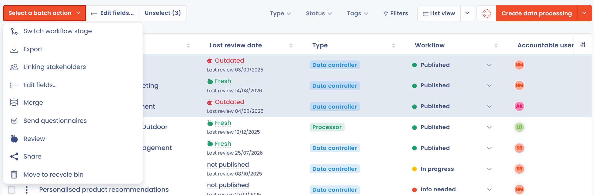

# Lists, bulk actions and recycle bin

The lists of Dastra (processing activities, assets, requests, tasks, contracts and others) share the same behavior. This page describes how to select several items, act on them at once, choose the columns and use the recycle bin. To sort and filter a list, see [Advanced filters](filters.md).

## Select items

Tick the box at the start of each line, or tick the box of the header to **Select all items from page**. A bar then shows the number of selected items.

When the list holds more results than the page, the button **Select all** with the total in brackets selects every result of the current search and filters, including the lines that are not displayed. Click **Unselect** to clear the selection.

## Act on several items

Once items are selected, open **Select a batch action** above the list, or right-click a selected line. The actions depend on the module, on your permissions and on the features of your plan. The most common are:

<figure><figcaption>
Three selected lines and the Select a batch action menu
</figcaption></figure>

* **Edit fields...**: change the value of one or more fields on all the selected items. A window titled **Batch edit** followed by the number of items opens. Only the fields that can be edited in bulk are offered.
* **Switch workflow stage**: move all the selected items to another workflow stage, in the modules that use workflow stages.
* **Export**: export the selected items.
* **Move to recycle bin**: see [Recycle bin](#recycle-bin).

For the full list of actions of a module, see its own page, for example [Act on several processing activities at once](../ropa/README.md#act-on-several-processing-activities-at-once). When the selection is large, Dastra processes it in the background and shows **Batch processing started**: the lists are updated once the processing is complete.

## Choose the columns

Click **Customize columns** in the header of the list to show, hide and reorder columns, then keep the result in a custom view. See [Customize columns](filters.md#customize-columns) in the advanced filters page.

## Recycle bin

In every module, deleting an item first moves it to the recycle bin.

1. Select the item or the items, then choose **Move to recycle bin**.
2. Confirm. Items in the recycle bin no longer appear in the lists, but they are not permanently deleted.
3. To find them, turn on **View recycle bin** or **Include recycle bin**, depending on the list.
4. Open the menu of an item in the bin: **Restore** puts it back in the lists, **Delete permanently** deletes it.


**Delete permanently** can't be undone.


Purge rules, where a module has them, delete the items of the recycle bin automatically: see [Request purge rules](../requests/advanced/purge.md) for data subject requests.
