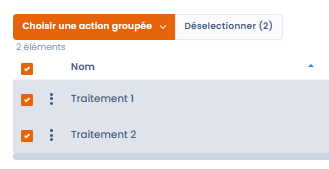

# Merging elements

## What the merge tool does

Dastra's **item merge** feature has been designed to simplify the management of duplicates and similar items in your compliance data. It lets you **combine several identical or similar items** into a single one, without having to manually perform the **complex linking to all the associated entities** (processing activities, controllers, records, etc.).

This feature aims to **ensure the consistency of your referential** while **limiting manual handling**, saving you time and increasing reliability.

## On which elements can the merge tool be used?

The merge tool can be used on:

* Processing activities
* Assets
* Stakeholders
* Datasets
* Data glossaries
* Measures
* Categories of data subject
* Tasks
* Compliance controls (applied controls and reference controls)
* Compliance tests (operational tests and reference tests)


Merging compliance controls and tests is done from the library or the project of the Compliance module, via grouped actions. You can select up to 30 items to merge. For the details of this operation, see the [Controls](../compliance/library/controls.md) and [Tests](../compliance/library/tests.md) pages.


## How do I merge elements?

1. In the list, select the elements to merge.

<figure><figcaption></figcaption></figure>

2. Click **Select a batch action**, then **Merge**.

3. In the **Merging tool** window, tick the element to keep in the header of its column: it becomes the **Reference version**. The other columns show the **Keep selected fields** badge: those elements are deleted once the merge is confirmed, and only the fields you select in them are carried over to the reference version.
4. For each field that differs, select the value to keep.
5. Click **Merge**.

<figure><figcaption>
The Merging tool window
</figcaption></figure>

To make choosing the values easier:

* each field whose value differs from one element to another is marked **Different**, and a counter shows the number of rows concerned;
* the table only shows the rows that differ; turn on **View all fields** to show all the comparable fields. Hidden identical fields keep the value of the reference version;
* the **Select all** button, under a column header, keeps its values on all the rows that differ; **Undo selection** reverts it. An empty value never replaces a filled-in value, and the number of rows updated is shown.


The entities (processing activities, analyses, etc.) associated with the deleted elements are automatically re-attached to the reference version, avoiding any loss or disconnection in your record. The **Linked objects kept** section of the window shows how many there are.


When an object is updated from the answers to a questionnaire, the same window opens with a **Questionnaire’s responses** column. The existing object always remains the reference version: it keeps its identifier, its history and its links.

## Data quality tool — automatic duplicate detection

Dastra includes a **data quality tool** that automatically scans your repository to detect potentially duplicate items, without requiring a manual pre-selection.

### How automatic detection works

The algorithm uses **explainable scoring**: for each pair of potential duplicates, it analyses several dimensions (name, publisher, organisational unit, URL, category) and assigns a **confidence score**. This score lets you make an informed decision before merging or deleting anything.

### Supported modules

The data quality tool is available for:

* Assets
* Measures
* Stakeholders
* Datasets
* Data glossaries
* Processing activities
* Categories of data subjects

### How to access the tool

In each of these modules, click the **main menu button** (⋮ or "Actions") and select **"Data quality tool"**. All detected duplicates are listed with their confidence score. You can then choose to **merge** or **delete** each identified duplicate.
