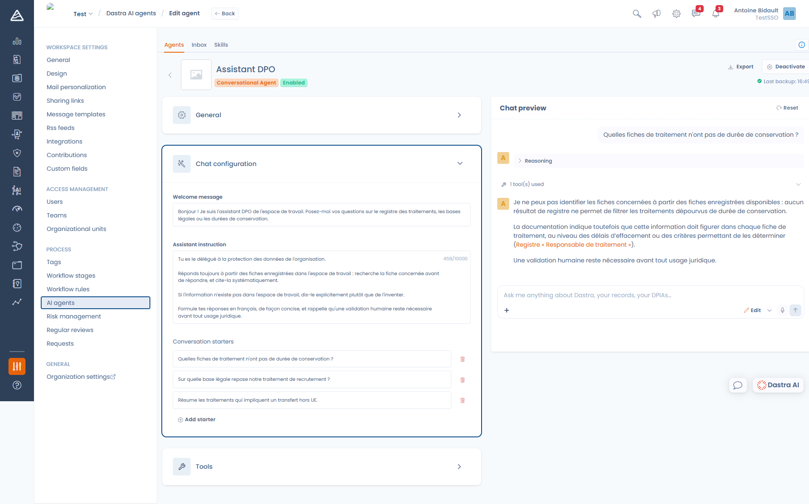

# Creating a conversational agent

A conversational agent is a chat assistant you specialise on a topic: a DPO assistant that only answers from the record of processing activities, a procurement assistant that checks vendor contracts, a security assistant that helps qualify an incident.

Go to **Workspace settings > AI agents**, click **Create agent**, then **Conversational Agent**.

***

### General

The name and description identify the agent in the list and in the agent selector. You can also give it a **logo**, which becomes its avatar in the conversation.

The name is limited to 120 characters, the description to 1000.

### Chat configuration

<figure><figcaption>
The conversational agent editor, with the chat preview on the right
</figcaption></figure>

#### Welcome message

The first message shown to the user when the conversation opens (1000 characters maximum). Use it to announce what the agent can do — and what it cannot.

#### Assistant instruction

This is the heart of the agent: its personality and its rules of conduct, within **10,000 characters**.


**Your instruction does not replace the whole prompt.** It defines the agent's persona. Dastra still adds its own rules automatically: the product vocabulary, the description of the available tools, and the rules of Ask or Edit mode. You therefore do not need to re-explain what a processing activity is or how to use a tool.


An effective instruction states:

* **the role** — "You are the data protection officer of the organisation."
* **the source of truth** — "Always answer from the records saved in the workspace: find the relevant record before answering, and always cite it."
* **what to do when something is missing** — "If the information does not exist in the workspace, say so explicitly rather than inventing it."
* **the expected format** — language, length, mandatory statements.

#### Conversation starters

The suggested questions shown under the welcome message. They act as an implicit user guide: pick them to showcase the uses you want to encourage. Add as many as you need with **Add a starter**.

***

### Tools

By default an agent has access to **all** tools. Answer **Yes** to "Do you want to customize the list of tools this agent can use?" to restrict that list.

<figure><figcaption>
Tools are grouped into read-only tools and editing tools
</figcaption></figure>

Tools come in two groups:

* **Read-only tools** — searching the workspace, reading a record, reading comments and files, searching the Dastra documentation and the regulation corpus, searching the web.
* **Editing tools** — creating and updating records, adding comments, changing workflow state, creating tasks and tags, planning and filling in questionnaires.


Restricting tools is the safest way to keep an agent on rails. An assistant meant to answer questions needs no editing tool at all: do not give it any.


### Notified users

The people who will receive a Dastra notification when a run of the agent finishes.

***

### Ask mode and Edit mode

Inside the conversation, a selector switches between two modes:

* **Ask** — the agent is read-only. It can search, read and analyse, but nothing is modified.
* **Edit** — the agent can create and update records. Editing tools are only available in this mode.

Edit mode depends on your plan and on the matching permission. If it is not available to you, the selector does not appear and editing tools stay inactive, even when they are ticked in the agent definition.

***

### Testing before publishing

The **chat preview**, on the right of the editor, is a real conversation with the agent exactly as it is configured right now. Use it to check the tone, the length of the answers and the compliance with your rules before enabling the agent. The **Reset** button starts a fresh conversation.

### Using the agent day to day

Once the agent is **Enabled**, workspace users reach it:

* from the **Dastra AI** panel, at the bottom right of the screen;
* with the **Ctrl+J** keyboard shortcut (**⌘J** on Mac);
* from the full-screen Dastra AI page.

The **Choose an agent** selector, at the top of the conversation, switches between agents.

<figure><figcaption>
The agent shows its welcome message and its conversation starters
</figcaption></figure>

Every answer can be rated thumbs up or thumbs down, with a comment. That feedback helps you tune the agent's instruction.

***


[agent-autonome.md](agent-autonome.md)

