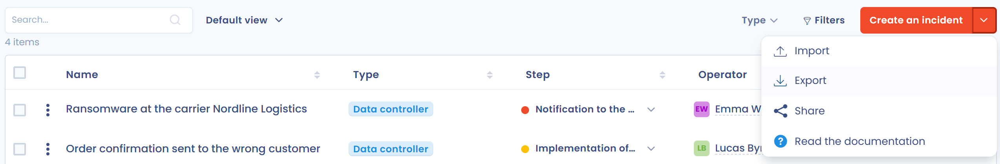

# Export your data breaches

You can export the whole record of incidents, a selection of incidents or a single incident, for example to answer a request from the supervisory authority or to archive a closed incident.

## Export the record

1. Open **Operations** > **Incidents** > **Record of incidents**. Apply filters if you only want to export part of the record: the export uses the active filters.
2. Click the arrow on the right of the **Create an incident** button, then **Export**.

   <figure><figcaption>
The menu of the Create an incident button, with the Export entry
</figcaption></figure>
3. In the window that opens, under **Choose an export format**, select PDF, Word, HTML, Excel, CSV, JSON or Markdown.
4. Click **Download file**.

   <figure><figcaption>
The export window
</figcaption></figure>

The **Export** entry is greyed out when the record is empty or when your role does not allow exporting.

## Options by format

* **Include table of contents** for the PDF, Word, HTML and Markdown formats.
* **Use native column names or reports (recommended for importing data)** and **Export custom fields** for the CSV and Excel formats. Native column names let you import the file again: see [Import your data (Excel, Csv)](../general/import.md).

PDF, Word and HTML exports include up to 500 incidents, and CSV, Excel, JSON and Markdown exports up to 10,000. If your selection is larger, the window warns you that only the first items are exported.

## Export a selection or a single incident

* In the record, tick the rows you want, then click **Export** in the action bar of the selection.
* In the form of an incident, open the arrow of the **Save changes** button, then click **Export**.

The export window is the same.
