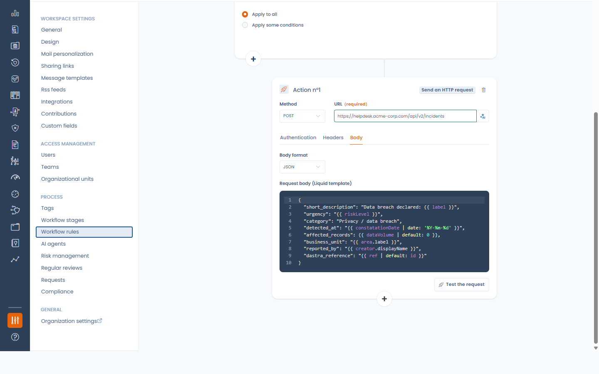
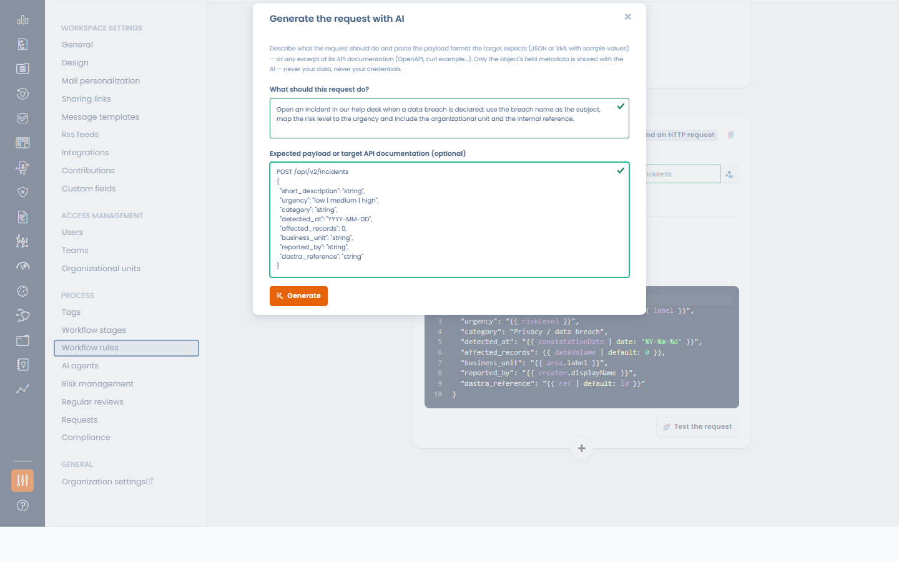

# HTTP / Custom API

### What does the integration do?

The HTTP / Custom API integration lets your **workflow rules call any platform that exposes an HTTP API** — a ticketing tool, an ITSM, an internal service, an automation hub — when a rule fires. You shape the request yourself: the method, the URL, the headers and a JSON or XML body built from the record's data. It is the integration to reach for when no native connector exists for your tool.

<!-- 📸 Screenshot: the workflow rule designer with a "Send an HTTP request" action — method and URL on top, the Body tab open on a JSON Liquid template -->

<figure><figcaption>
The "Send an HTTP request" workflow action
</figcaption></figure>

### Prerequisites

* An endpoint on the target platform that accepts an HTTP request (GET, POST, PUT, PATCH or DELETE), and its credentials: an API key or token, a username and password, or an OAuth 2.0 client (client ID, client secret and token URL).
* The **Integrations** permission on the workspace, to activate the integration, manage connections and add or change HTTP request actions. Workflow designers without it can still edit the rest of a rule that contains one, or remove the action — but not add or change it.
* A target reachable from the internet: Dastra blocks requests to private or internal network addresses.

### Installation

1. In Dastra, open **Workspace settings** > **Integrations** and select **HTTP / Custom API**.
2. Activate the use case: there is no credential to enter at this stage — the switch simply enables the action for the workspace.
3. Click **Manage connections** and add one connection per target platform. A connection holds one way to authenticate:
   * **API key / token** — the key, the header that carries it (`Authorization` by default) and an optional value prefix (`Bearer ` by default when the header is `Authorization`). For a header such as `X-API-Key`, leave the prefix empty.
   * **Basic (credentials)** — a username and a password.
   * **OAuth 2.0 (client credentials)** — a token URL, a client ID and a client secret (plus optional scopes): Dastra requests the access tokens itself and renews them before they expire.

   The optional **Base URL** is only used by the connection test: Dastra sends a GET to it with the credentials and expects a success response.

<!-- 📸 Screenshot: the HTTP / Custom API integration page — activated use case, "Manage connections" button -->

<figure><figcaption>
The integration is a simple activation switch; credentials live on connections
</figcaption></figure>

<!-- 📸 Screenshot: the "Add a connection" modal with the API key / token method (key, header name, value prefix, base URL) -->

<figure><figcaption>
Adding an API key connection
</figcaption></figure>


Credentials live on the connection, never in the workflow rule. Several rules can share one connection, and a workspace can hold as many connections as it has target platforms. The connections manager shows how many rules use each one.


### Sending a request from a workflow rule

Once the integration is active, the workflow rule designer offers the action **Send an HTTP request**:

* **Method** and **URL** — the URL must be absolute (`https://…`). Its host is fixed; the path and the query string can contain variables.
* **Authentication** tab — pick the connection to use, or **No authentication** for a public endpoint. A connection can be created from here.
* **Headers** tab — up to 20 custom headers. Values accept variables. The connection's authentication header always wins over a header with the same name.
* **Body** tab (POST, PUT and PATCH) — choose the format (**JSON**, **XML** or **No body**) and write the body as a template.

Type `{{` in the URL, in a header value or in the body to insert the record's fields (label, owner, dates, custom fields…). They are rendered when the rule fires. The rendered body must be well-formed JSON or XML, otherwise nothing is sent and the rule execution is logged in error.

#### Testing the request

**Test the request** renders the URL, the headers and the body against a real record of your workspace and validates them — the authentication header is shown with its secret masked. **Preview** sends nothing; **Send the request** performs the real call and shows the target's response status and, on failure, the beginning of its error message.

<!-- 📸 Screenshot: the test modal after "Send the request" — delivery result, rendered URL, masked header, rendered body -->

<figure><figcaption>
Dry-run of the request against a real record
</figcaption></figure>

#### Generating the request with AI

With the Dastra AI assistant, the button next to the URL field (**Generate with AI**) drafts the whole request: describe what it should do and paste the payload the target expects — or an excerpt of its API documentation. Only the names and types of the record's fields are shared with the assistant, never your data and never your credentials, and the draft never carries authentication: that stays on the connection. Review the draft, then use the test button.

<!-- 📸 Screenshot: the "Generate the request with AI" modal — instruction and pasted payload fields -->

<figure><figcaption>
Drafting the request from an instruction and the expected payload
</figcaption></figure>

### Logs

Every delivery performed by a rule is traced in the integration logs of the use case (**View logs** in the use case menu): the rule, the method, the target host and the response status — never the full URL, the headers or the body. The rule's own execution logs keep the detailed error message, and a rule that keeps failing on the same record stops retrying after three attempts.

<!-- 📸 Screenshot: the integration logs panel with HTTP deliveries (success and error lines) -->

<figure><figcaption>
Integration logs of the HTTP deliveries
</figcaption></figure>

### Deactivation and uninstallation

Turning the use case off, uninstalling it or deleting a connection **automatically disables the workflow rules that depend on it** (they are not deleted), so nothing keeps failing unnoticed. Re-enable the rules once the dependency is restored.


Requests time out after 15 seconds. A 2xx response is a success; anything else is logged as a failure with the beginning of the target's answer. Requests to private or internal addresses are always blocked.

