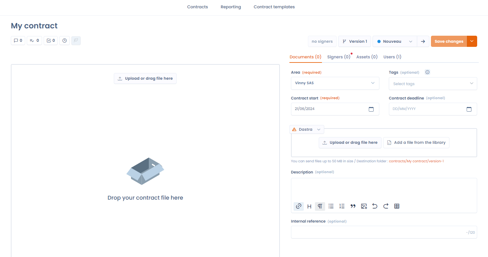

# Filerskeepers

### What is Filerskeepers?

[Filerskeepers](https://www.filerskeepers.co/) is a service that provides **ready-to-use data retention schedules**, covering legal retention requirements from all around the world.\
It helps companies **determine how long to keep or delete each type of data** in order to remain compliant with applicable regulations.

### Prerequisites

* Have a paid Dastra license
* Have a Filerskeepers account. If you don’t have one yet and you are already a Dastra customer, you can [contact our sales team](https://meetings-eu1.hubspot.com/yann-forveille/rendez-vous-avec-un-expert?message=Filerskeepers+Integration), who can offer you preferential pricing.
* Have set up a data retention repository (“Schedule”) in the Filerskeepers software. The integration requires this repository to access your catalog data.


Using the connector is subject to the Filerskeepers terms of use. The data provided by Filerskeepers is for internal use only within your organization: it cannot be copied, exported, shared or used commercially. Filerskeepers credentials can only be linked to one Dastra organization. If the service ends, you must delete all Filerskeepers data. Dastra is not responsible for the content or updates coming from Filerskeepers.


### Installation

The installation follows the common integration flow (see [Connections, use cases and field mapping](connections.md)):

1. Open **Workspace settings** > **Integrations** and select **Filerskeepers**.
2. On the datasets use case, click **Add integration**.
3. In the **Connection** step, choose **Add a connection**. Enter the **Email** and the **Password** of a Filerskeepers administrator account, then click **Connect**. Dastra uses these credentials to get an access token for the Filerskeepers API.

<figure><figcaption>
Connecting to Filerskeepers
</figcaption></figure>

4. In the **Configuration** step, select the Schedule to synchronize with Dastra. This step is required to finish the installation.

<figure><figcaption></figcaption></figure>

### Configuration

Reopen the configuration from the use case menu, **Project configuration** entry.

* **Select the filerskeepers Schedule you would like to sync** (required): the Filerskeepers schedule to synchronize with Dastra.
* The switch that keeps the retention periods synchronized: when on, the datasets synchronized with Filerskeepers are updated once a day.
* **Users to notify in case of creation/update of datasets** (required when synchronization is on, 10 at most): these users receive an email listing the datasets that were created or updated.
* The switch that creates the missing datasets: when on, it creates a dataset for every data type declared in your Filerskeepers account.
* The optional jurisdiction selector, shown when dataset creation is on: it chooses the jurisdiction synchronized for the created datasets. When no jurisdiction matches, Dastra uses the reference retention period (Golden standard).


If you turn on dataset creation, a large number of datasets are created automatically in your workspace.


#### Run a synchronization

To synchronize without waiting for the daily run, open the use case menu and click **Run synchronization now**. A synchronization started by hand creates the missing datasets, even when the creation option is off.

**View logs**, in the same menu, lists the past runs and their result.

### Selecting the retention policy

The Filerskeepers connector offers several modes of operation:

* Display of the retention period selector based on your Filerskeepers retention repository (called “Schedule” in the software).

From now on, when you open a dataset in Dastra, in the “Retention Policies” section, a button to select a retention policy will appear.

<figure><figcaption>
Picking from the Filerskeepers schedule
</figcaption></figure>

By clicking this button, you can directly select a dataset from your Filerskeepers repository. **This retention period will be automatically synchronized** with Dastra if you enabled this option in the integration configuration.

Select a dataset by clicking the **"Select"** button.

<figure><figcaption>
Table of retention periods in the schedule
</figcaption></figure>

Once you have selected the retention period, the window will close and the retention period details will be displayed.

<figure><figcaption>
A synchronized retention period
</figcaption></figure>


Only retention periods related to active data stores will be synchronized.


### How are data synchronized between Dastra and Filerskeepers?

A number of fields from Filerskeepers are automatically mapped to your retention period:

* **The retention duration** (from)
* **The description of the retention policy**
* **The legal justification, link, and jurisdiction**, which are concatenated into the justification field
