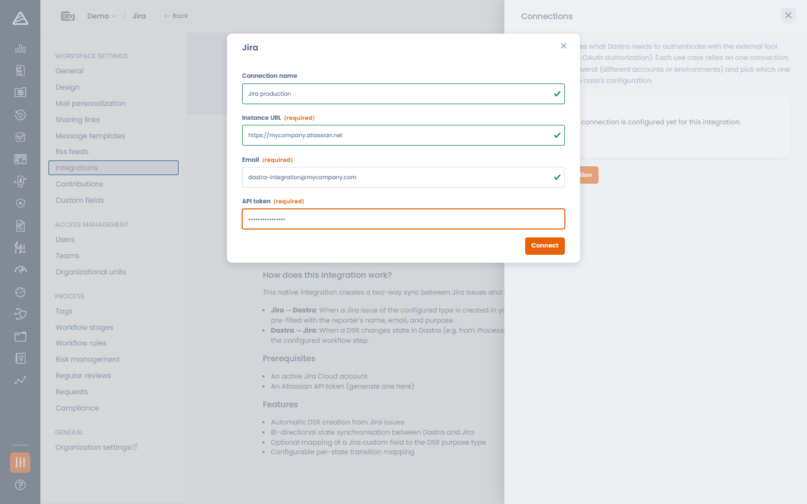
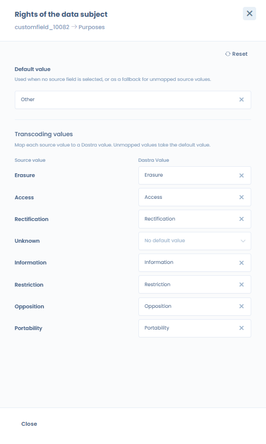
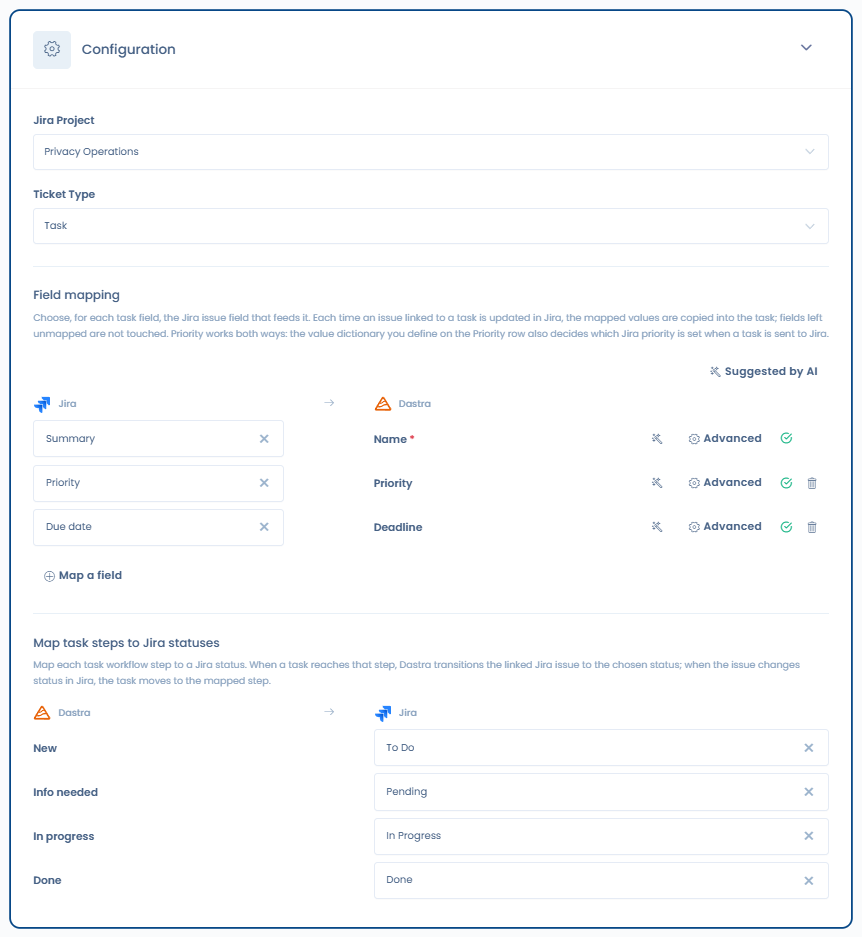
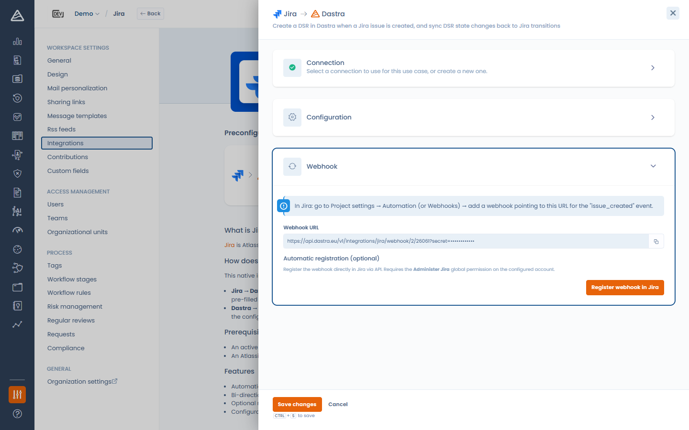

# Jira

### What does the integration do?

The Jira integration offers **two use cases**. They share the same Jira connection, and each one has its own configuration: Jira project, issue type, field mapping, step-to-status mapping and webhook.

| Use case | What it does |
| --- | --- |
| **Data subject requests** | A Jira issue creates or updates a data subject request (DSR) in Dastra. When the request reaches a workflow step, the linked issue moves to the Jira status associated with that step. |
| **Tasks** | You send a Dastra task to Jira, where it becomes an issue. The task and the issue then stay linked: status, assignee and mapped fields flow back from Jira, and step changes made in Dastra move the issue to the matching Jira status. |

You can install one use case or both.

### Prerequisites

* A Jira Cloud instance (e.g. `https://your-company.atlassian.net`) and a project for each use case.
* Depending on the authentication method:
  * **Basic** — the e-mail address of a Jira account and an [API token](https://id.atlassian.com/manage-profile/security/api-tokens) for that account.
  * **OAuth** — no token to create: you sign in with your Atlassian account and authorize Dastra.
* Each use case is shown only to users who have the matching module and permission:

| Use case | Module | Permission |
| --- | --- | --- |
| Data subject requests | Data subject requests | Write access on requests |
| Tasks | Tasks | Write access on tasks |


The OAuth method appears in the **Authentication method** list when it is available on your Dastra environment. Otherwise, use an API token.


### Installation

1. Open **Settings > Integrations** and select **Jira**.
2. On the use case you want, click **Add integration**.
3. Add a connection, or select the Jira connection you already use for the other use case:
   * **Basic**: enter the **Instance URL**, the **Email** and the **API token**, then click **Connect**.
   * **OAuth**: enter the **Instance URL**, then click **Save and connect** — you are redirected to Atlassian to authorize Dastra.

<!-- 📸 Screenshot: the Jira connection modal showing the Authentication method select with Basic and OAuth -->

<figure><figcaption>
Connecting Dastra to Jira
</figcaption></figure>


If both use cases target the same Jira instance, give each one **its own project or issue type**. Each use case only reads the issues of its own project and issue type, so two use cases on the same project and issue type would compete for the same issues.


## Data subject requests use case

### Configuration

* **Jira project** — the project to synchronize.
* **Issue type** — the issue type that represents a data subject request.
* **Field mapping** — map Dastra request fields to Jira fields. When a Jira issue creates or updates a DSR, the chosen Jira value populates each field. The sources include the standard Jira fields (summary, reporter e-mail, description, status) **and your Jira custom fields**.
* **Map DSR states to Jira transitions** — associate each DSR workflow step with a Jira status. When a request reaches that step, Dastra transitions the linked issue accordingly. Leave a step on **No transition** to skip it.
* **Default organisational unit** (required) — the unit assigned to requests created by the integration.

<!-- 📸 Screenshot: the Jira configuration panel with project, issue type and the field mapping -->

<figure><figcaption>
Configuring the data subject requests use case
</figcaption></figure>


The **Email** field of the request must be mapped (or given a default value): it identifies the data subject. The configuration cannot be saved without it.


#### Fields with a closed list of values

Some Dastra fields only accept a fixed list of values, such as **Rights of the data subject**. When you map one of them to a Jira field, the row shows **Mapping required** until you tell Dastra how to convert the Jira values. Open the **Advanced** panel of the row, then:

* associate each Jira value with a Dastra value, and/or
* set a **default value**, used when the Jira value has no match.

The configuration cannot be saved while a row is incomplete. Jira fields with closed values (statuses, select lists) offer their possible values in the same **Advanced** panel. See [Connections and field mapping](connections.md) for the details of the mapping editor.

<!-- 📸 Screenshot: the Advanced panel of the "Rights of the data subject" row, with two Jira values associated with rights and a default value -->

<figure><figcaption>
Converting Jira values into data subject rights in the Advanced panel
</figcaption></figure>

#### Workflow steps and Jira statuses

<!-- 📸 Screenshot: the "Map DSR states to Jira transitions" section with a few steps mapped to Jira statuses -->

<figure><figcaption>
Mapping DSR workflow steps to Jira statuses
</figcaption></figure>

When a request reaches a mapped step, Dastra looks for a Jira transition that leads from the current status of the issue to the associated status:

* the issue is already in that status: nothing is done;
* the Jira workflow offers no such transition: the issue stays unchanged and the integration log shows a **Sync error** entry naming the current status and the target status. Adjust the Jira workflow or the step mapping.

## Tasks use case

### Configuration

* **Jira project** and **Issue type** — where the issues created from tasks go. They can differ from those of the data subject requests use case.
* **Field mapping** — for each task field, choose the Jira issue field that feeds it. Each time an issue linked to a task is updated in Jira, the mapped values are copied into the task. Fields left unmapped are never touched.
  * The sources are the standard Jira fields (summary, description, status, assignee e-mail, priority, due date) and your Jira custom fields.
  * The targets are the task fields, **task custom fields included**.
  * The workflow step and the assignee are not offered as targets: they follow the step-to-status mapping and the assignee rule described below.
* **Priority works both ways.** The value dictionary you define in the **Advanced** panel of the **Priority** row converts Jira priorities into Dastra priorities, and also decides which Jira priority is set when a task is sent to Jira. Without a dictionary entry, the Dastra priority is sent under its own name (Low, Medium, High), which matches Jira's default priority scheme.
* **Map task steps to Jira statuses** — associate each task workflow step with a Jira status. When a task reaches that step, Dastra moves the linked issue to that status; when the issue changes status in Jira, the task moves to the mapped step. Only mapped steps are synchronized, in both directions.

No default organisational unit is required: this use case never creates objects in Dastra.

<!-- 📸 Screenshot: the Tasks use case configuration with project, issue type, the field mapping (Priority row) and the "Map task steps to Jira statuses" section -->

<figure><figcaption>
Configuring the tasks use case
</figcaption></figure>

### Sending a task to Jira

From a task, open the actions menu and click **Send to Jira**, then confirm.

<!-- 📸 Screenshot: the actions menu of a task form with "Send to Jira" -->

<figure><figcaption>
Sending a task to Jira from its actions menu
</figcaption></figure>

Dastra creates an issue in the configured project and issue type, with:

* the task **label** as summary, the task **description** as plain text, and the task **due date**;
* the Jira **priority** chosen as explained above;
* a **link back** to the task in Dastra, visible on the Jira issue;
* the Jira **status** associated with the current step of the task, when that step is mapped.

The task then shows the banner **This element is synced with Jira**, with the issue key and the date of the last update, and the **Send to Jira** action disappears.

<!-- 📸 Screenshot: a task form showing the "synchronized with Jira" banner with the issue key -->

<figure><figcaption>
A task linked to its Jira issue
</figcaption></figure>

Good to know:

* The action is available on any task of the workspace, whatever it relates to (processing activity, risk, audit, request…), to users with write access on tasks, when the tasks use case is installed, configured and active.
* It is not offered on an archived task or on a task already linked to an external system.
* Sending is manual and task by task: creating or editing a task never creates a Jira issue by itself.
* Sending a task twice (for instance from two browser tabs) never creates a second issue: Dastra answers that the task is already linked to its issue.
* If the link back or the initial status cannot be set, the issue is still created and linked to the task.

### What stays in sync

| Change | Direction | Effect |
| --- | --- | --- |
| The task moves to a mapped step | Dastra → Jira | The issue moves to the associated Jira status. |
| The issue changes status in Jira | Jira → Dastra | The task moves to the mapped step. Its state (open, in progress, closed) and its activation and closing dates are updated as for a change made in Dastra; reaching the final step also closes the sub-tasks. |
| The assignee changes in Jira | Jira → Dastra | The task is assigned to the active user of your organization whose e-mail address is the one of the Jira assignee. The new assignee is notified. |
| A mapped field changes in Jira | Jira → Dastra | The value is copied into the task, converted with the value dictionary of the row when there is one. |

Changes made from Jira appear in the task history and trigger notifications and workflow rules, like changes made in Dastra. A change that came from Jira is never sent back to Jira.

When a step change cannot be applied in Jira because the Jira workflow offers no transition to the associated status, the issue stays unchanged and the integration log shows a **Sync error** entry naming the current status and the target status.

Limits of this version:

* Only issues created from a Dastra task are synchronized. The other issues of the project are ignored, and no task is created from Jira.
* After the issue is created, only step changes go from Dastra to Jira. Later edits of the label, description, due date or priority in Dastra are not sent to Jira.
* When the Jira assignee's e-mail address is hidden by Atlassian privacy settings, or matches no active user of your organization, the task assignee stays unchanged and the integration log shows the reason. The e-mail address itself is never written to the log.
* Removing the assignee in Jira does not unassign the task.
* Comments and attachments are not synchronized.

### Task list columns

The column picker of the task list offers **Integration source**, **Integration identifier** and **Last external integration sync.** They are hidden by default.

## Webhook (Jira → Dastra)

Each use case has **its own webhook URL**: Jira changes reach Dastra through it. Save the configuration first — the URL becomes available once the use case is configured. Then, in the **Webhook** step, two options:

* **Manual registration** — copy the **Webhook URL** and, in Jira, go to **Project settings > Automation** (or **Webhooks**) and add a webhook pointing to this URL. For data subject requests, use the *issue created* and *issue updated* events; for tasks, *issue updated* is enough.
* **Automatic registration** — click **Register webhook in Jira** and Dastra registers it for you through the Jira API, filtered on the project and issue type of the use case. This requires the **Administer Jira** global permission on the configured account. Registering again replaces the previous webhook. You can remove it with **Delete webhook**.

<!-- 📸 Screenshot: the Webhook step with the copyable URL and the "Register webhook in Jira" button -->

<figure><figcaption>
Registering the Jira webhook
</figcaption></figure>


Webhooks registered before the tasks use case existed keep working: their URL still targets the data subject requests use case.


## Integration log

Click **View logs** on a use case to see what the synchronization did with Jira. An entry in **Sync error** says what was not done and why: for instance a Jira workflow that does not allow the expected status change, or an assignee that could not be matched.

## Deactivating and uninstalling

* **Deactivating** a use case stops its synchronization; the other use case keeps working. For tasks, the **Send to Jira** action is no longer offered. Synchronization resumes for the changes made after reactivation.
* **Uninstalling** a use case erases its configuration and removes the webhook registered in Jira for it, when it was registered automatically. The data subject requests and the Jira issues already created are kept, and tasks keep the key of their Jira issue.
