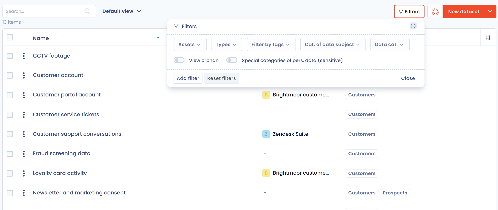

# Datasets

A dataset groups data fields, sensitive or not, with the retention rules that apply to their life cycle. Paper pay slips or the customer records of a CRM are examples of datasets.

Define a dataset once in this repository, then reuse it in the assets that hold it and in your processing activities. This keeps the inventory of your data consistent and lets you find, for one asset, everything it contains.

## Add a dataset

Open **Data inventory** > **Repositories** > **Datasets**. You can:

* click **New dataset** to open the **Dataset creation wizard**, then choose **Empty dataset**, **AI Generated** (this option depends on the features enabled for your organization) or **Step by step guide**, which asks you to select the data fields of the dataset first. **From filerskeepers** appears when the [Filerskeepers](../../integrations/filerskeepers.md) integration is enabled;
* click the AI button to the left of **New dataset** to describe the dataset and let the assistant draft it;
* click the arrow next to **New dataset**, then **Create from library...** to copy a dataset of the library;
* import datasets, with their data fields, from a file: arrow next to **New dataset**, then **Import**. See [Import your data (Excel, Csv)](../../general/import.md).

<figure><figcaption>
The list of datasets
</figcaption></figure>

## Complete the dataset form

| Section | Field | Content |
| --- | --- | --- |
| **General information** | **Dataset name** | The name of the dataset, required. |
| | **Linked asset** | The asset that holds the dataset. You can create an asset from this field. A dataset without an asset is an orphan. |
| | **Related subject categories** | The [categories of data subjects](subject-categories.md) the data relates to. You can create a category from this field. |
| | **Internal reference**, **Summary** | Your reference and a free description. |
| **Data fields** | | The data fields of the dataset. Select a field in the list or create one, then fill in the **Remarks** and tick **Required** where the field is mandatory. Each field shows its sensitivity level and category. |
| **Default retention policies** | **Active database retention**, **Archived database retention** | For each: the **Retention period**, the policy (**Describe the policy (duration, conditions...)**) and its **Justification**. |
| | **Data destruction policy** | The description of the purge policy and its **Justification**. |
| **Data source origin** | **Data source origin**, **Description of the collection source** | Where the data is collected from. |

The [custom fields](../../general/custom-fields.md) defined for datasets and the [tags](../../general/tags.md) are added to the form.

The toolbar of the form gives access to the comments, questionnaires, tasks and AI systems linked to the dataset, depending on your permissions and the enabled features. It also contains:

* **Linked elements**: the [generic relationships](../relationships.md) of the dataset;
* **Link a data processing**: the processing activities that use the dataset, and the link to add more.

The actions menu of the form offers **Create a copy**, **Merge** and **Delete**.

## Find datasets in the list

The filters of the list include **Assets**, **Types**, **Filter by tags**, **Cat. of data subject**, **Data cat.** and **Special categories of pers. data (sensitive)**. Turn on **View orphan** to list the datasets attached to no asset, then attach them from the **Linked asset** field.

From a selection, you can **Edit fields...**, **Merge**, **Export** and **Delete**. **Data quality tool**, in the menu of **New dataset**, detects duplicates. See [Merging elements](../../general/merge.md).

## Where datasets are used

* In a processing activity, you add the datasets that the processing handles, and you can customize their retention period for this activity only. See [Datasets and retention](../../ropa/activity/datasets.md).
* In an asset, the **Datasets** section lists the datasets it holds. See [Assets](assets.md).
* In categories of data subjects: the form of a category lists its datasets. See [Categories of data subjects](subject-categories.md).
* In AI systems, through the **AI systems** tab of the dataset.


Deleting a dataset removes its links to data fields, attachments, processing activities and assets. The conversations and the processing of related requests to exercise rights are permanently deleted. Questionnaires and related tasks are kept.

