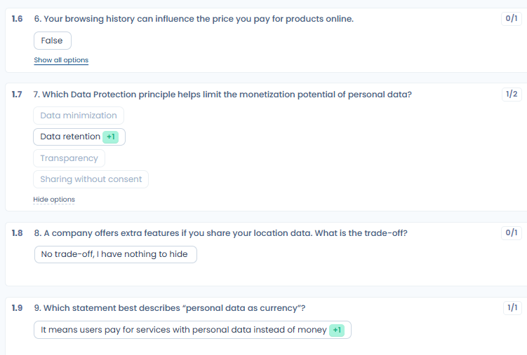
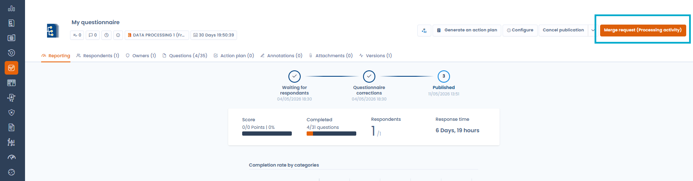

# Monitor questionnaires

## Response dashboard

From **Questionnaire templates**, click a template to open its response dashboard. It provides five views:

* **Responses**: list of all responses with their status (waiting for respondents, started, pending validation, validated, cancelled, deadline exceeded), their score and the linked object;
* **Detailed board**: side-by-side comparison of all responses by category and score, useful for benchmarking across entities or processing activities;
* **Stats**: aggregated statistics across all responses for that template;
* **Details**: configuration and metadata of the template;
* **Questionnaire**: the content of the template, which you can print or export.

To follow the responses of all templates at once, open **View questionnaires**.

<figure><figcaption>
The response dashboard of a template
</figcaption></figure>

<figure><figcaption>
The response statuses, including "Cancelled" (red badge)
</figcaption></figure>

## Individual response reporting

Opening a response gives access to a detailed reporting view:

* **Status**: progression from "Waiting for respondents" to "Started", "Pending validation" and "Validated";
* **Score**: total score out of the maximum points;
* **Completed**: number of questions answered out of the total;
* **Response time**: how long the questionnaire took to complete;
* **Red flags**: answers automatically flagged as requiring attention based on the template configuration;
* **Result analysis**: automatic analysis blocks generated from the responses (compliance level, risk assessment, etc.);
* **Scoring by categories**: visualized as a radar chart or bar chart.

Answers to multiple-choice questions are displayed in a condensed form:

* only the options selected by the respondent are shown;
* the **Show all options** link, below each question, displays the unselected options of that question; the **Hide options** link returns to the condensed display;
* an unanswered question is flagged with a hyphen (-), without any list of options.

<figure><figcaption>
Only the selected options are shown; the other options remain available question by question
</figcaption></figure>

## Response actions

The menu next to the response's main button groups the following actions, depending on the status of the response and your permissions:

* **Renew questionnaire**: see [Schedule a questionnaire](schedule.md);
* **Export questionnaire**: see [Export a report](export.md);
* **Send invites**: re-invites the respondents while the response is waiting for respondents or started;
* **Cancel questionnaire**;
* **Share questionnaire**: shares the report by link, only when the response is validated;
* **Edit template**;
* **Workflow rule**;
* **Move to recycle bin**: see [Delete a questionnaire or a template](delete.md).

### Workflow rules

Questionnaire responses can trigger workflow rules. The **Workflow rule** action in the response menu lists the rules that apply to responses, with their state and history, and lets you create one with **Create a workflow rule**. In the rule designer, choose the **Responding to a questionnaire** entity. For how rules work, see [Workflow rules](../settings/workflow-rules.md).

## AI analysis (beta)

From a response's reporting view, trigger an **AI analysis** to get:

* an overall compliance or risk score;
* a written summary of the key findings;
* a breakdown by criteria (completeness, legal basis, security measures, etc.);
* suggested tasks to address the identified gaps.


The AI analysis is a beta feature. Results should be interpreted with caution and reviewed by a qualified professional.


## Validating a response

Once you have reviewed the response, click **Review and validate the questionnaire** to move it to **Validated** status. This action is reserved for the approvers of the response. Approval, revision requests and final validation are described in [Validate a questionnaire](validate.md).

## Cancelling a questionnaire

An approver can cancel a questionnaire without going back through the questionnaire list. The **Cancel questionnaire** action is offered:

* at the validation step of a response pending validation, next to **Validate questionnaire** and **Request revisions**;
* in the response menu, at any status as long as the response is not already cancelled or in the recycle bin.

<figure><figcaption>
The "Cancel questionnaire" action is offered at the validation step
</figcaption></figure>

Cancelling asks for a confirmation and accepts an optional comment. The reason entered is kept in the history and remains visible to the respondent.

A cancelled response takes the "Cancelled" status, shown as a red badge in the list, the filters, the reporting view and the exports. It can no longer be edited by the respondent and is not compiled into the results.

To resume a cancelled questionnaire, open it and click **Reinstate questionnaire**. Dastra takes you to the invitations screen to re-invite the respondents.

## Merging responses into the linked object

Questionnaires whose template is a creation type (data processing project, data breach, asset, contract, AI system or stakeholder collection) let you **merge the collected responses into a Dastra object**. This action creates the object, or updates the linked object, from the information entered in the form, without any additional manual data entry.

The button only appears once the response is validated, and it is active for the approvers of the response. It is called **Merge request** followed by the object type, for example **Merge request (Processing activity)**, when the response is already linked to an object. Otherwise it is called **Creation request (Processing activity)**.

Open the validated response and click this button: a confirmation window lists the fields that will be updated in the target object.

<figure><figcaption>
The merge button pushes questionnaire answers back into the linked Dastra object
</figcaption></figure>

<figure><figcaption>
Confirming the merge and creating the processing activity from the collected responses
</figcaption></figure>

This feature is particularly useful for external collection through a Trust Center, where third parties (suppliers, processors) fill in information that then needs to appear in your internal records. See [Collecting data processing projects from a Trust Center](../trust-center/creation-questionnaires.md).

## Translating a questionnaire template with AI

The AI can translate all sections and questions of a template into another language. The procedure is described in [Translate a questionnaire with AI](translate.md).

## Generating an action plan

When a response is validated, an approver can click **Generate an action plan** in the reporting view to automatically create tasks based on the answers provided. Tasks are suggested according to the template's configuration and added to Dastra's task management module.
