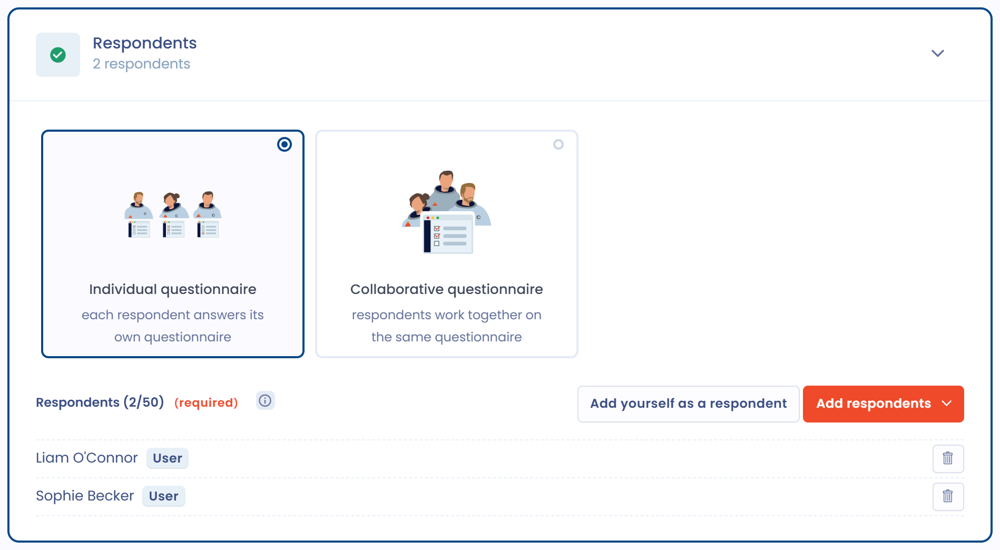

# Schedule a questionnaire

Scheduling a questionnaire means sending a template to its respondents, or answering it yourself. This page covers the four creation modes, the scheduling settings and the link with the other objects in Dastra.

## Start a scheduling

Once the questionnaire template has been created and customized, click **Plan questionnaire**. The button is available in the **Questionnaire templates** list, at the top of a template's page and, for PIA, TIA and LIA questionnaires, from the processing activity concerned (see [PIA / DPIA](types/dpia.md)).

The **Plan a questionnaire** window offers four creation modes.

<figure><figcaption>
The four creation modes of a questionnaire
</figcaption></figure>

### Express questionnaire

**Express questionnaire**: answer it yourself, skip configuration. Dastra immediately creates the questionnaire, with you as the respondent and the approver, without a review step or invitation email, and opens the response form. This mode suits internal self-assessments.

### Questionnaire campaign

**Questionnaire campaign**: invite users, teams and stakeholders to respond to the questionnaire. This mode opens the scheduling form described in the next section. Internal and external respondents receive an email with a link to an online space where they fill in their answers. You can re-invite the people who have not responded with **Send invites** in the response menu.

### Invitation link

**Invitation link**: share the link to your questionnaire. In the window that opens:

1. Choose the **organizational unit** and, if the template is linked to an object type, the object concerned.
2. Click **Copy link** and share it.

This mode turns on link sharing for the template by itself: there is no switch to turn on. Anyone with the link becomes a respondent of the questionnaire. A questionnaire is generated on each access, and the link stays available until it is disabled: turn the option off to make the links already sent inaccessible. When the email address entered by the respondent matches a Dastra account, it is carried over to the sign-in step, and the respondent is sent directly to their organization's identity provider if SSO is set up.

To find the link again or to disable it later, open the template's page and click the **Access** button under its title. The **Link sharing settings** window opens: it contains the **Enable the ability to respond to the questionnaire by link** switch. The same window is available from the menu next to **Plan questionnaire**. A template used in a Trust Center cannot have its link disabled until it is removed from that Trust Center.

<figure><figcaption>
The link sharing settings of a template
</figcaption></figure>

### AI-assisted response

**AI-assisted response**: save time by generating a questionnaire response with AI. This is a creation mode, not an action inside a questionnaire that is already open. It is greyed out when the AI feature for questionnaires is not enabled for your organization.

In the **AI-assisted response** window:

1. Enter the **Questionnaire label** and choose the **Organizational unit**.
2. If the template is linked to an object, select the related item: its information is sent to the AI.
3. In **Give detailed instructions to the assistant**, add guidance if needed (300 characters maximum).
4. Choose the **Answer language**. Answers are written in that language, regardless of the interface language, and Dastra remembers it from one generation to the next.
5. Attach up to three documents with **Add an attachment** (PDF, Word, Markdown, HTML, JSON, CSV or text: project notes, security policy, DPA, existing analysis, etc.), or give a website address with **Website url**.
6. Click **Generate**.

Dastra creates the questionnaire, with you as the respondent and the approver, fills in the answers proposed by the AI and opens it. Review each answer, adjust it, then finalize the questionnaire like any other response. This mode is especially useful for long questionnaires such as DPIAs, TIAs or LIAs, when you already have documentation.

A **Usage** indicator appears as soon as your AI credit quota reaches 80%. Generation is blocked when the quota is exceeded.


Using the AI-assisted response consumes AI credits. See the [AI Assistant](../general/ai-assistant/README.md) page for details on your quota and usage.


<figure><figcaption>
Generating the response to a questionnaire with AI
</figcaption></figure>

## Scheduling settings

The **Questionnaire campaign** mode opens a form organized in four sections.

<figure><figcaption>
The General information section of the scheduling form
</figcaption></figure>

### General information

* **Questionnaire label** and **Organizational unit** are required.
* **Subject linked to the response** appears when the template is linked to an object type (see the section "Linking the questionnaire to other objects in Dastra" below).
* **Pre-fill questionnaire** copies the fields of the linked object into the answers. For a PIA-type template, the option is called **Auto fill DPIA with data processing infos**.
* **Disable review step** publishes the response as soon as the respondents have finalized it (see [Validate a questionnaire](validate.md)).

### Respondents

First choose the response mode:

* **Individual questionnaire**: each respondent answers their own questionnaire. If you add several respondents, Dastra generates a separate questionnaire for each of them. This mode suits collecting comparable information from several people or entities (vendor assessments, department-by-department evaluations) and producing consolidated reporting.
* **Collaborative questionnaire**: respondents work together on the same questionnaire. This mode suits long or multi-domain questionnaires that involve several teams (for example a DPIA that needs input from legal, IT and business teams).

Then click **Add respondents**:

* **Add users** and **Add a team** for Dastra users;
* **Add external emails** for external respondents;
* **Add stakeholder emails** to use the contact email of stakeholders in your workspace;
* **Add yourself as a respondent**;
* **Import .csv emails file**, with the columns `email` and `displayName` (UTF-8, semicolon separator).

A questionnaire accepts up to 50 respondents. Each respondent can be required or not: the response moves to pending validation once all required respondents have finalized their answers.

<figure><figcaption>
The Respondents section of the scheduling form
</figcaption></figure>

### Invitations

* **Deadline**: the date and time limit for answering. It is proposed from the template's **Number of days before the deadline**.
* **Send email invitations**: turn the option off if you prefer to send the access links yourself. Otherwise, write the **Invitation's message**, or reuse a message template with **Select a template**.
* **Schedule notification**: choose a **Date notification**, within the next 70 hours.

An external respondent may have to confirm their identity with a 6-digit code sent by email before accessing the questionnaire. The [FAQ](faq.md) explains when.

<figure><figcaption>
The Invitations section of the scheduling form
</figcaption></figure>

### Approvers

Approvers check the responses and validate the questionnaire. Choose at least one **Required approvers** and, if needed, turn on **Add optional approvers**. The full process is described in [Validate a questionnaire](validate.md).

## Import responses

To bring in responses you have already collected, open the template's page, click the arrow next to **Plan questionnaire**, then **Import responses**. Download the xlsx template file, fill it in using the format required for each question, then import it (xlsx or csv).

## Recurring questionnaires and renewal

In the template's configuration, answer **Yes** to **Should this questionnaire be conducted on a regular basis?** and set the **Days between responses**. A validated response then shows the date by which it must be renewed, and the **Need renewal** badge flags the responses to renew in the lists.

To renew a response, open it and choose **Renew questionnaire** in its menu. You can choose the template version, then say whether the renewed questionnaire keeps the answers of the previous one. If you answer **No**, you start from a blank questionnaire and the old answers are archived.

## Linking the questionnaire to other objects in Dastra

You can attach the questionnaire to another module of Dastra. In the template's configuration, after giving it a name and a description, choose an object type in **Related to**. The possible objects are stakeholders, assets, processing activities, data breaches, requests, security measures, datasets, risk assessments, AI systems and contracts.

<figure><figcaption>
The Subject linked to the response field when scheduling
</figcaption></figure>

If the template already exists, you can still attach an object to it: open the template's menu (the three dots), click **Settings**, then fill in **Related to**.

When you then schedule the questionnaire, the **Subject linked to the response** field appears. Its selector lets you choose the exact object to link the response to.


You can only link a questionnaire to one object in Dastra.


## Direct DPIA access from a processing activity

For PIA-type questionnaires, you can start the impact assessment from a processing activity. In the **Impact assessment** step of the processing activity, the **Create a DPIA** button opens the matching questionnaire without leaving the processing activity.
