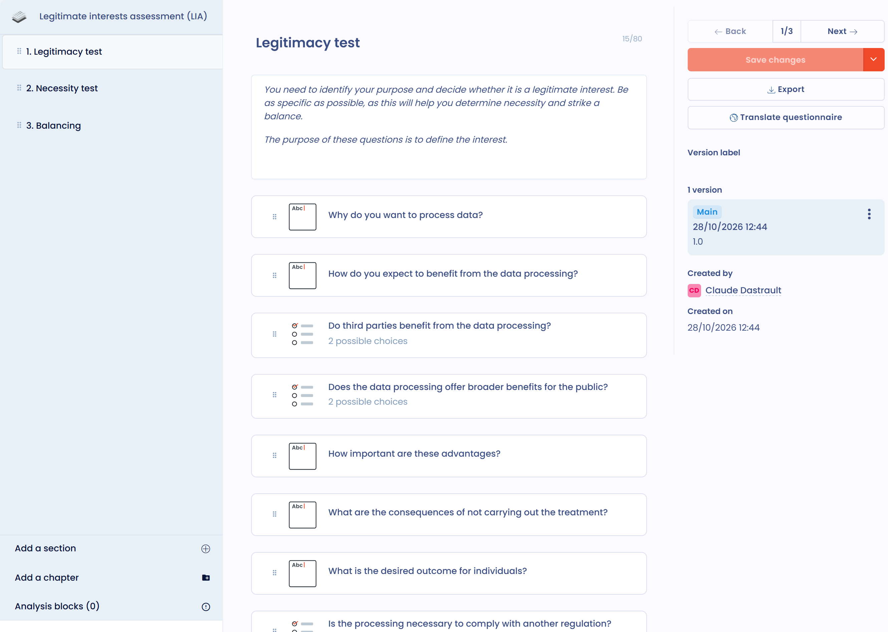

# Create a questionnaire template

A questionnaire template describes the sections, the questions and the scoring rules of a questionnaire. You create it once, then schedule it as many times as needed. To reach the templates, open **Questionnaires** > **Questionnaire templates**.

## Create or modify a questionnaire template

To create a template, click **Create a template** at the top of the **Questionnaire templates** list. The button is greyed out when you have reached the number of templates included in your plan.

<figure><figcaption><p>The list of questionnaire templates</p></figcaption></figure>

The **Choose a questionnaire template type** window offers four options:

* **Automated questionnaires**: choose a predefined template from the Dastra library. See [Automated questionnaire templates](#automated-questionnaire-templates).
* **Personalized questionnaire**: build your own template. See [Customized questionnaire templates](#customized-questionnaire-templates).
* **Create from AI**: the AI assistant generates the template from your description. You can attach documents with the **+** button (an internal audit grid in Word, a security questionnaire in PDF, etc.): the assistant transposes the questionnaire provided into sections, questions, question types and answer options. Specify the questionnaire type (**Standard**, **Cyber compliance** or **Training**), then, under **More options**, the sections you want, the number of questions (from 1 to 50) and, for a training questionnaire, the difficulty level. You preview the result before creating the template. The option is greyed out when the AI feature for questionnaires is not enabled for your organization.
* **Upload file**: import an existing template with **Json File** (a template exported from Dastra) or **Excel file** (a questionnaire in Excel or CSV format).

<figure><figcaption><p>The four options for creating a template</p></figcaption></figure>

<figure><figcaption><p>Creating a questionnaire template with AI from a document</p></figcaption></figure>


Unlike automated questionnaires, personalized questionnaires are fully customizable. Based on the answers selected by respondents, you can automatically generate an action plan or map the risks associated with the template.


## Automated questionnaire templates

Dastra offers many automated questionnaire templates that document compliance and drive processes. They include DPIAs, TIAs, LIAs and processor questionnaires.

In the selection window, filter the library with **Choose the library source**, **Locale**, **Tags** and **Types**, or search for a template by name. Click the eye icon of a template to see its details. Click the template to install it: Dastra creates a copy in your workspace and opens its page.

<figure><figcaption><p>The questionnaire template library</p></figcaption></figure>

From the template's page, you can:

* modify the template with **Edit template**;
* schedule a questionnaire with **Plan questionnaire**.


Some questionnaire types (DPIA, TIA, LIA) can also be started directly from a processing activity, for example from the **Impact assessment**, **Recipients** or **Purposes** steps. See the dedicated pages below for details.


## Customized questionnaire templates

To create your own template, click **Personalized questionnaire**. The **Creation of a questionnaire template** panel opens: fill it in (see the next section), then build the sections and questions in the template editor. Click **Save changes** to keep your edits, or **Save and exit** to close the editor.

<figure><figcaption><p>The questionnaire template editor</p></figcaption></figure>

### Configure the template

The configuration panel opens when you create a template. To come back to it later, open the template's menu in the list and click **Settings**, or, in the editor, click **Configure**. It is titled **Template's configuration** when you reopen it.

<figure><figcaption><p>The configuration panel of a template</p></figcaption></figure>

| Field | Purpose |
| --- | --- |
| **Name**, **Summary**, logo | The identity of the template in the lists and the library. |
| **Related to** | The type of object each response is linked to (see [Items assessed](#items-assessed)). |
| **Default questionnaire approvers** | The approvers selected by default when scheduling. They can still be changed. |
| **Questionnaire type** | The behavior of the questionnaire in the application (see [Types of templates](#types-of-templates)). |
| **Tags** | Labels to filter the templates. |
| **Number of days before the deadline** | The number of days proposed as the deadline when scheduling. It is 30 days by default. |
| **Display analysis and allow exports to respondents** | Respondents see the analysis blocks and the scores, and can export their responses. |
| **Should this questionnaire be conducted on a regular basis?** | If you answer **Yes**, set the **Days between responses**. See [Schedule a questionnaire](../schedule.md). |

### Items assessed

You can link questionnaires to items in Dastra. By choosing the type of item assessed in **Related to**, you force all responses based on that template to be linked to an object of the chosen type. For example, this questionnaire template will always be linked to a processing activity.

The possible object types are stakeholders, assets, processing activities, data breaches, requests, security measures, datasets, risk assessments, AI systems and contracts.

You can also choose not to link a questionnaire to a particular object. The response is then always linked to an organizational unit, which suits global compliance questionnaires, for example.

### Types of templates

The **Questionnaire type** field classifies the template and changes its behavior in the application. Dastra offers 19 types, grouped as follows in the list:

| Group | Types |
| --- | --- |
| Impact assessments | Privacy impact assessment (DPIA), Transfer impact assessment (TIA), Legitimate interests assessment (LIA), Consent analysis, AI system impact assessment |
| Compliance | Cyber compliance, Privacy compliance, CSR compliance |
| Third party | Third party assessment, Stakeholder creation |
| E-Learning | Training |
| Privacy by design | Data processing project |
| Incident management | Data breach creation request |
| Asset management | Asset creation |
| Contracts | Contract creation |
| AI | AI System creation, AI system risk assessment, AI responsability assessment |
| Other | Standard |

Some types enable a specific behavior:

* **Standard**: a standard questionnaire with standard reporting;
* **Cyber compliance**: a questionnaire for compliance with a specific regulation, with a compliance score;
* **Privacy impact assessment (DPIA)**: this template displays a risk matrix (with the required configuration) and can be called up at the **Impact assessment** step of a processing activity. See [Create or modify a DPIA template](pia.md);
* **Third party assessment**: this template is called up at the processor recipients step of a processing activity;
* **Transfer impact assessment (TIA)**: a questionnaire to analyze the risks related to a data transfer outside the EU;
* **Legitimate interests assessment (LIA)**: a questionnaire on the legitimate interests legal basis, to make sure those interests do not override the rights and freedoms of individuals;
* **Training**: a questionnaire for running training quizzes. It lets you mark the correct answer among the answers offered and display the correct answers at the end of the questionnaire;
* the **creation** types (data processing project, data breach, asset, contract, AI system or stakeholder collection): once the response is validated, its data is used to create or update the matching object (see [Monitor questionnaires](../monitor.md)). These templates also feed the collection from a Trust Center (see [Collecting data processing projects from a Trust Center](../../trust-center/creation-questionnaires.md)).

### Scoring calculation rule for multiple-choice questions

For a multiple-choice question whose answers carry a score, the **Scoring calculation rule** field determines the score kept:

* **Sum of values** (default): adds the scores of all selected answers;
* **Maximum value**: keeps only the highest score among the selected answers. For example, in a DPIA, the risk level of a "Data categories" question then reflects the most sensitive category, not the total of the categories ticked.

The question's **Score max** is shown under the selector. The rule applies to the overall score, the percentage score and the score by category, and it is saved with the template.

<figure><figcaption><p>Scoring calculation rule of a multiple-choice question</p></figcaption></figure>

## Load a questionnaire template you own

You can import one of your questionnaire templates in JSON format. When creating the template, click **Upload file**, then **Json File**, and drop the file. To get this file, export a template from its menu with **Export**.

## Dynamic selection questions

Among the question types available in the template editor, two types connect a question directly to data in your Dastra workspace: **Single dynamic selection** and **Multiple dynamic selection**.

These question types display a list of objects from Dastra to the respondent: assets, processing activities, stakeholders, security measures, datasets, data fields, AI systems, contracts, etc. The respondent selects one or more items from their library as their answer.


For the list to display correctly, the respondent must have **read access** to the corresponding objects in Dastra. An external respondent without a Dastra account, or without the appropriate permissions, will not be able to see the list.


## Populate custom fields from a questionnaire

You can use a questionnaire to automatically populate custom fields in Dastra registers. Configure the question variable with the `custom_` prefix, followed by the field’s technical name.



### Configure the template question

In **Questionnaires**, open the relevant template and add the question that should populate the custom field. Choose a question type that is compatible with the field type.

Open the question properties, then enable **Do you want to customize the variable name?**. In **Variable name**, enter `custom_` followed by the field’s technical name.

For a field with the technical name `business_owner`, use:

```
custom_business_owner
```

Then save the template changes.



### Variable syntax

The variable name must follow the `custom_variable_name` format. Use the field’s technical name exactly as written after the prefix.


The custom field does not need to appear under **Select a variable to map**. Enter the full variable name directly.



The `custom_` prefix is required. For the `business_owner` field, use `custom_business_owner`, not `business_owner`.


## Template version management

When modifying a template that is already in use, Dastra offers two options:

* **Overwrite the current version**: the changes replace the template in place, with no version history. Existing answers are kept, but answers to questions that were removed or restructured may no longer be shown or counted. Before you confirm, a comparison between the saved version and your changes is shown, and you can still cancel.
* **Create a new version**: a new version of the template is created. You can leave it as a **draft** while preparing it, then promote it to **main version** when it is ready. Existing questionnaires continue to use the previous main version until you explicitly switch.

To navigate between versions, use the version selector available in the template interface. The version marked as main is the one used for all new campaigns.

The **Compare versions** action shows two versions side by side. Each section and each question has a status: **Unchanged**, **Modified**, **Removed**, **Added** or **Moved**; an item that was only moved is not reported as removed and then added. A reminder of the impact on the answers already collected comes with the comparison.

<figure><figcaption><p>Comparing two versions of a questionnaire template</p></figcaption></figure>


The number of available templates depends on your subscription plan. This quota is shared across all workspaces in your organization. The template recycle bin counts towards the quota: remember to empty it regularly to free up slots.


## History, export and contribution

In the editor, the menu next to the **Save changes** button gives access to several actions:

* **Create a version**;
* **Plan questionnaire**;
* **Configure**;
* **Activity history**: review and restore earlier changes to the template;
* **Export**: download the template (JSON, Excel, CSV, PDF, Word, HTML or Markdown);
* **Contribute**: publish the template for all Dastra users, for users allowed to contribute.

To delete a template, see [Delete a questionnaire or a template](../delete.md).

## Analysis blocks

Analysis blocks display a custom text based on the questionnaire score or the answers provided.

## Go further


[Schedule a questionnaire](../schedule.md)



[Export a report](../export.md)



[PIA / DPIA](../types/dpia.md)



[Transfer Impact Assessment (TIA)](../types/tia.md)



[Legitimate Interests Assessment (LIA)](../types/lia.md)



[Create or modify a DPIA template](pia.md)

