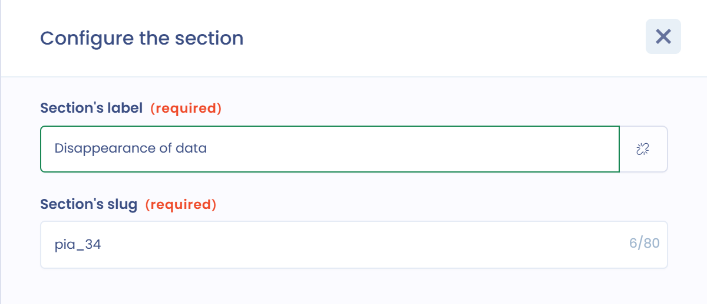

# Create or modify a DPIA template

Dastra has several data protection impact assessment (DPIA) templates. You can also create your own.


Do not start from scratch: use an existing template and customize it. It gives you a starting point.


## Step 1: create the template

In the **Questionnaires** module, click **Create a template**, then **Personalized questionnaire**.

<figure><figcaption>
The Personalized questionnaire option in the creation window
</figcaption></figure>

## Step 2: configure the template

In the **Creation of a questionnaire template** panel, choose the following options to get the full benefit of the DPIA features.

<figure><figcaption>
The configuration of a DPIA template
</figcaption></figure>

* **Questionnaire type**: choose **Privacy impact assessment (DPIA)**.


The DPIA type displays the elements specific to DPIAs, in particular the heat map in the questionnaire dashboard, and brings in the data of the processing activity when the DPIA is generated. It also lets you import DPIAs in JSON format from the CNIL PIA tool.


* **Related to**: choose **Processing activity**. Your DPIA questionnaire is then associated with a processing activity, and you find the DPIA from that processing activity. In addition, the processing activity's **Last DPIA Date** is updated automatically when the DPIA is published: when the questionnaire is finalized if the review step is disabled, otherwise when it is validated.

## Step 3: define the variable names

DPIA-type templates feed two kinds of elements:

* risk analyses (initial impact and probability, residual impact and probability);
* remediation tasks.

For the DPIA result report to display, name the variables of the sections (**Section's slug** field) and of the questions (**Variable name (slug)** field) according to the plan below. The plan follows the PIA (CNIL) template of the library, which has three security risks. Each risk has two sections: the initial risk section and the residual risk section, whose name starts with `pia_todo_`.

<figure><figcaption>
The slug of the Disappearance of data section
</figcaption></figure>

| Section or question | Variable | Type |
| --- | --- | --- |
| Illegitimate access to data (risk 3.2) | `pia_32` | Section |
| Existing measures | `pia_324` | Multiple dynamic selection |
| Initial severity (impact) | `pia_325` | Single choice with score |
| Initial likelihood (probability) | `pia_326` | Single choice with score |
| Illegitimate access: residual risk | `pia_todo_32` | Section |
| Planned measures (remediation) | `pia_todo_324` | Multiple dynamic selection |
| Details of the action plan | `pia_todo_321` | Rich text |
| Residual severity (impact) | `pia_todo_325` | Single choice with score |
| Residual likelihood (probability) | `pia_todo_326` | Single choice with score |
| Unwanted modification of data (risk 3.3) | `pia_33` | Section |
| Disappearance of data (risk 3.4) | `pia_34` | Section |

For risks 3.3 and 3.4, reuse the same structure, replacing `32` with `33` or `34` in all the names, including in `pia_todo_`. For an additional risk, use the next number (`pia_35`, `pia_todo_35`, etc.). In the CNIL template, the severity and likelihood questions carry a score from 0 to 4.
