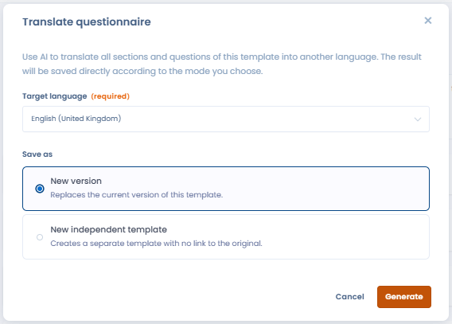

# Translate a questionnaire with AI

From the template editor, the AI assistant translates all the sections and all the questions of a questionnaire template into the language of your choice. The function is disabled when the AI feature for questionnaires is not enabled for your organization.

To start a translation:

1. In **Questionnaire templates**, open the menu of the template to translate, then click **Edit** to open the editor.
2. In the right-hand column, click **Translate questionnaire**.
3. Choose the **Target language**.
4. In **Save as**, choose one of the two options:
   * **New version**: replaces the current version of this template with the translation;
   * **New independent template**: creates a separate template with no link to the original.
5. Click **Generate**.

<figure><figcaption>
The Translate questionnaire button in the template editor
</figcaption></figure>

Dastra translates then saves the result directly, according to the mode you chose. The list of languages is the list of the languages of the application.

<figure><figcaption>
Choosing the target language and the save mode
</figcaption></figure>
